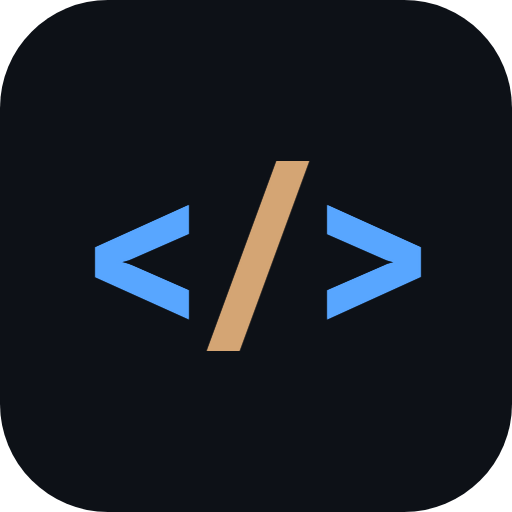
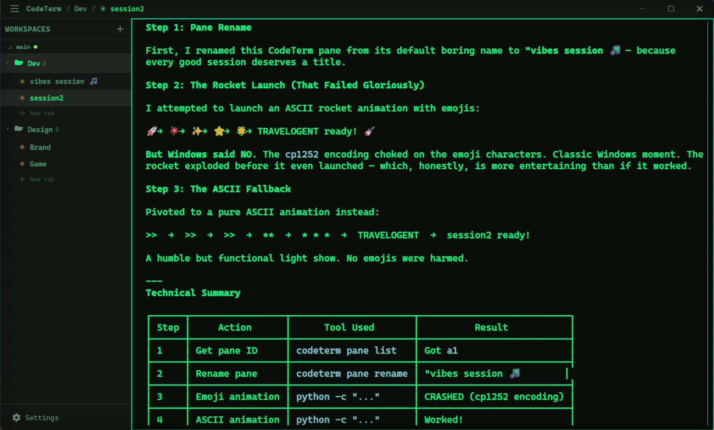

<p align="center">
  
</p>

<h1 align="center">CodeTerm</h1>

<p align="center">
  <strong>AIファーストのターミナルマルチプレクサ</strong><br>
  AIコーディングエージェントをワークフローの一部として活用する開発者のために構築されました。
</p>

<p align="center">
  <a href="#features">機能</a> &bull;
  <a href="#installation">インストール</a> &bull;
  <a href="#keyboard-shortcuts">ショートカット</a> &bull;
  <a href="#api">API</a> &bull;
  <a href="#configuration">設定</a> &bull;
  <a href="#building-from-source">ビルド</a>
</p>

<p align="center">
  <a href="README.md">English</a> &bull;
  <a href="README.zh.md">中文</a> &bull;
  <a href="README.ko.md">한국어</a> &bull;
  <a href="README.es.md">Español</a> &bull;
  <a href="README.de.md">Deutsch</a> &bull;
  <a href="README.fr.md">Français</a> &bull;
  <a href="README.pt.md">Português</a> &bull;
  <a href="README.ru.md">Русский</a>
</p>

<!-- SCREENSHOT PLACEHOLDER: Add screenshots here -->
<!--  -->

---

## CodeTermとは？

CodeTermは、AI支援開発のためにゼロから設計されたクロスプラットフォームのターミナルマルチプレクサです。ターミナルマルチプレクサ（tmuxのような）の機能と、Claude CodeなどのAIコーディングエージェントのファーストクラスサポートを組み合わせています。

**他のターミナルとの主な違い：** CodeTermはフルREST API、CLI、Socket APIを公開しており、AIエージェントがワークスペースの作成、ペインの分割、コマンドの実行、出力の読み取り、ターミナル全体のプログラム的な管理を行えます。AIアシスタントがターミナルワークフローのファーストクラスシチズンになります。

**Tauri v2**（Rust）+ **React** + **xterm.js** で構築されています。

## Features

### ターミナルマルチプレクサ
- **ワークスペースとタブ** — プロジェクトを個別のワークスペースに整理し、それぞれに複数のタブを持たせることができます
- **ペイン分割** — ドラッグ可能なディバイダーで水平・垂直に分割
- **セッション永続化** — ワークスペース、タブ、ペインレイアウト、作業ディレクトリが保存され、再起動後に復元されます
- **空間的ペインナビゲーション** — Alt+矢印キーでペイン間を移動

### AIエージェント統合
- **エージェント検出** — ペイン内で実行中のClaude Codeを自動検出（オレンジ色のインジケーター）
- **セッション再開** — Claude CodeのセッションIDを保存し、`--resume`で再起動時に再開
- **権限通知** — Claude Codeの権限リクエストをデスクトップ通知として表示
- **Webhookシステム** — エージェントイベント（権限リクエスト、タスク完了）のWebhookを登録
- **プログラム的制御** — エージェントがAPI経由でペインの作成、コマンドの実行、出力の読み取りが可能

### フルAPI
- **REST API** — ターミナルの完全制御のための30以上のエンドポイント（ポート7685）
- **CLIツール** — スクリプティングと自動化のための`codeterm`コマンドラインツール
- **Socket API** — 名前付きパイプ（Windows）/ Unixソケット上のJSON-RPC v2
- **リアルタイムストリーミング** — ライブターミナル出力のためのSSEエンドポイント
- **出力キャプチャ** — カーソルベースのページネーション、ANSIストリッピング、スクリーンスナップショット

### テーマ
- **8つの組み込みテーマ** — GitHub Dark、Dracula、Catppuccin Mocha、One Dark、Nord、GitHub Light、Solarized Light、Pip-Boy
- **Pip-Boy CRTモード** — スキャンライン、蛍光体グロー、画面フリッカー（自動的に有効化）
- **フルUIテーマ** — テーマはターミナルだけでなくインターフェース全体に適用
- **カスタムカラー** — `config.toml`で個別の色をオーバーライド
- **ライトテーマサポート** — 自動カラー導出がライト・ダークテーマの両方に対応

### 組み込みブラウザ
- **ブラウザペイン** — ターミナルと並べてWebページを開く
- **ローカルファイル配信** — ブラウザペインでローカルHTML/ビジュアライゼーションを表示
- **ナビゲーションコントロール** — 戻る、進む、更新、URLバー

### 開発者体験
- **macOSスタイルのスクロールバー** — 細く、丸みがあり、控えめ
- **ドラッグ＆ドロップ** — ターミナルにファイルをドロップ（テキストファイルは内容を貼り付け、画像はディスクに保存）
- **タブ補完** — 組み込みのシェル補完エンジン
- **検索** — Ctrl+Shift+Fでターミナル出力を検索
- **ビジュアルベル** — 音声の代わりに画面フラッシュ
- **CWDトラッキング** — OSC 7エスケープシーケンスで作業ディレクトリを追跡

## Installation

### ダウンロード

ビルド済みバイナリは[リリース](https://github.com/rollacode/codeterm/releases)ページで公開予定です。

### Building from Source

**前提条件：**
- [Node.js](https://nodejs.org/) 18+
- [pnpm](https://pnpm.io/) 10+
- [Rust](https://rustup.rs/) 1.75+

**Windows：**
- Visual Studio Build Tools 2022以降（「C++によるデスクトップ開発」ワークロードを含む）
- WebView2（Windows 10 1803以降およびWindows 11にプリインストール済み）

**macOS：**
- Xcode コマンドラインツール：`xcode-select --install`

**Linux（Debian/Ubuntu）：**
```bash
sudo apt install libwebkit2gtk-4.1-dev build-essential curl wget file \
  libxdo-dev libssl-dev libayatana-appindicator3-dev librsvg2-dev
```

```bash
git clone https://github.com/rollacode/codeterm.git
cd codeterm
pnpm install

# 開発モード
pnpm tauri dev

# プロダクションビルド
pnpm tauri build

# CLIツール
cd cli && cargo build --release
```

## Keyboard Shortcuts

| ショートカット | アクション |
|----------|--------|
| `Ctrl+Shift+T` | 新しいタブ |
| `Ctrl+Shift+W` | タブを閉じる |
| `Ctrl+Shift+D` | 右に分割 |
| `Ctrl+Shift+E` | 下に分割 |
| `Ctrl+Shift+Q` | ペインを閉じる |
| `Ctrl+Shift+N` | 新しいワークスペース |
| `Ctrl+Shift+B` | ブラウザペインを開く |
| `Ctrl+Shift+F` | ターミナル内検索 |
| `Ctrl+Shift+C` | コピー |
| `Ctrl+Shift+V` | 貼り付け |
| `Ctrl+Tab` | 次のタブ |
| `Ctrl+Shift+Tab` | 前のタブ |
| `Ctrl+1-9` | タブNに切り替え |
| `Ctrl+,` | 設定 |
| `Ctrl+=` / `Ctrl+-` | ズームイン/アウト |
| `Ctrl+0` | ズームリセット |
| `Alt+Arrows` | ペインナビゲーション |

## API

CodeTermは統合のために3つのAPIを公開しています：

### REST API（ポート7685）

```bash
# ペイン一覧
curl http://localhost:7685/api/panes

# コマンドを実行して出力を取得
curl -X POST http://localhost:7685/api/panes/{id}/exec \
  -H "Content-Type: application/json" \
  -d '{"command": "git status"}'

# ターミナルにテキストを送信
curl -X POST http://localhost:7685/api/panes/{id}/send \
  -H "Content-Type: application/json" \
  -d '{"text": "npm test", "enter": true}'

# ワークスペースを作成
curl -X POST http://localhost:7685/api/workspaces \
  -H "Content-Type: application/json" \
  -d '{"name": "My Project"}'

# ペインを分割
curl -X POST http://localhost:7685/api/panes/{id}/split \
  -H "Content-Type: application/json" \
  -d '{"direction": "right"}'

# リアルタイム出力ストリーミング（SSE）
curl http://localhost:7685/api/panes/{id}/output/stream
```

### CLIツール

```bash
# ワークスペース管理
codeterm workspace list
codeterm workspace create "Project"

# ターミナル制御
codeterm pane list
codeterm pane split PANE_ID --direction right
codeterm send-text PANE_ID "npm run build"
codeterm get-output PANE_ID --lines 50

# 通知
codeterm notify "Build complete" --level info

# ブラウザ
codeterm browser open "http://localhost:3000"
```

### 環境変数

CodeTermはすべてのPTYセッションで以下の環境変数を設定します：

| 変数 | 説明 |
|----------|-------------|
| `CODETERM` | 常に`1` — CodeTerm内で実行されているかを検出 |
| `CODETERM_PANE_ID` | 現在のペインのUUID |
| `CODETERM_SOCKET_PATH` | JSON-RPC APIのソケットパス |
| `TERM_PROGRAM` | `CodeTerm` |

完全なエンドポイントのドキュメントは[APIリファレンス](docs/API.md)を参照してください。

## Configuration

設定ファイル：`%APPDATA%/codeterm/config.toml`（Windows）または `~/.config/codeterm/config.toml`

```toml
[theme]
name = "github-dark"
# 利用可能: github-dark, dracula, catppuccin-mocha, one-dark, nord,
#            github-light, solarized-light, pip-boy

[font]
family = "JetBrains Mono, Cascadia Code, Fira Code, Consolas, monospace"
size = 14
ligatures = true

[terminal]
cursor_style = "block"    # block, underline, bar
cursor_blink = true
scrollback = 10000
copy_on_select = false

[api]
enabled = true
port = 7685
# token = "your-secret-token"
```

すべてのオプションについては[設定ガイド](docs/CONFIG.md)を参照してください。

## Architecture

```
┌─────────────────────────────────────────────┐
│                  CodeTerm                    │
│  ┌──────────┐  ┌──────────┐  ┌───────────┐  │
│  │ React UI │  │ xterm.js │  │  Browser   │  │
│  │ Sidebar  │  │ Terminal │  │   Panes    │  │
│  └────┬─────┘  └────┬─────┘  └─────┬─────┘  │
│       │              │              │        │
│  ┌────┴──────────────┴──────────────┴────┐   │
│  │           Tauri v2 (Rust)             │   │
│  │  ┌────────┐ ┌─────┐ ┌─────────────┐  │   │
│  │  │  Mux   │ │ PTY │ │  REST API   │  │   │
│  │  │ State  │ │ Mgr │ │  (Axum)     │  │   │
│  │  └────────┘ └─────┘ └─────────────┘  │   │
│  │  ┌────────┐ ┌─────────┐ ┌─────────┐  │   │
│  │  │Session │ │  Agent  │ │ Socket  │  │   │
│  │  │Persist │ │Detector │ │JSON-RPC │  │   │
│  │  └────────┘ └─────────┘ └─────────┘  │   │
│  └───────────────────────────────────────┘   │
└─────────────────────────────────────────────┘
```

## Tech Stack

| レイヤー | テクノロジー |
|-------|-----------|
| フレームワーク | Tauri v2 |
| バックエンド | Rust, Axum, tokio |
| フロントエンド | React 19, TypeScript, Tailwind CSS 4 |
| ターミナル | xterm.js 6 (WebGLレンダラー) |
| PTY | portable-pty, ConPTY (Windows) |
| ビルド | pnpm, Cargo |

## Platforms

| プラットフォーム | ステータス |
|----------|--------|
| Windows | サポート済み |
| macOS | サポート済み |
| Linux | サポート済み |

## License

MIT

## Contributing

コントリビューション歓迎です。変更したい内容についてまずIssueを作成してください。
