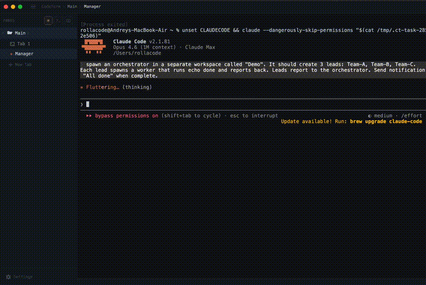
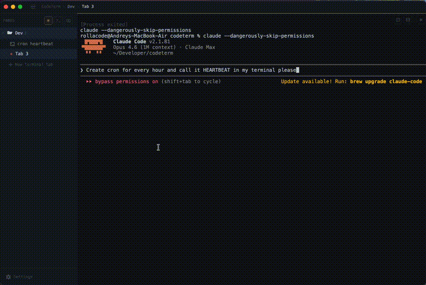

<p align="center">
  
</p>

<h1 align="center">CodeTerm</h1>

<p align="center">
  <strong>AI-first terminal multiplexer</strong><br>
  Built for developers who use AI coding agents as part of their workflow.
</p>

<p align="center">
  <a href="#features">Features</a> &bull;
  <a href="#installation">Installation</a> &bull;
  <a href="#keyboard-shortcuts">Shortcuts</a> &bull;
  <a href="#api">API</a> &bull;
  <a href="#configuration">Config</a> &bull;
  <a href="#building-from-source">Build</a>
</p>

<p align="center">
  <a href="README.zh.md">中文</a> &bull;
  <a href="README.ja.md">日本語</a> &bull;
  <a href="README.ko.md">한국어</a> &bull;
  <a href="README.es.md">Español</a> &bull;
  <a href="README.de.md">Deutsch</a> &bull;
  <a href="README.fr.md">Français</a> &bull;
  <a href="README.pt.md">Português</a> &bull;
  <a href="README.ru.md">Русский</a>
</p>

### Agent Orchestration



### Cron Jobs



---

## What is CodeTerm?

CodeTerm is a cross-platform terminal multiplexer designed from the ground up for AI-assisted development. It combines the power of a terminal multiplexer (like tmux) with first-class support for AI coding agents like Claude Code.

**Key difference from other terminals:** CodeTerm exposes a full REST API, CLI, and Socket API — so AI agents can create workspaces, split panes, run commands, read output, and manage the entire terminal programmatically. Your AI assistant becomes a first-class citizen in your terminal workflow.

Built with **Tauri v2** (Rust) + **React** + **xterm.js**.

## Features

### Terminal Multiplexer
- **Workspaces & tabs** — organize projects into separate workspaces, each with multiple tabs
- **Pane splitting** — split horizontally and vertically with draggable dividers
- **Session persistence** — workspaces, tabs, pane layout, and working directories are saved and restored across restarts
- **Spatial pane navigation** — move between panes with Alt+Arrow keys

### AI Agent Integration
- **Agent detection** — automatically detects Claude Code running in a pane (orange indicator)
- **Session resume** — saves Claude Code session IDs and resumes them on restart with `--resume`. Stale ids are validated before launch (`session_exists`) so missing JSONLs don't loop. Pre-generated `--session-id` UUIDs keep multiple panes in the same cwd disambiguated. Cross-provider session search/resume is exposed via `codeterm sessions` and `/api/sessions/*` (see [docs/plans/session-tracking.md](docs/plans/session-tracking.md))
- **Permission notifications** — surfaces Claude Code permission requests as desktop notifications
- **Webhook system** — register webhooks for agent events (permission requests, task completion)
- **Programmatic control** — agents can create panes, run commands, read output via API
- **Agent restart** — `codeterm agent restart --pane ID` runs a graceful `/exit` + auto-resume on any pane (`--force` to kill a hung agent), reusing the same lifecycle as `update --apply` post-install relaunch

### Full API — let external AI operate your terminal
- **REST API** — 30+ endpoints for complete terminal control (port 7685). An external AI (e.g. OpenClaw, custom agents) can create workspaces, spawn panes, run commands, read output, and orchestrate Claude Code sessions — all remotely
- **CLI tool** — `codeterm` command-line tool for scripting and automation
- **Socket API** — JSON-RPC v2 over named pipes (Windows) / Unix sockets
- **Agent prompt** — copy the integration prompt from Settings to give any LLM full control over CodeTerm
- **Real-time streaming** — SSE endpoint for live terminal output

### Bridges & external services
- **Telegram bridge** — bidirectional. Inbound messages arrive in the General Agent pane as `[Telegram: USER_ID] text`; outbound replies go through `codeterm bridge send` with HTML formatting (sanitizer auto-escapes stray `<word>` placeholders so unsupported tokens never break the parser). `codeterm bridge migrate --to PEER` hot-relocates the active poller to a paired mesh peer without restarting either daemon — secrets stay local to each host's vault
- **Voice transcription** — when `integrations.voice_transcribe.enabled = true`, voice / video-note attachments are transcribed by a local Whisper daemon (`http://127.0.0.1:7891` by default) before reaching any agent — Claude, Codex, future clients, all covered by one upstream change
- **Webhook bridge** — register URLs for agent events (`agent.permission_request`, `agent.task_complete`, `agent.report`)

### Mesh tab & service registry (v1.2.0)
- **Mesh canvas** — radial peer terminals with live connection lines (width / opacity by recent push volume, bidirectional pulse on every event), pan/zoom, fit-to-view. Replaces the old standalone Crons panel.
- **Service registry** — register daemons (HTTP / TCP / process / script health probes) via `codeterm service add` or the Mesh tab's Smart-Add wizard. Cron jobs are projected as virtual `cron`-kind services. Per-service Bearer tokens let daemons write to panes via `POST /api/panes/<id>/send` without the global API token.
- **Activity log** — bounded (10 000 rows / 30 days) feed of every push, health transition, peer event, and cron lifecycle event. `GET /api/activity?source=push|health|peer|cron`.
- **Auto online/offline** — backend ping scheduler (20 s interval) flips peer `online` flags and emits `mesh-state-changed` so the canvas updates without polling. Toggling `mesh.enabled = false` makes every `/api/mesh/*` route return `503` for both local and peer callers — kill-switch with no restart.

### Self-update & resilience
- **Self-update** — `codeterm update --check / --apply / --channel <stable|rc|nightly>`. Manifests are signed with ed25519 and verified before any binary is touched; auto-install runs a 9-step graceful shutdown (mem WAL checkpoint, supervisor stop, signed binary swap), then panes auto-resume so context survives the upgrade
- **Subprocess supervisor** — heavy mem operations (dreaming, librarian extraction) run as child processes with a circuit breaker (3 failures in 60s → open). Worker death does not take the API down; `503` timeouts on heavy mem requests keep the daemon responsive
- **External watchdog** — health probe at `/api/health`; setup recipes for Windows Task Scheduler, launchd, and systemd live in [docs/RESILIENCE.md](docs/RESILIENCE.md)

### Theming
- **8 built-in themes** — dark and light options included
- **Full UI theming** — themes apply to the entire interface, not just the terminal
- **Custom colors** — override individual colors in `config.toml`
- **Light theme support** — automatic color derivation works for both light and dark themes

### Canvas Panels
- **Canvas panes** — open web content side-by-side with your terminal for dashboards, docs, or visualizations

### Developer Experience
- **Clipboard & paste** — Ctrl+V pastes images from clipboard (Windows Snipping Tool, screenshots), text from any source
- **Drag & drop** — drop files and documents into terminal to paste content as text (works great with Claude Code)
- **Tab completion** — built-in shell completion engine

## Installation

### macOS (Homebrew)

```bash
brew tap rollacode/codeterm
brew install --cask codeterm
```

### Windows (Scoop)

```powershell
scoop bucket add codeterm https://github.com/rollacode/scoop-codeterm
scoop install codeterm
```

### Windows (installer)

Download `.exe` or `.msi` from [Releases](https://github.com/rollacode/codeterm/releases).

### Linux

Download `.AppImage`, `.deb`, or `.rpm` from [Releases](https://github.com/rollacode/codeterm/releases).

### Building from Source

**Prerequisites:**
- [Node.js](https://nodejs.org/) 18+
- [pnpm](https://pnpm.io/) 10+
- [Rust](https://rustup.rs/) 1.75+

**Windows:**
- [Visual Studio Build Tools 2022+](https://visualstudio.microsoft.com/visual-cpp-build-tools/) with "Desktop development with C++" workload
- WebView2 (pre-installed on Windows 10 1803+ and Windows 11)

**macOS:**
- Xcode Command Line Tools: `xcode-select --install`

**Linux (Debian/Ubuntu):**
```bash
sudo apt install libwebkit2gtk-4.1-dev build-essential curl wget file \
  libxdo-dev libssl-dev libayatana-appindicator3-dev librsvg2-dev
```

**Build:**
```bash
git clone https://github.com/rollacode/codeterm.git
cd codeterm
pnpm install

# Development
pnpm tauri dev

# Production build
pnpm tauri build

# CLI tool
cd cli && cargo build --release
```

## Keyboard Shortcuts

All shortcuts use `Cmd` on macOS, `Ctrl` on Windows/Linux. Configurable in Settings → Keybindings.

| Shortcut | Action |
|----------|--------|
| `Cmd/Ctrl+T` | New tab |
| `Cmd/Ctrl+W` | Close tab |
| `Cmd/Ctrl+Shift+→` | Split right |
| `Cmd/Ctrl+Shift+↓` | Split down |
| `Cmd/Ctrl+Shift+Q` | Close pane |
| `Cmd/Ctrl+Shift+N` | New workspace |
| `Cmd/Ctrl+Shift+F` | Search in terminal |
| `Ctrl+Tab` | Next tab |
| `Ctrl+Shift+Tab` | Previous tab |
| `Cmd/Ctrl+1-9` | Switch to tab N |
| `Cmd/Ctrl+,` | Settings |
| `Cmd/Ctrl+=` / `Cmd/Ctrl+-` | Zoom in/out |
| `Cmd/Ctrl+0` | Reset zoom |
| `Alt+Arrows` | Navigate panes |

## API

CodeTerm exposes three APIs for integration:

### REST API (port 7685)

```bash
# List panes
curl http://localhost:7685/api/panes

# Execute a command and get output
curl -X POST http://localhost:7685/api/panes/{id}/exec \
  -H "Content-Type: application/json" \
  -d '{"command": "git status"}'

# Send text to terminal
curl -X POST http://localhost:7685/api/panes/{id}/send \
  -H "Content-Type: application/json" \
  -d '{"text": "npm test", "enter": true}'

# Create workspace
curl -X POST http://localhost:7685/api/workspaces \
  -H "Content-Type: application/json" \
  -d '{"name": "My Project"}'

# Spawn an agent in a new pane next to a parent
curl -X POST http://localhost:7685/api/agents/spawn \
  -H "Content-Type: application/json" \
  -d '{"agent": "claude", "parent_pane_id": "PANE_ID"}'

# Stream output in real-time (SSE)
curl http://localhost:7685/api/panes/{id}/output/stream
```

### CLI Tool

```bash
# Workspace management
codeterm workspace list
codeterm workspace create "Project"

# Terminal control
codeterm pane list
codeterm send-text PANE_ID "npm run build"
codeterm get-output PANE_ID --lines 50

# Notifications
codeterm notify "Build complete" --level info

# Browser
codeterm browser open "http://localhost:3000"
```

### Environment Variables

CodeTerm sets these in every PTY session:

| Variable | Description |
|----------|-------------|
| `CODETERM` | Always `1` — detect if running inside CodeTerm |
| `CODETERM_PANE_ID` | UUID of the current pane |
| `CODETERM_SOCKET_PATH` | Socket path for JSON-RPC API |
| `CODETERM_API_PORT` / `CODETERM_API_TOKEN` | API port and bearer token, so CLI subcommands and Claude hooks (`/api/panes/*/hook/*`, `/api/mem/flush`) can authenticate without per-call wiring |
| `TERM_PROGRAM` | `CodeTerm` |

See [API Reference](docs/API.md) for the complete endpoint documentation.

## Configuration

Config file: `%APPDATA%/codeterm/config.toml` (Windows) or `~/.config/codeterm/config.toml`

```toml
[theme]
name = "github-dark"
# Available: github-dark, dracula, catppuccin-mocha, one-dark, nord,
#            github-light, solarized-light, pip-boy

[font]
family = "JetBrains Mono, Cascadia Code, Fira Code, Consolas, monospace"
size = 14
ligatures = true

[terminal]
cursor_style = "block"    # block, underline, bar
cursor_blink = true
scrollback = 10000
copy_on_select = false

[api]
enabled = true
port = 7685
# token = "your-secret-token"
```

See [Configuration Guide](docs/CONFIG.md) for all options.

## Architecture

```
┌─────────────────────────────────────────────┐
│                  CodeTerm                    │
│  ┌──────────┐  ┌──────────┐  ┌───────────┐  │
│  │ React UI │  │ xterm.js │  │  Browser   │  │
│  │ Sidebar  │  │ Terminal │  │   Panes    │  │
│  └────┬─────┘  └────┬─────┘  └─────┬─────┘  │
│       │              │              │        │
│  ┌────┴──────────────┴──────────────┴────┐   │
│  │           Tauri v2 (Rust)             │   │
│  │  ┌────────┐ ┌─────┐ ┌─────────────┐  │   │
│  │  │  Mux   │ │ PTY │ │  REST API   │  │   │
│  │  │ State  │ │ Mgr │ │  (Axum)     │  │   │
│  │  └────────┘ └─────┘ └─────────────┘  │   │
│  │  ┌────────┐ ┌─────────┐ ┌─────────┐  │   │
│  │  │Session │ │  Agent  │ │ Socket  │  │   │
│  │  │Persist │ │Detector │ │JSON-RPC │  │   │
│  │  └────────┘ └─────────┘ └─────────┘  │   │
│  └───────────────────────────────────────┘   │
└─────────────────────────────────────────────┘
```

## Tech Stack

| Layer | Technology |
|-------|-----------|
| Framework | Tauri v2 |
| Backend | Rust, Axum, tokio |
| Frontend | React 19, TypeScript, Tailwind CSS 4 |
| Terminal | xterm.js 6 (WebGL renderer) |
| PTY | portable-pty, ConPTY (Windows) |
| Build | pnpm, Cargo |

## Platforms

| Platform | Status |
|----------|--------|
| Windows | Supported |
| macOS | Supported |
| Linux | Supported |

## License

MIT

## Contributing

Contributions welcome. Please open an issue first to discuss what you'd like to change.
