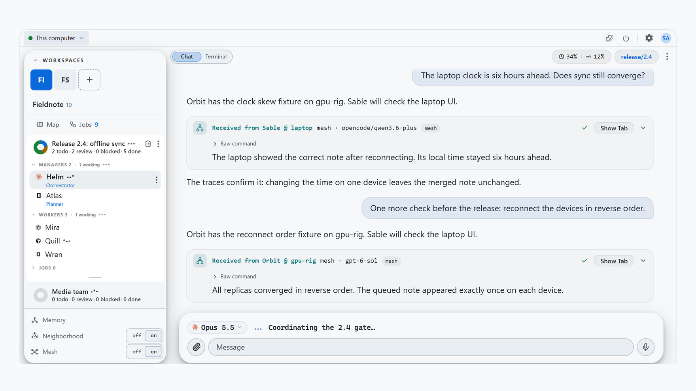
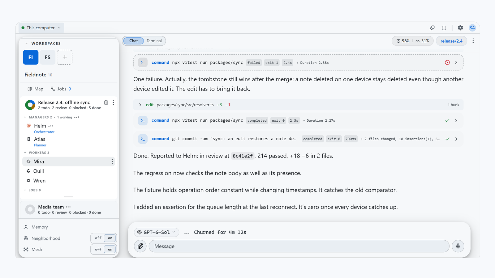
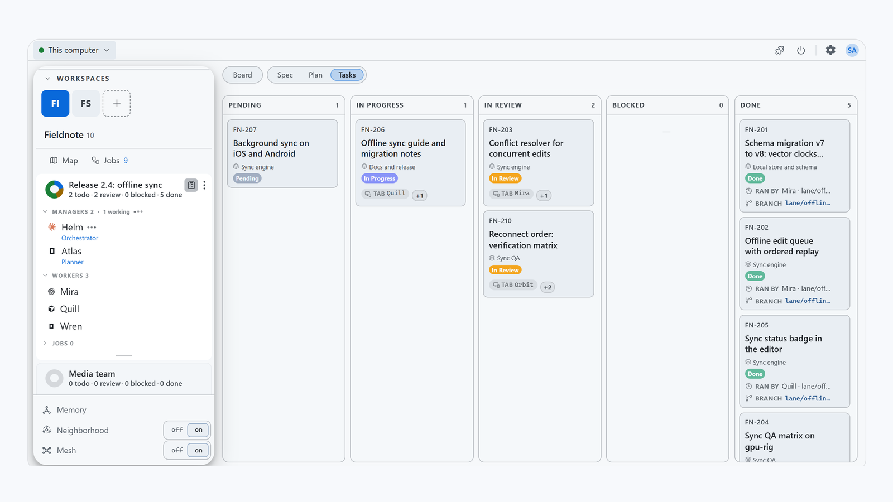
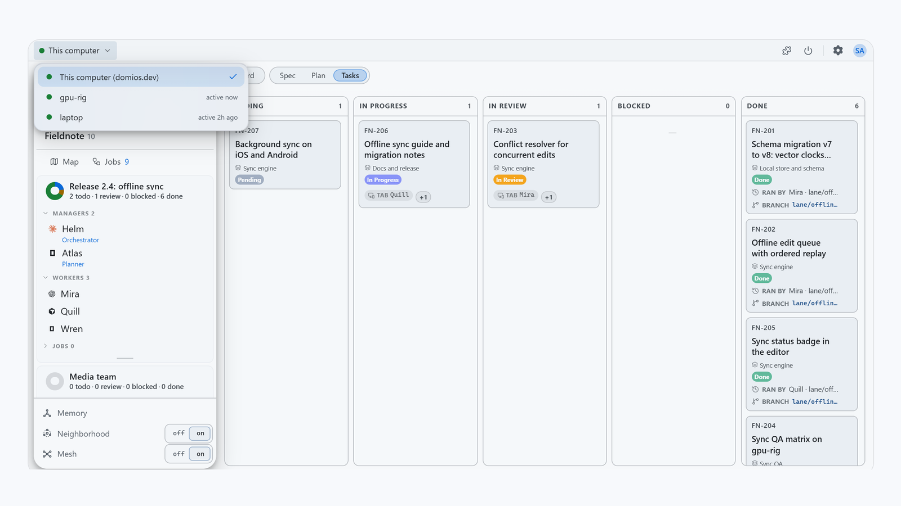
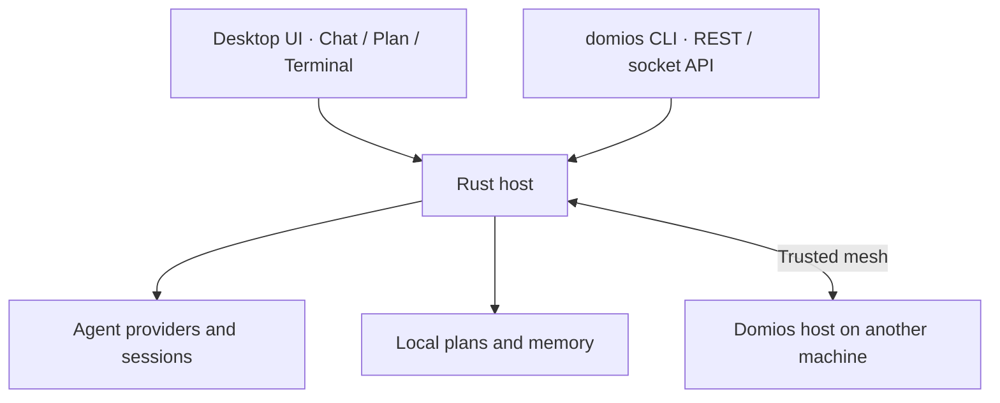

<div align="center">

<picture>
  <source media="(prefers-color-scheme: dark)" srcset="docs/readme/logo-dark.png">
  
</picture>

<h1>Agents live here.</h1>

<p>Run Claude Code, Codex and other agents in one workspace. Give them a plan, follow their work, and check in from another machine.</p>

<p><a href="https://domios.dev/#try"><strong>Interactive demo</strong></a> · <a href="https://domios.dev">Website</a> · <a href="#installation">Install</a> · <a href="https://github.com/domios-dev/domios/blob/master/generated/cli/cli.md">Docs</a> · <a href="https://t.me/domi_os">Telegram</a></p>

<p><a href="https://github.com/domios-dev/domios/releases/download/v1.23.2/Domios_1.23.2_aarch64.dmg">macOS Apple Silicon .dmg</a> · <a href="https://github.com/domios-dev/domios/releases/download/v1.23.2/Domios_1.23.2_x64-setup.exe">Windows x64 -setup.exe</a> · <a href="https://github.com/domios-dev/domios/releases/download/v1.23.2/Domios_1.23.2_amd64.deb">Linux x64 .deb</a> · <a href="https://github.com/domios-dev/domios/releases/download/v1.23.2/Domios_1.23.2_amd64.AppImage">Linux x64 .AppImage</a> · <a href="https://github.com/domios-dev/domios/releases/latest">All installers</a></p>

</div>

<a href="https://domios.dev/#try">
<picture>
  <source media="(prefers-color-scheme: dark)" srcset="docs/readme/hero-dark.png">
  
</picture>
</a>

<p align="center"><a href="https://youtu.be/kMZJDku4xcE">Watch the 3-minute film</a></p>

## Features at a glance

| Feature | What it does | Docs |
| --- | --- | --- |
| Memory | Keep project facts, decisions and skills available across sessions. | [Memory](https://github.com/domios-dev/domios/blob/master/prod-docs/MEMORY.md) |
| Dreams | Consolidate learned context overnight and record what changed. | [Memory services](https://github.com/domios-dev/domios/blob/master/prod-docs/MEMORY-SERVICES.md) |
| Mesh | Reach agents and workspaces on paired computers. | [Mesh](https://github.com/domios-dev/domios/blob/master/prod-docs/MESH.md) |
| Teams | Turn a goal into scoped tasks, assign them and review results. | [Teams](https://github.com/domios-dev/domios/blob/master/prod-docs/TEAMS.md) |
| Neighbors | Connect with a trusted contact and let agents ask across an explicit access grant. | [Neighbors](https://github.com/domios-dev/domios/blob/master/prod-docs/NEIGHBORS.md) |
| Proof before done | Review task evidence and verify the work before closing it. | [Verification](https://github.com/domios-dev/domios/blob/master/prod-docs/ORCHESTRATION-OPERATIONS.md) |
| Blueprints | Run routines as graphs with conditions, actions and escalation. | [Blueprints](https://github.com/domios-dev/domios/blob/master/prod-docs/BLUEPRINTS.md) |
| Reports | Receive task and scheduled-run results in chat or through configured bridges. | [Task reports](https://github.com/domios-dev/domios/blob/master/prod-docs/ORCHESTRATION-TASKS.md) · [Scheduled jobs](https://github.com/domios-dev/domios/blob/master/prod-docs/API-INTEGRATIONS.md) |
| Jev | Connect the Supporter Agent to help rank relevant memory and surface context. | [Supporter Agent](https://github.com/domios-dev/domios/blob/master/prod-docs/SPINAL-CORD.md) |
| Browser | Watch agents open and inspect real web pages in a visible browser. | [Browser](https://github.com/domios-dev/domios/blob/master/plugins/browser/BROWSER.md) |
| Plugins | Add providers, tools, views and messaging integrations. | [Plugin SDK](https://github.com/domios-dev/domios/blob/master/packages/plugin-sdk/README.md) |
| Scheduled work | Run an agent task later or on a recurring schedule. | [Schedules](https://github.com/domios-dev/domios/blob/master/prod-docs/API-INTEGRATIONS.md) |
| Desktop to phone | Continue an agent session from a phone browser over your private Tailnet. | [Remote access](https://github.com/domios-dev/domios/blob/master/prod-docs/MESH.md) |
| Voice messages | Send voice notes through a bridge with a transcription plugin. | [Transcription](https://github.com/domios-dev/domios/blob/master/prod-docs/TRANSCRIBE.md) |
| Local secrets | Store credentials in the local secret store. | [Secrets](https://github.com/domios-dev/domios/blob/master/prod-docs/SECRETS.md) |

## One workspace, from prompt to review

<table>
<tr>
<td width="44%"><h3>Work in chat or terminal</h3><p>Keep agent conversations alongside your shells. Inspect tool output and diffs, then resume a past session when you return.</p></td>
<td width="56%"><picture>
  <source media="(prefers-color-scheme: dark)" srcset="docs/readme/agents-dark.png">
  
</picture></td>
</tr>
<tr>
<td width="44%"><h3>Give the work a team</h3><p>The Planner scopes tasks, Workers take assignments, and the Orchestrator reviews what comes back. Give tasks their own Git lanes when they need isolation.</p></td>
<td width="56%"><picture>
  <source media="(prefers-color-scheme: dark)" srcset="docs/readme/teams-dark.png">
  
</picture></td>
</tr>
<tr>
<td width="44%"><h3>Pick up from another machine</h3><p>Pair your computers over the private mesh. Reply from a browser or Telegram, while shared memory keeps project context available across sessions.</p></td>
<td width="56%"><picture>
  <source media="(prefers-color-scheme: dark)" srcset="docs/readme/mesh-dark.png">
  
</picture></td>
</tr>
</table>

## More ways to work with Domios

<table>
<tr>
<td width="50%"><strong>Shared memory</strong><p>Facts, decisions and skills live on your machine. Hybrid keyword and vector search works across agent models and providers.</p><p>Capture a project convention once and recall it from another agent’s session.</p></td>
<td width="50%"><strong>Mesh and remote machines</strong><p>Pair computers and reach their agents, terminals and plans over a trusted mesh.</p><p>Hand work from your laptop to a workstation and get the report back in chat.</p></td>
</tr>
<tr>
<td width="50%"><strong>Teams and the Agentic Team Protocol</strong><p>Share roles, docs and skills in a <code>.team</code> file using the open <a href="https://atp.domios.dev">Agentic Team Protocol</a>.</p><p>Export a team that works for your project and let someone review it before installing.</p></td>
<td width="50%"><strong>Schedules and Blueprints</strong><p>Run an agent job later or on a schedule. Use a Blueprint for a routine with steps and conditions.</p><p>Schedule a daily check or route a failed step for an agent to inspect.</p></td>
</tr>
<tr>
<td width="50%"><strong>Telegram and voice notes</strong><p>Bridge a conversation to Telegram and transcribe voice notes with a configured plugin.</p><p>Reply to an agent’s question aloud from your phone.</p></td>
<td width="50%"><strong>Plugins and the built-in browser</strong><p>Add providers or integrations through plugins. The browser lets an agent navigate and inspect pages while you watch.</p><p>Watch an agent check a staging page and point it to the UI element you want reviewed.</p></td>
</tr>
<tr>
<td colspan="2"><strong>Multiple accounts</strong><p>Since <a href="https://github.com/domios-dev/domios/releases/tag/v1.20.2">v1.20.2</a>, Claude Code and Codex support separate accounts with their own credentials, settings, history and usage.</p><p>Choose the account for a tab, workspace or team seat.</p></td>
</tr>
</table>

## Installation

[Download Domios](https://github.com/domios-dev/domios/releases/latest) for **macOS** (`.dmg`), **Windows** (`-setup.exe`), or **Linux** (`.deb` or `.AppImage`). Choose the artifact for your CPU.

**Providers.** Claude Code, Codex, OpenCode, Cursor and Aider, plus compatible agents through [ACP profiles](https://github.com/domios-dev/domios/blob/master/prod-docs/ACP.md). Run `domios agent providers` in a Domios terminal to see what’s available.

### Building from source

You’ll need Node.js 22, [pnpm 10](https://github.com/domios-dev/domios/blob/master/package.json), the [pinned Rust toolchain](https://github.com/domios-dev/domios/blob/master/rust-toolchain.toml) via rustup and the [Tauri prerequisites](https://v2.tauri.app/start/prerequisites/) for your OS.

```bash
git clone https://github.com/domios-dev/domios.git
cd domios
pnpm install --frozen-lockfile
./build.sh dev
```

On Windows, run `.\build.ps1 dev` in PowerShell with Git Bash installed. For a production build, use `./build.sh build` or `.\build.ps1 build`.

## Architecture

The Tauri v2 desktop app serves a React and TypeScript UI backed by a Rust host. The host manages sessions, plans and local memory, and routes commands to trusted peers.



For team work, the Planner scopes tasks, the Orchestrator dispatches and verifies, and Workers report their results. [Lanes](https://github.com/domios-dev/domios/blob/master/prod-docs/LANES.md) give tasks isolated Git worktrees when needed.

## CLI quick reference

| Command | What it shows |
| --- | --- |
| `domios agent providers` | Providers and their availability |
| `domios tab list` | Shell and agent tabs |
| `domios mesh peers` | Connected machines |
| `domios mem search "project conventions"` | Relevant saved context |
| `domios docs MESH` | Mesh reference for your installed version |

[CLI reference](https://github.com/domios-dev/domios/blob/master/generated/cli/cli.md) · [Configuration](https://github.com/domios-dev/domios/blob/master/prod-docs/CONFIG.md) · [Memory](https://github.com/domios-dev/domios/blob/master/prod-docs/MEMORY.md) · [Blueprints](https://github.com/domios-dev/domios/blob/master/prod-docs/BLUEPRINTS.md)

[Website](https://domios.dev) · [Docs](https://github.com/domios-dev/domios/blob/master/generated/cli/cli.md) · [Telegram setup](https://github.com/domios-dev/domios/blob/master/prod-docs/TELEGRAM-SETUP.md) · [Telegram](https://t.me/domi_os) · [ATP specification](https://atp.domios.dev)

Open source, free to start. Licensed under [AGPL-3.0-only](https://github.com/domios-dev/domios/blob/master/LICENSE).
