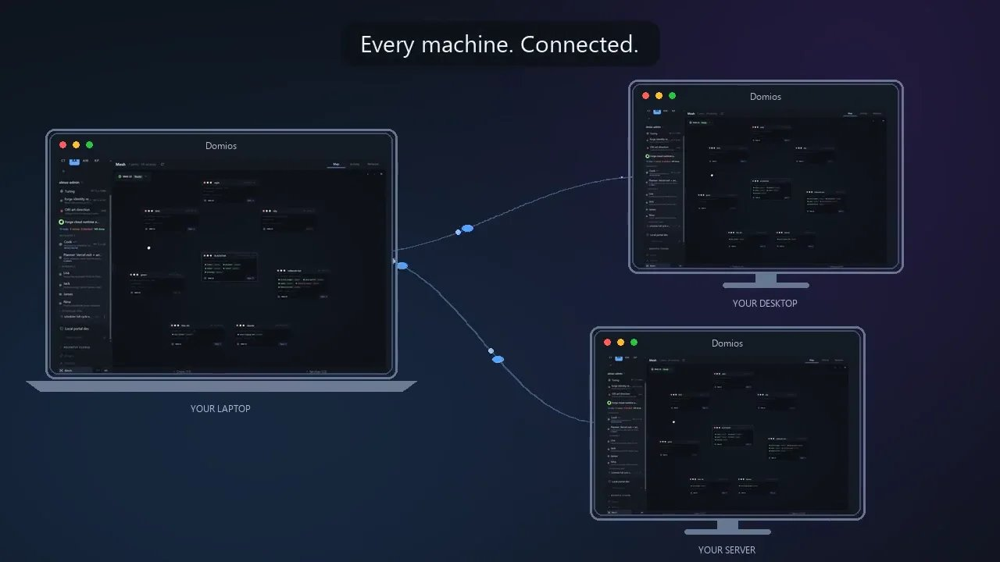
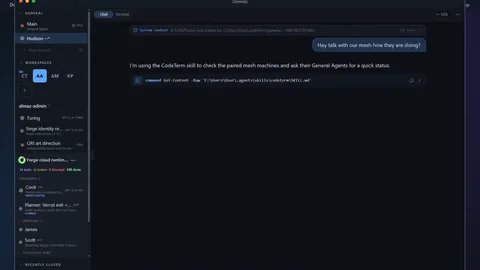
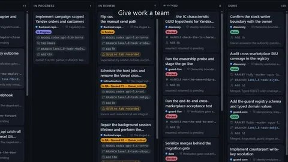
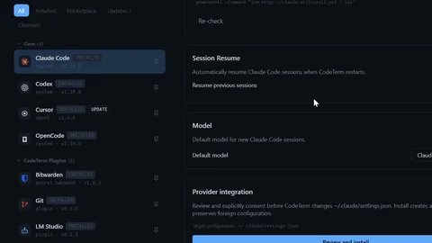

<p align="center">
  
</p>

<h1 align="center">Domios</h1>

<p align="center">
  <strong>An OS for AI agents.</strong><br>
  A place for your agents to live, work, remember, and coordinate across machines.
</p>

<p align="center">
  <a href="https://domios.dev">Website</a> &bull;
  <a href="#capabilities">Capabilities</a> &bull;
  <a href="#installation">Install</a> &bull;
  <a href="#building-from-source">Build</a> &bull;
  <a href="#links">Docs</a>
</p>

[](https://domios.dev/media/trailer.mp4)

*Watch the trailer: meet your agents, give work a team, connect your machines, and choose your tools.*

## What is Domios?

Domios is a distributed OS for AI agents, with a terminal at its heart. It runs on macOS, Windows, and Linux. Agents get a shared control surface through the `codeterm` CLI, REST API, and socket API; people follow the same work through terminals, Chat, plans, and bridges.

Keep a conversation going with one agent, or give a goal to a meta-team. The **Orchestrator** coordinates and verifies, the **Planner** designs tasks and fits each Worker's role and model to the work, and named **Workers** execute in isolated lanes. Reports and review carry the work into the canonical checkout.

Built with Tauri v2, Rust, React, TypeScript, and xterm.js. The product is called Domios; the repository, CLI, and install packages retain the `codeterm` name.

## Capabilities

### Agents and Chat



- **Project workspaces and named tabs** keep shells and agents together. Sessions survive restarts, and past conversations can be searched and resumed.
- **Choose your agent** through provider plugins, including Claude Code, Codex, and OpenCode. Provider-owned catalogs expose models and reasoning options.
- **Chat beside the terminal** shows conversations, tool cards, Mermaid diagrams, sandboxed HTML, file previews, and image and voice attachments.

### Meta-teams and plans



- **Orchestrator, Planner, Workers** turn a goal into scoped tasks, dispatches, reports, and reviewed results.
- **Isolated lanes** give each Worker its own branch and worktree. Accepted work lands through real merges, with verification in the canonical checkout.
- **Recurring work** runs through scheduled jobs and bounded Blueprint graphs, with visible escalation when an owner decision is needed.

### Mesh and remote access


- **Pair your machines** into a trusted mesh. Reach remote tabs, agents, services, and plan commands through `--mesh` and bring reports back.
- **Telegram bridges** carry conversations to the General Agent or an individual tab's topic. Voice messages become text through a swappable transcription service.
- **The web client** reaches the existing interface from a phone or browser over your private Tailnet.

### Memory, plugins, and the host



- **Durable memory** stores facts, notes, preferences, and skills with hybrid keyword and vector search, a knowledge graph, and consolidation.
- **Plugins and the marketplace** add agent providers, bridges, tools, and views through installable channels. Credentials live in the local secret store.
- **Signed self-updates** install and relaunch the app with session continuity. Frontend updates support hot swap with client health confirmation before activation is saved.
- **Accounts (in rollout)** provide a signed-in identity for account-dependent features through Settings → Account. Product analytics are optional and off by default.

The [capability map](essences/capabilities.md) distinguishes shipped capabilities, work in rollout, and the roadmap. The [vision](essences/vision.md) explains how they fit together.

## Installation

Get the current desktop installer from [domios.dev](https://domios.dev) or [the latest public release](https://github.com/rollacode/codeterm-releases/releases/latest).

### macOS (Homebrew)

```bash
brew tap rollacode/codeterm
brew install --cask codeterm
```

### Windows (Scoop)

```powershell
scoop bucket add codeterm https://github.com/rollacode/scoop-codeterm
scoop install codeterm
```

The Homebrew tap and Scoop bucket may trail the current release; use the desktop installer for the latest build.

### Desktop installers

- **macOS:** download the `.dmg` for Apple Silicon or Intel, then move the app to Applications.
- **Windows:** download and run the `.exe` installer for x64 or ARM64.
- **Linux:** download the `.deb` or `.AppImage` for your architecture. Install the Debian package with your package manager, or make the AppImage executable and launch it.

## Building from source

Use Node.js 22, pnpm 10 (the exact version is in [package.json](package.json)), and Rust via rustup (the toolchain is pinned in [rust-toolchain.toml](rust-toolchain.toml)). Install the [Tauri platform prerequisites](https://v2.tauri.app/start/prerequisites/) for your OS: Xcode Command Line Tools on macOS, MSVC Build Tools and WebView2 on Windows, or the Linux system libraries.

```bash
git clone https://github.com/rollacode/codeterm.git
cd codeterm
pnpm install --frozen-lockfile
./build.sh dev
```

For a production build, run `./build.sh build`. On Windows PowerShell, use `.\build.ps1 dev` or `.\build.ps1 build`; the wrapper selects Git Bash and forwards to `build.sh`. Development uses a separate instance from production.

## Links

- [Website and trailer](https://domios.dev) · [Public releases](https://github.com/rollacode/codeterm-releases/releases/latest)
- [CLI reference](generated/cli/cli.md) · [API reference](prod-docs/API.md) · [Configuration](prod-docs/CONFIG.md)
- [Orchestration](prod-docs/ORCHESTRATION.md) · [Lanes](prod-docs/LANES.md) · [Mesh](prod-docs/MESH.md) · [Memory](prod-docs/MEMORY.md)
- [Telegram setup](prod-docs/TELEGRAM-SETUP.md) · [Voice transcription](prod-docs/TRANSCRIBE.md) · [Accounts](prod-docs/ACCOUNT.md)

Inside Domios, run `codeterm docs` to discover the help embedded in your installed version, then `codeterm docs <NAME>` to read a document.

Contributions welcome: open an issue to discuss the change. Licensed under [MIT](LICENSE).
