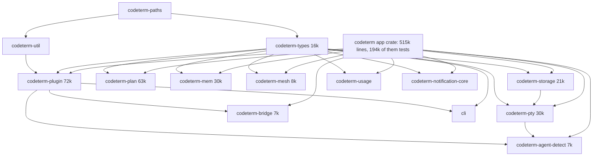

# Splitting the `codeterm` app crate: graph findings and ranked roadmap

Source facts come from `scripts/module-graph.py` (output: `module-graph.md`) and the Cargo manifests. Speedups are hypotheses until measured on the warm canonical target with `./build.sh check` and `./build.sh test-one`; nothing here was compiled in the authoring lane.

## Crate-level graph today

Source fact: `codeterm-types` is a leaf with 12 workspace dependents plus the CLI. Every edit in it rebuilds all of them and the app crate.

## Module graph of the app crate

Source facts (see `module-graph.md`):

- The app crate has 36 top-level modules in one strongly connected component, and its core is 162 units (266k non-test lines) in one component. There is no acyclic layering inside it.
- Even with every facade and hub removed (`service`, `multiplexer`, `api/events`, `api/routes`, `config`, `paths`, `plugin`, `app_runtime`, `pty`, `plan`, `mesh`, `session`, `agent/*` facades, `api/tab_routes`, `commands`, `startup`) a component of 110 units / 222k lines remains: `service/*` (spawn, agent_runtime, agent_restart, codex_rpc, pty_io, tab_chat, chat_send_transaction, hierarchy, orchestrator, general_agent, team, surface, supporter...) plus `api/*_routes`, `sentinel`, `cron`, `crash`, `storage`, `update`, `socket`, `agent/run_watcher`. This tangle is the service core and has no clean seam.
- `multiplexer`, `pty`, `paths`, `plan`, `mesh`, `session`, `plugin`, `provider`, `agent/{provider,status,detector,chat_types,keys}`, `bridge` are re-export shims over existing crates. They are not seams to cut.
- `service::ServiceContext` (216 references, `service/mod.rs`) is the god-object. Any module that touches it must sit on the same side of a crate boundary as `service`, or reach it through a trait.
- Hubs by fan-in: `multiplexer` 142, `service` 97, `api/events` 70, `api/routes` 53, `config` 52, `agent/provider` 50. `api/events` (1.0k lines) and `config` (2.0k) depend only on facades, so they can be lowered into crates.
- Churn in the last 90 days (touches of `.rs` files): `sentinel` 505, `socket` 171, `commands` 173, `startup` 104, `service/codex_rpc` 256, `service/agent_restart` 240, `service/agent_runtime` 203, `service/pty_io` 190; crates: `codeterm-plugin` 849, `codeterm-pty` 267, `codeterm-types` 119.

Clean seams found (few inbound edges, no cycles through them):

| seam | lines (with tests) | inbound from outside | cycle status |
|---|---:|---|---|
| `domios` + `message_markers` (inside `codeterm-types`) | 1.0k | plugin, bridge, app, cli | none; std only, `domios` uses `message_markers`, nothing uses `domios` back |
| `socket` | 34k | 5 call sites of `socket_display_path()` (service/general_agent, instance_env, plugin_host, spawn, startup), `cli_rpc_routes`, `mesh_routes/rpc`, `plan_routes/tasks` | one component today only through those 8 call sites; engine itself depends on service, so it can only be an upper crate |
| `sentinel` engine | 32k | `scheduler::Handle` via `try_state` in ~12 service/api files, `store::*` types in `blueprint_pipeline` and `service/sentinel`, `storage/{migration,verification}` | depends on `ServiceContext` (5 sites), `cron::{clock,store}` (16), `crash::shutdown`, `storage::OTHER_BUCKET` (10) |
| `api/events` | 1.0k | 70 units | none, depends on `plugin` facade only |
| `secrets` | 3.5k | api/routes, config | back-edges: `api/routes`, `config` |
| `keepawake` | 1.2k | api/events, process_util | back-edges: `api/events`, `process_util` |

## Ranked roadmap

Ranking criterion: (expected feedback gain x edit frequency) / (risk x work). Each step keeps the previous step's graph acyclic.

### R1. `codeterm-wire`: `domios` + `message_markers` out of `codeterm-types` (first split, executed in this task)

- Contents: `domios.rs` (336 lines), `message_markers.rs` (427) and its tests (233). Pure std; no serde, no ts-rs.
- Dependencies: none. Dependents: `codeterm-plugin`, `codeterm-bridge`, the app crate, the CLI.
- Cycles to break: none. The only intra-types coupling is `domios` -> `message_markers`, and both move together.
- Expected effect (hypothesis): an edit to routed-message code no longer rebuilds `codeterm-pty`, `codeterm-plan`, `codeterm-mem`, `codeterm-mesh`, `codeterm-storage`, `codeterm-usage`, `codeterm-notification-core`, `codeterm-input-windows`; those 8 stop depending on the edited crate. Edits to the rest of `codeterm-types` stop rebuilding `codeterm-wire` and its dependents only where they do not also use `codeterm-types`, so the gain on type edits is zero. Measure: touch a comment in `domios.rs`, time `./build.sh check`, compare with the same touch before.
- Risk: low. Mechanical path rewrite; the compiler finds every miss.

### R2. Dissolve the rest of `codeterm-types` by consumer set

Consumer sets measured from `codeterm_types::<module>` paths (counts are use sites):

| module(s) | lines | consumers | target |
|---|---:|---|---|
| `agent/provider_signals` | 520 | plugin, pty, app | micro-crate `codeterm-provider-signals` (neither plugin nor pty can own it) |
| `decision`, `config/decision_rerank` | 1.0k | mem 16, plugin 20, app 98 | `codeterm-decision` micro-crate |
| `blueprint_*`, `sentinel_input`, `automation_name` | 3.9k | storage, plugin, cli, app | `codeterm-blueprint-types` |
| `mesh/*` | 0.8k | codeterm-mesh, cli, app | into `codeterm-mesh` (cli gains that dependency) |
| `usage` | 0.1k | codeterm-usage, plugin 4, plan 1, app | into `codeterm-usage` |
| `notification` | 0.5k | notification-core, cli, app | into `codeterm-notification-core` |
| `local_recording` | 0.4k | input-windows, plugin, app | micro-crate or into `codeterm-input-windows` consumers' lowest common crate |
| `agent/*`, `pty/*`, `team/*`, `plan/*`, `config/*`, `startup_records`, `trace`, `update` | ~8k | broad hub | stays as `codeterm-types` |

Cycles to break: none; all moves go toward leaves. Expected effect: edits to `config/schema.rs` (50 touches), `plan/types.rs` (25) and `plan/attempt.rs` (23) still rebuild the hub's consumers; everything else stops. Risk: low per step, mechanical. One PR per row.

### R3. Lower hubs out of the app crate

- `codeterm-events`: `api/events.rs` (1.0k) and `EventBroadcaster`; depends only on `plugin`. Unblocks `keepawake`, `usage`, `delayed_send`, `mem_host` leaving the app crate.
- Lower `config` (2.0k; depends on `mesh`, `paths` facades), `process_util`, `lock_hold` into the same or sibling small crates. Then `secrets` (3.5k) and `keepawake` (1.2k) become leaf crates.
- Cycles to break: `secrets` -> `api/routes`, `config` -> `secrets`; `keepawake` -> `app_runtime`.
- Expected effect: small by themselves (each leaf is 1-4k lines); the point is to open R4 and R5.
- Risk: low-medium, because `EventBroadcaster` has 70 inbound units and any signature drift shows up everywhere.

### R4. `codeterm-socket` (34k lines, 171 touches) as an upper crate

- Contents: `socket/` (20k source plus 14k tests). Depends on the app crate lib (service, api, sentinel, startup).
- Cycles to break: (a) `socket_display_path()` moves to `codeterm-paths` (5 callers, trivial). (b) `api/cli_rpc_routes`, `api/mesh_routes/rpc.rs` and `api/plan_routes/tasks.rs` call `dispatch_service_rpc`, `dispatch_mesh_rpc`, `protocol::*`, `JsonRpcError` and `plan_task_dispatch::remote_recovery`; invert with a function table registered at startup, or move those three route files into the socket crate. (c) `startup` (6.4k) references socket and sentinel and becomes the composition root in the bin crate.
- Expected effect (hypothesis): an edit to `socket/` rebuilds socket plus the binary instead of the full 515k-line crate.
- Risk: medium. Behaviour risk is in the registration order of the dispatch table; no logic changes.

### R5. `codeterm-sentinel` engine (32k lines, 505 touches: the hottest module)

- Contents: `sentinel/` (19.7k source, 12.2k tests) plus the adapter `service/sentinel*` (1.8k).
- Dependencies today: `ServiceContext` (5 sites), `cron::{clock,store}` (16), `crash::shutdown` (4), `crate::storage::OTHER_BUCKET` (10), `supporter*`, `messenger`, `instance_env`, `flow_trace`, `api::events`, `mem::decision`.
- Cycles to break: the app core reaches into sentinel in 12 files through `try_state::<scheduler::Handle>()` (team, tab, workspace, close_history, plugin_host, output_feed, orchestrator_digests) and through `store::*` in `blueprint_pipeline`; replace each with a small port trait (`SentinelCleanup`, `BlueprintStore`) defined in a lower crate and implemented by the sentinel crate; lower `cron::clock/store` and `storage` constants with R3.
- Expected effect (hypothesis): the most frequently edited 32k lines stop recompiling the other 480k.
- Risk: medium-high. The ports touch team/tab close paths; lock ordering must be audited after the move (`mux` -> `output_buf` -> ... unchanged; the new traits must not hold a guard across calls).

### R6. `codeterm-api-routes` (65k lines)

- Largest children: `mem_routes` 9.4k, `mesh_routes` 8.3k, `hook_routes` 5.3k, `plan_routes` 4.8k, `tab_routes` 2.7k, `inbound_webhook` 1.9k.
- Cycles to break: `api/routes` (fan-in 53) and `api/events` (R3); `api/tab_routes` (fan-in 18); the service core calls `api::events`, `api::routes::*`, `api::auth`.
- Expected effect: route edits stop recompiling the service core. Risk: medium-high; do after R3-R5 have shrunk the surface.

### R7. The service core (110 units, 222k lines)

No clean seam. Only a trait-port rewrite of `ServiceContext` would split it. Out of scope for this roadmap; the residue after R1-R6 is the target for a later effort.

## What the first split does and does not claim

R1 is chosen because it is the only candidate with zero cycles to break and zero behaviour surface (pure string/struct functions). It addresses the owner's concern that volatile logic in `codeterm-types` triggers a workspace-wide rebuild. It does not shrink the 515k-line app crate; R4 and R5 do that.

## R1 status

Executed on this branch: `src-tauri/crates/codeterm-wire` holds `domios` and `message_markers` (git renames, content unchanged). Dependents changed: `codeterm-plugin`, `codeterm-bridge`, the app crate (`src-tauri/Cargo.toml`), and the CLI. Both lockfiles were edited by hand to add the package and its edges; `./build.sh release-preflight` should confirm them. Selectors: `./build.sh test-one wire NAME`, and the existing app selectors that exercise markers (`message_markers`, `paste_encoding`, `inbound_webhook`). Timings: canonical measures touch-`domios.rs` + `./build.sh check` before (types) and after (wire).

## R2a status

Done: `codeterm-decision` holds `decision` (git renames; app dev-dependency now enables its `decision-fixture-clock`). `codeterm-provider-signals` holds `AuthStatus`, `ApiErrorKind`, `PermissionMode`, `SessionObservations`, `ProviderTurnIncident`, `admit_key`; `ProviderSignals` stays in `codeterm-types` because it embeds `ProbeSnapshot`, `BackgroundRoster` and `pty` types and moving it would cycle. `config/decision_rerank` does not exist in `codeterm-types` (rerank lives in `codeterm-mem`), so nothing moved for it. Selectors: `./build.sh test-one decision NAME`, `./build.sh test-one provider-signals NAME`.
R2b done (blueprint_*/sentinel_input/automation_name -> `codeterm-blueprint-types`, `mesh/*` -> `codeterm_mesh::contract`, `usage` -> `codeterm_usage::contract`, `local_recording` -> `codeterm-local-recording`); `notification` -> `codeterm_notification_core::contract`. Correction to the R2 table: this row was not cycle-free, because `config/schema.rs` (stays in `codeterm-types`) uses `NotifyLevel`/`NotifyDestination`; those two enums moved to the leaf crate `codeterm-notify-types`, which both `codeterm-types` and `codeterm-notification-core` depend on (the latter re-exports them from `contract`).
## R3 status
Executed: `codeterm-events` (`EventBroadcaster`, `SystemEvent`, generic `emit_everywhere`), `codeterm-config`, `codeterm-secrets` (REST handlers stay in the app as `secrets/api.rs`) and `codeterm-keepawake` (generic over the tauri runtime). `lock_hold` and `process_util` were already thin shims over `codeterm-util`. The app modules are `pub use` facades, so inbound paths are unchanged.
