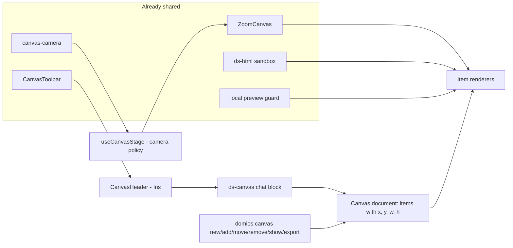

# Study: one shared DS canvas

The owner's idea (16 Nov): make one shared DS canvas, place images, HTML and other things on it, show an area of it when needed, and fill it from the CLI (`domios canvas …`). "If this is hard, don't. If it simplifies things, explain how."

This is a research study for that decision. Nothing has been built. Line counts were measured on `feature/1.20.1` at `7cab8842b9` with `wc -l` and exclude tests unless stated. Figures marked *estimate* are judgement, not measurement.

## Summary

**Recommendation: take a small first step. Don't build the full canvas yet.**

- **Little to deduplicate.** The pan/zoom camera (`@codeterm/canvas-camera`) and the toolbar (`CanvasToolbar`) are already shared by every canvas. The repeated code is a thin camera-policy layer above the camera, about 380 lines across five surfaces. A shared hook would remove about 200 of them. The large canvases (plans, memory, mesh, Blueprint, essence map) render thousands of domain objects with Canvas 2D, WebGL or SVG. Moving them onto a DOM canvas of placed items would be slower and would delete nothing.
- **The value is new capability.** Agents could build visual reports, side-by-side comparisons and boards in the chat. Most of the parts already exist: the image viewer is already a canvas of placed items (`ZoomCanvas`), and ds-html is already a hardened sandbox.
- **Smallest useful step.** Do Iris's `CanvasHeader` and a shared camera-policy hook. Then add a transient `<ds-canvas>` chat block that carries its items inline, like `<ds-tasks>` carries a snapshot. It needs no storage, no daemon and no new CLI. Add persistent canvases, `domios canvas new|add|…` and mesh sharing only after agents actually use the block.

## 1. Inventory

### 1.1 What is already shared

| Shared piece | Path | Lines | Used by |
|---|---|---|---|
| Camera: transform, wheel, mouse, touch, fit, fly-to, paint layer | `packages/canvas-camera/src/*` | 519 (+15 package.json) | Plans canvas, essence map, Mesh, Blueprint, `ZoomCanvas` (image viewer, Mermaid) |
| Toolbar: Fit all, 100%, −, +, Refresh, view and extra slots | `packages/chat-ui/src/CanvasToolbar.tsx` | 41 | All of the above plus Memory; `src/components/Canvas/graphToolbar.wiring.test.tsx` proves the wiring for each surface |
| Zoomable DOM canvas of absolutely placed items: dotted ground, fit / focus / natural modes, keyboard, swipe, tap-to-select via `data-zoom-target` | `packages/chat-ui/src/ZoomCanvas.tsx` + `useZoomCanvas.ts` + `canvasGrid.ts` + `imageCanvasCamera.ts` | 35 + 144 + 12 + 51 | Image viewer (`ImageFullscreen.tsx`, 72), Mermaid fullscreen (`MermaidCanvas.tsx`, 10) |
| Fullscreen shell: focus trap, Escape, return focus | `packages/chat-ui/src/FullscreenOverlay.tsx` | 96 | Image, video, HTML, page, document, code and tasks viewers |
| ds-html sandbox: `sandbox="allow-scripts"` iframe, strict CSP, inlined Tailwind v4, `ct.*` runtime | `packages/chat-ui/src/HtmlPreviewBlock.tsx` | 346 | `<ds-html>`, `<ds-page>` |
| Local file previews with size bounds, tab ownership and mesh path rewriting | `src-tauri/crates/codeterm-local-preview/src` (non-test, 1,574), `codeterm-service-core/src/service/local_preview.rs` (177) | 1,751 | `<ds-image>`, `<ds-page>`, `<ds-document>` |

The consolidation the idea hopes for has already happened at the camera and toolbar level.

### 1.2 Each surface and what it implements itself

| Surface | Entry | Renderer | Camera | Own camera policy (measured) | Layout | Selection / detail | Persistence |
|---|---|---|---|---|---|---|---|
| Plans canvas | `src/components/Canvas/CanvasView.tsx` (1,009) | Canvas 2D world: `canvasRender/` (2,461 non-test), level of detail, bitmap cache | `useCanvasViewport` | ~28: ResizeObserver 487–498, fit-once by context key 450–465; fly-to in `canvasView/useCanvasFlyTo.ts` (238) | `layout/` (~1,600 non-test): zones, task clouds, lineage | Detail overlay, presence, minimap (`CanvasMinimap.tsx`, 109) | Settings plus focus store |
| Essence map | `EssenceMapCanvas.tsx` (125) | DOM project views | `useCanvasViewport` | ~16: ResizeObserver 51, fit-once keyed by maps 52–63 | `essenceMapModel.ts` (601) | Source panel | None |
| Mesh | `src/components/MeshPanel/MeshCanvas.tsx` (426) | DOM cards plus SVG lines | `useCanvasViewport` | ~45: two ResizeObservers, `userAdjustedRef` auto-fit 206–240, adjust flags 346–360 | Radial around the gateway | Peer click | None |
| Blueprint | `src/components/Automation/blueprint/Canvas.tsx` (138) | DOM nodes plus SVG edges | `useCanvasViewport` | 147 (`viewport.ts`): ResizeObserver, fit and overview, follow on resize, keyboard, its own touch-pan, camera memory across reopen | `layout.ts` (236), `graphModel.ts` (461) | Node sheet | Camera held by the opener |
| Memory graph | `src/components/MemoryPanel/MemorySnapshotCanvas.tsx` (732) | sigma (WebGL) | sigma's own camera | Its own, through the sigma API | Server-computed positions, pinning | Node detail | Pinned positions on the server |
| Image viewer | `ImageFullscreen.tsx` (72) | DOM `` on `ZoomCanvas` | `useZoomCanvas` | 144 (`useZoomCanvas.ts`) + 51 (`imageCanvasCamera.ts`, camera memory) | `galleryModel.ts` (20): one row | Tap-to-focus, pager | In-memory LRU of 24 cameras |
| Mermaid fullscreen | `MermaidCanvas.tsx` (10) | Inline SVG on `ZoomCanvas` | `useZoomCanvas` | Shared with the image viewer | n/a | n/a | n/a |

The Mission Control board (`src/components/Canvas/missionControl/`) and the plan board (`planView/PlanBoardView.tsx`) are scrolled layouts, not pan/zoom canvases, so they are out of scope.

### 1.3 The duplication, named

1. **Container measurement**, five copies of a ResizeObserver feeding the camera size, about 10 lines each: `CanvasView.tsx:487`, `EssenceMapCanvas.tsx:51`, `MeshCanvas.tsx:199`, `blueprint/viewport.ts:53`, `useZoomCanvas.ts:55`.
2. **"Fit once, then respect the user's camera"**, five different implementations of the same rule: `fittedRef` with a context key (plans), `fittedKey` (essence), `userAdjustedRef` with `fittedBoundsRef` (Mesh), `moved`/`fitted`/`same()` (Blueprint), and the `modeRef` fit/focus/custom/natural modes (ZoomCanvas). About 120 lines in all, with five sets of edge-case fixes. The essence map's comment at lines 52–57 records one bug this caused.
3. **Keyboard camera control**, two copies: `blueprint/viewport.ts:121–129` and `useZoomCanvas.ts:128–141`.
4. **Camera memory across reopen**, two copies: `AutomationCamera` in the Blueprint view and `imageCanvasCamera.ts`.
5. **Touch pan**: the Blueprint view keeps its own pointer pan (`viewport.ts:131–144`) beside the camera's `useCanvasTouch`.
6. **Inconsistent zoom steps.** These are not code duplication, but they are visible: ±0.25 for the essence map and plans, ±0.2 for Blueprint, −0.2/+0.25 for ZoomCanvas, and ±0.06 for Mesh, all asserted in `graphToolbar.wiring.test.tsx`.
7. **Viewer headers**: the image, video, page/document and HTML fullscreen viewers each draw their own header row (`ImageFullscreen.tsx:36`, `VideoFullscreen.tsx:21`, `LocalArtifactBlock.tsx:161`). Iris's `CanvasHeader` spec covers this already.

That makes about 380 lines of camera policy above the shared camera, plus four header rows. The renderers (Canvas 2D, WebGL, SVG, DOM) and the domain layouts are not duplicates of each other. Each one serves a different data shape and scale.

## 2. Proposal: the DS canvas

### 2.1 Shape



### 2.2 The document

A canvas is a small JSON document:

```json
{
  "id": "cv_7f3a",
  "title": "Header options",
  "items": [
    { "id": "a", "kind": "image", "x": 0, "y": 0, "w": 640, "h": 400, "src": "/abs/a.png" },
    { "id": "b", "kind": "html", "x": 680, "y": 0, "w": 480, "h": 400, "html": "<div class='p-4'>…</div>" },
    { "id": "n", "kind": "note", "x": 0, "y": 440, "w": 640, "h": 120, "markdown": "**A** is calmer, **B** is denser." }
  ],
  "views": [{ "name": "compare", "x": 0, "y": 0, "w": 1160, "h": 400 }]
}
```

| Kind | Source | Renders with |
|---|---|---|
| `image` | absolute path or a canvas asset | the `<ds-image>` loader and bounds |
| `html` | inline body (≤ 200,000 bytes, as ds-html) | `buildHtmlPreviewDocument`, unchanged |
| `page` | `.html` path | the same as `<ds-page>` |
| `document` | text path | the same as `<ds-document>` |
| `note` | inline markdown | `MarkdownBody` on a soft surface (Iris: the only item with a fill) |
| `tab` | tab id | static tab card with a last-screen snapshot; live terminals are excluded (see §4.3) |
| `graph` | `plan`, `blueprint`, `mermaid` or `essence` ref | that surface's own read-only renderer inside the item frame |

Position and size are in world units. Without explicit `x`/`y`, items flow onto a grid (the gallery's row layout, wrapped), so an agent rarely needs coordinates. Named `views` are rectangles; `view=` in the block and `show --view` frame one of them.

### 2.3 Rendering surface

- **The viewer is `ZoomCanvas` with Iris's header** (`toolbar="header"`). The pager "‹ 1 / N ›" steps through named views, or through items when no views exist. "Fit", the percentage and close behave as in the image viewer.
- **Camera policy moves into one `useCanvasStage` hook**: measurement, fit-once-then-respect-the-user, follow on resize, keyboard and camera memory. `ZoomCanvas`, the Blueprint view, Mesh, the essence map and the plans canvas all adopt it. Each surface keeps its own renderer and layout.
- **The graph surfaces do not move onto the item renderer.** They gain the shared policy and, later, the shared header. A `graph` item embeds them read-only.
- **Look (Iris):** frameless items on the dotted ground, no item shadows or rotation. A 1px hairline appears only when an item's background matches the canvas. Hover shows a 1px muted outline. Selection is a 2px accent outline at a 3px offset, and the other items are not dimmed. A failed item shows one quiet sentence in its own frame with the cause in a collapsed Details, never a broken-image icon. There is no minimap until a canvas outgrows Fit, no per-item toolbars and no decorative connectors.

### 2.4 Chat block

```text
<ds-canvas id="cv_7f3a" view="compare" />
<ds-canvas>{"title":"Header options","items":[…]}</ds-canvas>
```

- `id` points at a stored canvas (phase 3). An inline JSON body is a transient canvas that lives in the message (phase 1), the same pattern as the `<ds-tasks>` snapshot body.
- **Inline, the block is static until clicked (Iris).** It shows a fitted, non-interactive preview of the whole canvas or of `view`, about 320px high, with a hairline frame and the title as a small caption. Click or Enter opens the full viewer. It never pans or zooms in place, because the wheel must keep scrolling the chat. There is no inline toolbar and no editing in the chat.
- Grammar, escaping and inertness follow `domios docs CHAT-BLOCKS`. The 32-preview limit and the per-kind byte bounds apply to the whole canvas.

### 2.5 CLI and API

**Name collision:** `domios canvas` already exists and holds `focus` and `filter` for the plans canvas. AGENTS.md allows breaking changes, so move those two to `domios plan canvas focus|filter` and give the bare `domios canvas` group to the new document:

```text
domios canvas new "Header options" [--team T | --tab ID]          -> cv_7f3a
domios canvas add cv_7f3a --kind image --src /abs/a.png [--x --y --w --h] [--id a]
domios canvas add cv_7f3a --kind html --from-pad b.html
domios canvas add cv_7f3a --kind note --from-pad note.md
domios canvas move cv_7f3a a --x 0 --y 0 [--w --h]
domios canvas remove cv_7f3a a
domios canvas view cv_7f3a compare --x 0 --y 0 --w 1160 --h 400
domios canvas show cv_7f3a [--view compare]   # prints the <ds-canvas> tag to paste into a reply
domios canvas export cv_7f3a --format json|png|html
```

- `show` prints a block. It doesn't post to a chat, so it adds no route that bypasses the chat.
- `--from-pad` follows the pad rule for multi-line bodies.
- The REST API mirrors the verbs under one canvas route group with read and write permissions, and changes are pushed as events to open viewers.
- `export png` needs a rasteriser for sandboxed HTML. That is the one expensive verb, so it is deferred (see §4).

### 2.6 Storage, ownership and sharing

- **Store:** the daemon keeps one JSON document per canvas, under the owning scope's data directory. Images that the CLI adds are copied into a per-canvas, content-addressed asset folder, so the canvas no longer depends on a pad or a temporary path that may be deleted. Size bounds follow the existing preview limits.
- **Ownership:**
  - A tab-scoped canvas is deleted with its tab, the same lifetime as pads.
  - A Team canvas survives its agents.
  - A workspace canvas is the owner's board.
  - Writes need the same authority as posting into that scope. Reads follow the local preview ownership rules (`access_policy` local preview routes).
- **Mesh:** a canvas sent with a message travels the same way as file cards today. The document and its assets transfer to the target host before delivery, and a failed transfer refuses delivery. A canvas is never live-shared across peers: a copy arrives, and the author's machine stays the authority.
- **Web UI:** the block and viewer live in `@codeterm/chat-ui`, which already runs in the web client, so the web UI gets them unchanged.

### 2.7 Security

The `html` and `page` items use the existing sandbox byte for byte:

- `sandbox="allow-scripts"`, which gives an opaque origin with no same-origin access;
- the CSP `default-src 'none'; connect-src 'none'; frame-src 'none'; form-action 'none'`, with images, fonts and media allowed only from `data:` and `blob:`;
- `sanitizeLocalHtml` for page files;
- the existing message channel, which accepts only height and close.

The canvas adds no `postMessage` verbs and no shared state between items. Each item is its own iframe, so one item can't read another. No item gets network or filesystem access; `ct.file.pick` remains user-initiated inside the frame.

Two canvas-specific rules:

- **Pointer isolation.** Non-selected HTML items get `pointer-events: none`, so dragging or wheeling over them pans the canvas. A selected item receives input and Escape returns it to the canvas. Without this rule an iframe would capture the wheel.
- **A live-frame budget.** Each frame inlines the 287 KB Tailwind runtime (`@tailwindcss/browser` 4.3.5 `index.global.js`). Load frames lazily when visible and cap live frames at 8 (*estimate*, to be measured). HTML items beyond the cap show their title until they are focused.

## 3. What it simplifies

### 3.1 Code that collapses (measured scope, estimated savings)

| Change | Lines today | Likely net change |
|---|---|---|
| `useCanvasStage` replaces the policy in `useZoomCanvas`, Blueprint `viewport.ts`, Mesh, essence and plans | ~380 | −180 to −220 |
| `CanvasHeader` replaces four viewer header rows (Iris/Elgar task) | ~60 | −30 to −40 |
| The image gallery becomes a canvas of `image` items (`galleryModel`, `useImageCanvasGallery`) | 45 | about 0: they become the grid-flow layout |
| One zoom step and one keyboard map for every canvas | constants plus tests | consistency, not lines |
| The graph renderers and layouts (plans, memory, Mesh, Blueprint, essence) | ~7,000 | 0: keep them |

**Measured, the DS canvas deletes about 250 lines, and most of that comes from the camera-policy hook, which doesn't need the DS canvas at all.** This is not a refactor that pays for itself.

### 3.2 What becomes possible

- **Visual reports.** A Worker shows before/after screenshots, a rendered HTML mock and a note in one frame, and the owner reviews it from the bell or on a phone. Today that takes three separate blocks, and the viewer shows only images.
- **Comparisons.** Design options side by side under named views ("A vs B"). Iris and Elgar produce these as PNG mocks today.
- **Boards.** A Team board that collects a plan graph, the latest shots and notes, which the Orchestrator updates with `canvas add`/`move`.
- **One viewer for every artifact kind.** An image, a page, a document or a Mermaid diagram opened from chat lands in the same header and canvas, so there is one interaction to learn.

## 4. What it costs

### 4.1 Phased plan

| Phase | Scope | New surface | Size (*estimate*) | Gate to continue |
|---|---|---|---|---|
| 0 | Iris's `CanvasHeader` and `CanvasToolbar appearance="inline"` (already specified for Elgar), plus `useCanvasStage` adopted by the five surfaces and one zoom step | None | 1–2 Worker tasks, net −250 lines | Wiring test and visual review of the five canvases |
| 1 | `<ds-canvas>` with an inline JSON body: `image`, `html`, `page`, `document` and `note` items, grid-flow default, named views, Iris's static inline preview, and the full viewer on `ZoomCanvas`. Frontend only, in `@codeterm/chat-ui` and `chat-core` | One block grammar plus a CHAT-BLOCKS section | ~600–900 lines plus tests | Agents use it unprompted in reports for 2–3 weeks |
| 2 | `tab` and `graph` items (read-only embeds of plan, Blueprint and Mermaid) | Two item kinds | ~300–500 | A board use case asks for them |
| 3 | Stored canvases: the daemon store, the `domios canvas` verbs, the `focus`/`filter` move to `plan canvas`, asset copy, scopes, events and mesh transfer | A CLI group, an API group and a store | ~1,500–2,500 Rust+TS, one CLI contract regeneration | Persistent boards are actually requested |
| 4 | `export png` with a sandboxed HTML rasteriser | One verb | Unknown; needs its own spike | Explicit owner ask |

### 4.2 Risks

- **iframe cost and scroll capture.** This is the main technical risk, and it is handled by pointer isolation, lazy loading and the live-frame budget in §2.7. The budget number has to be measured in phase 1 with 20 HTML items under a realistic tab load. Until then it is a guess.
- **A canvas nobody reads.** Without a habit of use, stored boards turn into stale clutter. That is why phase 3 is gated on phase-1 use.
- **Scope creep toward a whiteboard**: editing in chat, drawing and connectors. Iris and this study both refuse these.
- **Daemon surface.** Phase 3 adds a store, routes and mesh transfer. It must follow the hot-path rules: per-canvas files, no large synchronous serialization, and asset copies off the async runtime.
- **CLI rename.** Moving `canvas focus|filter` touches prompts, skills and docs that teach them (`cli-contributor` skill).

### 4.3 What to leave out

- Live terminals as items. A tab item is a static card with its last screen. Embedding xterm instances would multiply PTY rendering and input routing.
- Editing in the chat block, freehand drawing, decorative connectors, rotation, item shadows, per-item toolbars and auto-animated layout on load (Iris).
- A minimap, until a canvas outgrows Fit.
- Real-time multi-peer co-editing. Mesh gets copies.
- Migrating the graph canvases onto the item renderer.

## 5. Recommendation

**Take the small first step: phase 0 now, then phase 1. Don't commit to phases 2–4 yet.**

Reasons:

1. **The duplication is real but small.** The camera and toolbar are already one implementation. What remains is about 380 lines of camera policy and four header rows. Phase 0 removes most of that with no new product surface, and it has value even if the canvas never ships.
2. **The value lies in new capability, and most of it is cheap.** `ZoomCanvas` already places items on a dotted canvas, the sandbox already isolates HTML, and the preview guard already bounds files and handles mesh. A transient `<ds-canvas>` block mostly connects these, needs no daemon work, and tests whether agents use boards.
3. **The expensive parts are the ones to defer**: the store, the CLI, mesh and PNG export. The owner's own condition ("if this is hard, don't") applies to them, so they wait until phase 1 shows use.
4. **The graph canvases should stay as they are.** Moving them onto a placed-item renderer would trade tuned Canvas 2D and WebGL rendering for DOM nodes and delete nothing.

Owner decision needed:

- **Yes, small step:** dispatch phase 0, which builds on Iris's header spec, then phase 1.
- **Yes, full:** phases 0–3 as one effort. This is not recommended before usage is proven.
- **No:** do phase 0 only. It stands on its own as a cleanup.
