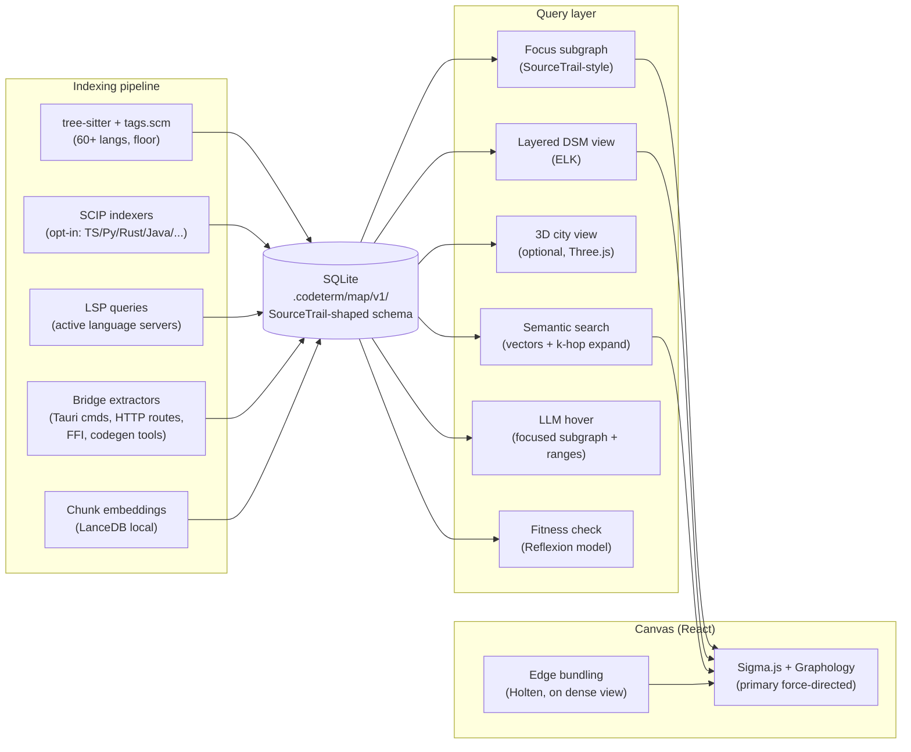

# Project Map: Prior Art Research

**Status**: research synthesis, May 2026
**Goal**: decide what CodeTerm's "project map" feature should be, by surveying everything that exists.

---

## TL;DR (read this first)

The structural-symbol-graph problem inside a single language is **solved**. Tree-sitter + per-language `tags.scm` + (optionally) PageRank gives 80% of the value in <1k LOC. Aider proved this in production; RepoGraph (NeurIPS-tier paper) typed the edges; SourceTrail nailed the UI affordances ten years ago.

The cross-language problem — linking a `fetch('/api/users')` in TypeScript to `@app.route('/api/users')` in Python — is **not solved** in OSS. SCIP (Sourcegraph's protobuf code-intel format) is the closest thing to a polyglot index, but cross-language symbols only join when both sides import a generated artifact (protobuf, gRPC, OpenAPI). For arbitrary repos, the realistic path is: per-language structural index + handcrafted **bridge extractors** (Tauri commands, HTTP routes, FFI symbols, Codegen tools when present) + LLM-as-fuzzy-linker for the long tail.

**Visualization** is also solved at the layer below "production product" — Sigma.js + Graphology, Cytoscape.js + fcose, ELK in a Web Worker. The 5k-node ceiling is achievable with off-the-shelf parts. Beyond 50k, switch to Cosmograph (GPU). The interesting product work is **not** in rendering — it's in (a) the focus-graph affordance pioneered by SourceTrail, (b) ranking + clustering (PageRank, Leiden community detection), (c) edge bundling (Holten 2006) for "cable management."

**Recommended stack** (full justification at the end): SQLite store with a SourceTrail-shaped schema, tree-sitter `tags.scm` floor + opt-in SCIP indexers, LanceDB chunk embeddings as a parallel index, Sigma.js + Graphology for canvas, ELK for layered views, Tauri-command bridge as a flagship cross-language demo, Reflexion-model fitness layer as a power-user feature.

---

## 1. Landscape

### 1a. LLM-era code maps

| Name | URL | License | Data model | Multi-lang | Vectors? | Status | Worth borrowing |
|---|---|---|---|---|---|---|---|
| **aider repomap** | https://aider.chat/2023/10/22/repomap.html | Apache-2.0 | File-level digraph + symbol tags (def/ref) ranked via PageRank | 130+ via tree-sitter, ~40 with full repo-map | No | Production, mature | **High** — the entire algorithm is a few files; mtime-keyed diskcache layout is ideal for `.codeterm/map/` |
| **RepoGraph** (paper) | https://arxiv.org/abs/2410.14684 | MIT (`ozyyshr/RepoGraph`) | Line-level nodes (def/ref) + `invoke`/`contain` edges | Python only (impl) | No | Research / ref impl | **Medium** — typed-edge schema is cleaner than aider's |
| **repomix** | https://github.com/yamadashy/repomix | MIT | Single packed file (XML/MD/JSON) | All file-level | No | Production | Low — packager, not map. Borrow ignore-pattern logic |
| **scg-cli** (Semantic Code Graph) | https://github.com/VirtusLab/scg-cli | Apache-2.0 | Typed nodes (CLASS/METHOD/VALUE) + typed edges (CALL/EXTEND/OVERRIDE) | Java + Scala only | No | Stable, niche | Medium — borrow typed-edge taxonomy |
| **GraphGen4Code** | https://github.com/wala/graph4code | EPL | RDF-style triples, includes docs/forum content | Python (WALA) | No | Research toolkit | Low |
| **Cursor codebase indexing** | https://docs.cursor.com/context/codebase-indexing | Closed | ~500-token AST chunks; Merkle tree for diffs; Turbopuffer | All via tree-sitter | Yes | Production | **High** — Merkle-hash incremental update is the right model |
| **Continue.dev @codebase** | https://github.com/continuedev/continue | Apache-2.0 | LanceDB chunks + SQLite metadata; Rust incremental sync | All | Yes | Production OSS | **High** — best open-source local-vectors reference |
| **Sourcegraph Cody** | https://sourcegraph.com/blog/how-cody-understands-your-codebase | Apache-2.0 (Cody), proprietary backend | SCIP code graph + BM25 (dropped embeddings) | All via SCIP | No (anymore) | Production; Cody Free/Pro killed July 2025 | Medium — instructive that they abandoned vectors at scale |
| **GitHub Copilot Workspace** | https://docs.github.com/copilot/concepts/indexing-repositories-for-copilot-chat | Closed | Remote semantic + local index | All | Yes | Production | Low — closed |
| **Greptile** | https://www.greptile.com/docs/how-greptile-works/graph-based-codebase-context | Closed | Graph: dirs/files/classes/funcs/vars; edges: calls/imports/deps + RAG | Multi (unspec) | Hybrid | Production SaaS | Medium — confirms hybrid is viable; no public schema |

### 1b. Interactive code-explorers (pre-LLM legends + commercial)

| Name | URL | License | Data model | Multi-lang | Viz tech | Status | Worth borrowing |
|---|---|---|---|---|---|---|---|
| **SourceTrail** | https://github.com/CoatiSoftware/Sourcetrail | GPL-3.0 | SQLite of (node, edge, source_location, occurrence, file, local_symbol, error). NameHierarchy strings. ~20 symbol kinds, ~13 edge kinds. | C/C++ (Clang), Java (JDT), Python (own); custom via SourcetrailDB | Qt 5 custom 2D canvas + 3-pane (Search/Graph/Code) | **Archived Dec 2021** | **Very high** — schema is a near-ideal blueprint; focus-mode + bundled edges + custom-trail are killer UI ideas |
| **Sourcegraph SCIP** | https://github.com/sourcegraph/scip | Apache-2.0 | Protobuf: `Index{Document[Occurrence,SymbolInformation]}`. Symbols are human-readable strings (`scip-typescript npm pkg 1.0 src/foo.ts/Bar#baz().`) | Free indexers for 9+ languages | Web list-view UI, no graph canvas | Alive; SCIP fully OSS, indexers fully OSS | **High** — adopt as the import format from CI / language servers |
| **Understand (SciTools)** | https://www.scitools.com | Commercial | Proprietary; entity graph + ~100 metrics; user-defined "Architecture" hierarchies | 15+ languages | Custom Qt-style desktop, treemap + butterfly/call/UML graphs; v7.1 added "AI summaries on hover" | Alive 2026 | UI ideas only: butterfly graph, metrics treemap, AI hover summary |
| **NDepend** | https://www.ndepend.com | Commercial | CQLinq queries; .NET entity store | .NET only | DSM (tri-color) + dep graph + treemap | Alive 2026 | DSM tri-color + cycle-triangularize button is stealable |
| **Structure101** | https://structure101.com | Commercial (Sonar) | Containment + "Levelized Structure Map"; tangles = SCC | Java/C/C++/.NET | Custom canvas with rows-as-levels | Alive (rebranded under Sonar) | LSM concept: hide expected downward edges, surface upward ones |
| **CodeSee CodeMaps** | https://www.codesee.io | Commercial (GitKraken-acquired May 2024) | File/folder/function nodes + import/call edges; review overlays | JS/TS/Python/Go/Java/Ruby (best) | Web canvas | Alive in GitKraken DevEx | UI: review-driven highlighting, "tour" overlays for onboarding |
| **Lattix LDM** | https://www.lattix.com | Commercial | Hierarchical Subsystems → Atoms; cross-domain (code+DB+reqs) | Multi-lang | Desktop DSM + Conceptual Architecture | Alive 2026 | Cross-domain DSM is unique |
| **Moose / Famix** | https://moosetechnology.org | MIT (Pharo) | Trait-based metamodel; entities (Class, Method, Access, Invocation, Inheritance) as first-class with metadata | Java/C/C++/C#/JS/TS/Smalltalk | Roassal canvas (Pharo) | Active academic | **High** — cleanest "unify N languages in one model" answer; metamodel only, no library |
| **github/semantic** | https://github.com/github/semantic | MIT | Haskell parse/diff/symbol library | Many | n/a (lib) | **Archived April 2025** | Cautionary tale |
| **Atomist** | n/a | n/a | "Code as data" TreeNode AST DSL | JVM-heavy | Web dashboards | Defunct ~2020 | Lesson: heavy DSL approach failed in market |

### 1c. 3D / spatial viz

| Name | URL | License | Approach | Status | Worth borrowing |
|---|---|---|---|---|---|
| **CodeCity** | https://wettel.github.io/codecity.html | Research / Smalltalk | Classes = buildings, packages = districts; height ∝ #methods, area ∝ #attrs (ICSE 2008) | Research artifact | Design language only — metric→geometry mapping is the canonical recipe |
| **CodeCharta** | https://github.com/MaibornWolff/codecharta | BSD-3-Clause | TS+Three.js viewer + Kotlin analyzer; importers (Sonar/Tokei/Code Maat/git log); JSON schema; delta diffing | **Very alive** (v1.143, April 2026) | **High** — closest live reference for canvas-rendered code city |
| **Gource** | https://github.com/acaudwell/Gource | GPL-3.0 | Real-time animated git history; OpenGL | Active | Time-as-axis pattern; GPL, copy idea not code |

### 1d. Pure dependency graphs

| Name | URL | Lang scope | Output | Active? | Notes |
|---|---|---|---|---|---|
| **Madge** | https://github.com/pahen/madge | JS (AMD/CJS/ESM), CSS | JSON, DOT, SVG via Graphviz | Yes (10.1k★) | Color-coded leaf/cycle/branch |
| **dependency-cruiser** | https://github.com/sverweij/dependency-cruiser | JS/TS/JSX/Vue/Svelte | Text, DOT, CSV, HTML, Mermaid, JSON | Very active (v17, 2026) | **Rule engine** — `forbidden`/`allowed` rules; closest to "fitness functions" in JS |
| **code2flow** | https://github.com/scottrogowski/code2flow | Python/JS/Ruby/PHP | DOT | Alive | AST-based, dynamic-lang imprecision |
| **pydeps** | https://github.com/thebjorn/pydeps | Python | SVG/PNG/DOT | Active (v3, 2026) | Reads bytecode opcodes — only actually-imported modules |
| **go-callvis** | https://github.com/ondrajz/go-callvis | Go | DOT, SVG, web | Less hot (Jan 2025) | Built on Go's `pointer` package — true call graph |
| **cargo-modules** | https://github.com/regexident/cargo-modules | Rust (single crate) | Tree + DOT | Active | Subcommands `structure`/`dependencies`/`orphans` |
| **jdeps** | OpenJDK bundled | Java bytecode | DOT per archive | JDK-stable | Module-aware |

### 1e. Architecture / fitness functions

| Name | URL | Notes |
|---|---|---|
| **ArchUnit** | https://github.com/TNG/ArchUnit | Apache-2.0 Java; rules-as-JUnit-tests. Canonical "architectural fitness function." |
| **Deptrac** | https://github.com/deptrac/deptrac | PHP, MIT; YAML-defined layers + violation reports. |
| **NetArchTest / ArchUnitNET / pytestarch** | various | .NET / Python ports of the ArchUnit pattern. **Rust has no equivalent yet — opening for CodeTerm.** |

### 1f. Tree-sitter / AST-graph ecosystem

| Name | URL | License | Role | Status | Worth borrowing |
|---|---|---|---|---|---|
| **stack-graphs** | https://github.com/github/stack-graphs | Apache-2.0 / MIT | Cross-file name resolution graph (Rust); push/pop/scope nodes; resolution = path-find | **Archived Sept 2025** | Model is gold; impl is now orphaned |
| **tree-sitter-graph** | https://github.com/tree-sitter/tree-sitter-graph | Apache-2.0 / MIT | DSL (`.tsg`) compiling parse tree → arbitrary graph | Active (Dec 2024) | Reusable for any AST→graph job |
| **SCIP indexers** | https://github.com/sourcegraph/scip | Apache-2.0 | Per-language CLIs emitting `index.scip` | Active | scip-typescript/python/clang/java/ruby; rust-analyzer ships its own |
| **ast-grep** | https://github.com/ast-grep/ast-grep | MIT | Structural search/lint/rewrite | Very active (13.7k★) | Pattern engine, useful for codemods, doesn't help map |
| **swc / oxc / biome** | various | Apache/MIT | JS/TS toolchains | Hyperactive | Real type-aware parsers; heavyweight vs tree-sitter |
| **tree-sitter `tags.scm`** | https://tree-sitter.github.io/tree-sitter/4-code-navigation.html | per-grammar | S-expression tag queries; ships with ~60 grammars | Stable | Pragmatic floor — used by aider, GitHub code search |

---

## 2. Deep dives — five most relevant

### 2.1 aider repomap — the working algorithm we should clone

The reference impl is `Aider-AI/aider/aider/repomap.py` (now sitting in `references/aider/`). The pipeline:

1. **Tag extraction.** Per source file, run a tree-sitter parser plus a per-language `*-tags.scm` query. Each `.scm` declares two capture classes — `name.definition.<kind>` and `name.reference.<kind>`. Aider ships modified `tags.scm` for ~40 languages with full repo-map support; remaining ~90 are linting-only. Files producing defs but no refs fall back to **Pygments lexer** scraping every identifier as a "reference."

2. **File-level digraph.** Nodes are **files**, not symbols. For each identifier `i` appearing in both `defs[A]` and `refs[B]`, add edge `B → A` with weight 1.0. Multipliers: **10× for identifiers mentioned in chat**, **10× for "well-named" identifiers** (snake_case / CamelCase, non-trivial), **0.1× for private (underscore)** names, **50× for files in chat context**. Isolated defs get a `0.1` self-loop.

3. **Personalized PageRank** via NetworkX. Personalization vector biases toward chat files, mentioned files, and files whose path contains a mentioned identifier (each gets `100/total_files` mass).

4. **Token-budget binary search.** PageRank → ranked (file, definition) list. Binary search over number kept until rendered token count ≤ `--map-tokens` (default 1024). When **no files in chat**, `map_mul_no_files` (default 8×) expands the budget so cold-start sessions still get a useful map.

5. **Persistence.** `diskcache.Cache` keyed by absolute file path at `{repo_root}/.aider.tags.cache.v{CACHE_VERSION}/`. Each entry: `{"mtime": file_mtime, "data": tags_data}`. **mtime mismatch invalidates.** Version suffix is bumped manually whenever extraction logic changes — stale shapes are skipped wholesale. SQLite errors → in-memory dict fallback (graceful degradation).

**For CodeTerm.** The whole thing is a couple of files and one NetworkX call. There's no embedding model, no server, no DB. The tags graph trivially yields nodes-and-edges for a canvas. PageRank gives free importance scores for visual sizing. The `.aider.tags.cache.v{N}` mtime-keyed format is essentially what `.codeterm/map/v1/` should be — versioned, blow-away-able, no migration code (matches our "no backward-compat" rule).

### 2.2 RepoGraph — the typed edge schema we should layer on

RepoGraph (Ouyang et al., 2024) types the schema cleanly. Nodes are **lines of code** with `(file, line, dir)` metadata, tagged `def` (function/class/var introduction) or `ref` (use). Edges are typed:

- `E_invoke` — `def → ref`, the standard call/use relation
- `E_contain` — `def → def`, hierarchy (class to its methods, method to its inner defs)

Construction: tree-sitter parse → relation filter (drop stdlib/third-party imports) → graph assembly. At query time, **`k`-hop ego-graphs centered on the search term** are retrieved, flattened, optionally LLM-summarized to fit context. SWE-bench gains: +2.66 / +2.34 absolute resolve-rate, **29.67% with Agentless** — SOTA among open-source agents at submission.

**For CodeTerm.** The (def, ref) × (invoke, contain) typed schema is strictly more expressive than aider's untyped file edges, while staying minimal. Combining aider's PageRank weighting with RepoGraph's typed edges = richer node-importance signal AND clean visualization vocabulary (solid edges = invoke, dotted = contain).

### 2.3 SourceTrail — the UI affordances we should clone

The legendary archived one (Coati Software, 2014–2021, GPL-3.0). The implied SQLite schema, deduced from `core/include/SourcetrailDBWriter.h`:

```
node            (id, kind, serialized_name)
edge            (id, kind, source_node_id, target_node_id)
source_location (id, file_id, start_line, start_col, end_line, end_col, type)
occurrence      (element_id, source_location_id)
file            (id, path, language, indexed, complete)
symbol          (id, definition_kind)   -- explicit / implicit
local_symbol    (id, name)
error           (id, message, file_id, ...)
```

Symbol kinds: `class, struct, function, method, field, variable, type, typedef, namespace, package, module, enum, enum_constant, macro, file, builtin_type, template_parameter, type_parameter, union, annotation`.

Edge kinds: `MEMBER, TYPE_USAGE, USAGE, CALL, INHERITANCE, OVERRIDE, TEMPLATE_SPECIALIZATION, TEMPLATE_MEMBER_SPECIALIZATION, TEMPLATE_ARGUMENT, TYPE_ARGUMENT, INCLUDE, IMPORT, MACRO_USAGE`.

**Killer UI affordances** (these are what made SourceTrail legendary):

1. **Per-symbol focus.** Selecting a symbol recenters the entire graph view — only its 1-hop neighbors show, color-coded by relation. Eliminates the "graph too dense" failure that kills every other code-graph viewer. **This single idea is the most important takeaway from this entire research.**
2. **Bundled edges.** When two parent nodes have N relations between their children, the canvas shows ONE thick edge with a count. Click to expand. Solves N² visual blow-up.
3. **Custom Trail.** Origin → target with depth + node/edge type filters → constrained sub-graph. Saved-query-as-view; in LLM era this is "ask in natural language → LLM authors a trail."
4. **3 panes + history.** Search / Graph / Code. `Z`/`Shift+Z` browser-style back/forward through symbol focus. WASD/arrows to walk graph. `Ctrl+B` bookmarks (`.srctrlbm` sidecar) with categories + comments.
5. **Striped/hatched nodes** = referenced but not defined in the index. Cheap visual signal, instantly readable.
6. **Trial graph view** (legacy) — alternate rendering preserved for muscle memory.

**Why it died.** Coati shut down 2021; the OSS pivot in 2019 was the last sustainability attempt. The hand-written per-language indexers (Clang for C/C++, JDT for Java, custom for Python) couldn't keep up commercially. **In an LLM era this changes** — tree-sitter + LLM closure of unresolved refs is acceptable for 90% of cases, so we don't need the per-language semantic-indexer mountain.

### 2.4 Sourcegraph SCIP — the import format we should adopt

SCIP replaced LSIF in 2022. Apache-2.0. Schema (`scip.proto`):

```protobuf
Index {
  Metadata metadata;             // version, project_root, tool_info, encoding
  repeated Document documents;
  repeated SymbolInformation external_symbols;
}

Document {
  string language;
  string relative_path;
  PositionEncoding position_encoding;
  repeated Occurrence occurrences;
  repeated SymbolInformation symbols;
}

Occurrence {
  repeated int32 range;          // [startLine, startCol, endLine, endCol]
  string symbol;                 // human-readable global id, see below
  int32 symbol_roles;            // bitset: Definition|Import|Write|Read|Generated|Test
  SyntaxKind syntax_kind;
  repeated string override_documentation;
  Range enclosing_range;
}

SymbolInformation {
  string symbol;
  repeated string documentation; // markdown
  repeated Relationship relationships;
  Kind kind;                     // Method|Class|Function|Trait|TypeAlias|Variable|... (~30+)
  string display_name;
  string signature_documentation;
  string enclosing_symbol;
}

Relationship {
  string symbol;                 // target
  bool is_reference;
  bool is_implementation;
  bool is_type_definition;
  bool is_definition;
}
```

**Symbol-id format** (the magic):

```
<symbol> ::= <scheme> ' ' <package> (' ' <descriptor>)+ | 'local ' <local-id>
<package> ::= <manager> ' ' <package-name> ' ' <version>
<descriptor> ::= <namespace>'/' | <type>'#' | <term>'.' | <method>'().' | …
```

Examples:
- `python pypi numpy 1.0 numpy/ ndarray#`
- `scip-java maven org.apache.commons commons-lang3 3.12.0 org/apache/commons/lang3/StringUtils#isEmpty().`
- `local 7` (file-scoped)

Cross-file/cross-repo joins are **string equality** on `symbol`. Free indexers: `scip-typescript`, `scip-python`, `scip-java/kotlin/scala`, `scip-clang`, `rust-analyzer scip`, `scip-ruby`, `scip-dotnet`, `scip-dart`, `scip-php`. Run any of them, get an `index.scip`, merge with `scip merge`.

**Cross-language reality.** Within one language ecosystem this is bulletproof. **Across** languages the package metadata diverges — `npm @org/api 1.0` ≠ `cargo my-api 1.0`. Sourcegraph's only documented cross-lang case is **protobuf / generated bindings**, where descriptor strings genuinely match because both sides import the same `.proto`. There is **no** "this `fetch` corresponds to that `@app.route`" link — that's product work, not data-format work.

**For CodeTerm.** Use SCIP as the *import* format from CI / language servers. Internal store stays SourceTrail-shaped (richer focus-graph queries). SCIP → our schema is a one-time loader. We get 9+ languages for free, day one. Skip when the user just opens a workspace with no SCIP indexes — fall back to tree-sitter `tags.scm`.

### 2.5 Continue.dev — the open-source vector layer reference

Continue (`continuedev/continue`, Apache-2.0) is the cleanest open implementation of the "Cursor-style" embedding side. Stack:

- **Chunking**: tree-sitter AST-aware, `chunkDocument()` splits files into segments sized by the embedding model's `maxEmbeddingChunkSize`, with overlap.
- **LanceDB** stores rows: `{uuid, path, cachekey, vector, startLine, endLine, contents}`.
- **SQLite** stores metadata for change detection and indexing state.
- **Rust-based incremental sync** library (in their core crate) walks the workspace, hashes files, queues only what changed.

This is directly cloneable for `.codeterm/map/`. The persistence is a couple of files inside the workspace and works offline.

The Sourcegraph-Cody counterpoint: Cody started with `text-embedding-ada-002`, built vector infra, then **abandoned embeddings entirely** for BM25 + structural SCIP. Reasons cited: shipping code to a third-party embedder, vector-DB ops cost, and **doesn't scale to 100k+ repo enterprises**. For a single-workspace tool like CodeTerm none of those apply, but worth knowing that vectors aren't strictly necessary — a precise structural index carries a lot of weight.

---

## 3. Cross-language frontend↔backend correlation — the user's hardest ask

The honest verdict: **purely-static cross-language linking from `fetch('/api/users')` to `@app.route('/api/users')` is not solved.** Five paths, ranked by what they actually deliver:

1. **Codegen / contract-first** (tRPC, GraphQL Codegen, OpenAPI generators).
   The *only* path that gives true cross-language nav, because the boundary is a single artifact both sides import. With **tRPC** the type system is the index — `client.users.get.useQuery()` walks back to `userRouter.get` because they're the same symbol. **GraphQL Codegen**: `useGetUsersQuery()` is generated from `query GetUsers`, LSP follows. **OpenAPI generators** (Orval, openapi-typescript-codegen, NSwag): client functions named after `operationId`s. The catch: only works for repos that already chose contract-first. **For "any repo," codegen is unavailable.** Pragmatic optimization: detect codegen tools (presence of `trpc`, `graphql-codegen.yml`, OpenAPI files) → use the generated symbol graph directly.

2. **Sourcegraph SCIP**.
   Cross-repo nav works *intra-language* and for explicit codegen bindings (protobuf, gRPC). It does **not** link a string literal to a routing decorator. There is nothing in SCIP's data model to express "this string in language A semantically refers to this annotation in language B."

3. **Pure-static cross-language inference** (research).
   **Respector** (Huang et al., ICSE 2024, DOI:10.1145/3597503.3639137) extracts OpenAPI spec from Python/Java backend source via static + symbolic analysis. Outperforms annotation-based and runtime-probing for *spec extraction*. But one-sided — you'd run Respector on backend, separate URL extraction on frontend, then string-match. State of the art: 70-90% recall, long tail being the actually-interesting cases (template literals, runtime-composed URLs).

4. **LLM-assisted inference**.
   **RESTSpecIT** (Decrop & Perrouin, arXiv:2402.05102, 2024): in-context prompting to mutate API requests and infer spec, 88.62% route discovery, 89.25% query-param coverage. Black-box (probes a running server) but the technique generalizes: tree-sitter extracts candidate URL strings on each side, then ask LLM "do these refer to the same endpoint?" with both snippets as context. Cheap, ~95% accurate, completely undocumented from a CS-rigor standpoint but the right pragmatic answer.

5. **Greptile-style "build a graph and let the LLM walk it."**
   Structural extraction is intra-language; *inter-language* correlation happens at LLM query time, not index time. This is the architectural pattern CodeTerm should adopt — **don't build cross-language edges at index time**, surface them lazily when the user hovers / asks.

6. **Regex on URL strings** (the GitHub Code Search baseline).
   What engineers actually use. Search for literal `/api/users`, find both call sites. Not a graph, but ~99% accurate when URLs are literal. **CodeTerm should ship this as a search panel**, not as graph edges, with extracted URL strings as a side-table. Honest UI affordance: graph for what we statically prove, search panel for the long tail.

**Verdict for CodeTerm.** Per-language structural index (intra-lang is solid) + URL/route string extraction on both sides + string match + LLM-as-fuzzy-linker for the hard cases + detect-and-honor codegen. **Don't promise full FE↔BE linking.** Promise it for codegen'd repos. Degrade gracefully to "best-effort + LLM ask" elsewhere. That's what the literature supports; anything stronger is hand-waving.

The **CodeTerm-specific bridge** worth flagshipping is **Tauri commands**: `#[tauri::command] fn greet()` in Rust + `invoke('greet')` in TS. Same shape works for HTTP routes, gRPC, FFI — generalize from there. Demoing a clean visual bridge between Rust and TS in the CodeTerm repo itself would be the killer screenshot.

---

## 4. Graph + embeddings hybrid

Most products use one or the other:
- **Graph only**: aider, RepoGraph, Cody (post-pivot), scg-cli, code2flow.
- **Vector only**: Cursor, GitHub Copilot Workspace, Continue.dev (mostly), Tabnine, Codeium.
- **Hybrid in marketing**: Greptile claims it. Continue.dev wires both loosely (vectors return chunks; structural data lives separately, no fused ranking). Cody started hybrid, dropped vectors.

**The honest summary**: vectors are good at "find me code that does X conceptually"; graphs are good at "show me everything that depends on Y." Most products pick one and slap "@codebase" on top.

**The right hybrid recipe** (nobody we found has a clean public implementation):
1. Vector search for the user's natural-language query → top-k chunks.
2. Expand each hit by `k`-hop graph traversal in the structural index → adds dependencies / dependents / siblings.
3. Dedupe, rank by combined score (vector similarity × PageRank importance × graph distance).
4. Optionally LLM-summarize the bundle.

This is exactly what RepoGraph's "k-hop ego-graph + LLM-summarize" does in the graph-only case; we'd add the vector-seeded entry point.

---

## 5. Visualization tech survey

| Lib | License | React fit | Realistic interactive ceiling | Layouts | Best for |
|---|---|---|---|---|---|
| **Cytoscape.js** | MIT | Good (`react-cytoscapejs`) | ~3-5k nodes smooth; ~10-20k with viewport culling | preset/grid/breadthfirst/dagre/klay/**cose-bilkent**/**fcose**/ELK/cola/euler | Mature ecosystem; default for ≤10k code graph |
| **vis-network** | Apache-2.0 | Decent | ~2-5k smooth; >7k struggles; clustering can show >50k | Hierarchical, Barnes-Hut, ForceAtlas2 | Quick wins, hierarchical layouts |
| **Sigma.js + Graphology** | MIT | Good (`@react-sigma/core`) | 100k edges easily; ~5k nodes if nodes have icons | Force Atlas 2, circular, noverlap (via graphology-layout) | **Best fit for 5k-node code graph** — model/renderer separation lets you persist computed layout |
| **D3-force** | ISC | Manual | ~1-3k SVG; 5-10k with Canvas/WebGL | Force primitives | Maximum flexibility, you build everything |
| **react-flow** | MIT | Native | ~1-2k smooth; 5k+ degrades; 10k laggy | None native; pair with elkjs/dagre | Hand-curated diagrams (workflow editors), **not** auto-graph view |
| **ELK / elkjs** | EPL-2.0 | Layout only | CPU-bound; 5k = seconds, run in Web Worker | **Layered (Sugiyama)**, force, stress, mrtree, radial | Best layered/orthogonal layout in JS world |
| **Pixi.js + custom** | MIT | `@pixi/react` | 50k-100k with precomputed layout, sprite batching | Bring your own (ngraph, d3-force, ELK) | Plan-ahead for 50k+ |
| **Three.js / r3f** | MIT | Excellent (`@react-three/fiber`) | 100k+ instanced meshes | DIY | 3D code-city secondary mode |
| **Graphviz / d3-graphviz / viz.js (WASM)** | MIT/BSD | Manual | >2-3k = seconds-to-minutes layout | dot/neato/fdp/sfdp/circo/twopi | Static docs, small (<1k) call graphs |
| **G6 (AntV)** | MIT | Adapter (`@antv/g6-extension-react`) | 5-10k; 50k with WebGL | Force/dagre/fruchterman/gforce/radial/circular/concentric/mds/comboCombined | Batteries-included (legend/minimap/lasso/tooltip) |
| **Cosmograph / cosmos.gl** | Apache-2.0 | React wrapper | **~1M nodes / several million edges** real-time on GPU | GPU force-directed only | Day we cross 50k nodes |

**Recommendation.** For a 5k-node code graph with hover-to-LLM and persisted positions, the two best picks are **Sigma.js + Graphology** (primary) and **Cytoscape.js + fcose** (fallback). Sigma's WebGL renderer keeps frame-time predictable as the tree grows; Graphology is the right shape for `.codeterm/map/` persistence (you serialize a Graphology JSON, not a rendered SVG). Cytoscape.js wins if we need richer built-in interactions (compound nodes for "package contains files," richer style language) and don't expect to grow past ~10k. Use **elkjs in a Web Worker** for the layered/orthogonal "system architecture" view — both libs integrate it cleanly. Skip react-flow for the auto-graph (5k is misery there); fine choice for a **secondary** "edit your module map by hand" view that writes back into the same persisted graph. Keep Cosmograph in the back pocket.

---

## 6. Cable management — graph simplification literature

The user's metaphor — "plugin-ization is reducing graph randomness, ordering edges into clean bundles between known endpoints" — has a direct trail.

**Reflexion models — Murphy, Notkin, Sullivan (FSE 1995, TOSEM 2001).** Engineer writes the architecture they *think* they have (high-level boxes + mapping from source files to boxes); tool computes which edges in source confirm the model (✓), violate it (✗), and which exist in code but not the model (?). Not auto-clustering; a **fitness check against a hypothesis**. The right primitive for "tell me when my code drifts from my mental model." Koschke et al. (QoSA 2012) made it incremental.

**Dependency Structure Matrix (DSM)** — Steward 1981 → Sullivan, Griswold et al. (2001) → Lattix, NDepend, Structure101. Adjacency matrix with rows reordered so clusters fall on the diagonal. **Triangular DSM = perfectly layered architecture.** MacCormack, Rusnak & Baldwin (Mgmt Sci 2006) used DSM to quantify modularity differences between Linux and Mozilla. Sullivan et al. (FSE 2005) is the canonical software DSM paper. The reorderings (partition/tear/band/cluster) are the formal name for "cable management." DSM toggle is a serious candidate for the second viz mode after force-directed.

**Bunch — Mancoridis & Mitchell (ICSM 1998–2004).** Module clustering as optimization on the **Module Dependency Graph (MDG)**. Defines **Modularization Quality (MQ)** = intra-cluster cohesion − inter-cluster coupling. Search via genetic / hill-climbing. Drexel JSS 2004 added spectral methods. Academic ancestor of every modern "suggest module boundaries" tool. Code unmaintained, algorithms reproducible.

**Modularity maximization — Louvain & Leiden.** Blondel et al. (J. Stat. Mech. 2008) introduced Louvain; Traag, Waltman, van Eck (Sci. Rep. 9:5233, 2019) fixed Louvain's disconnected-community bug (up to 25% in their experiments) → **Leiden**. Both optimize Newman's modularity Q (with known resolution limit, Fortunato & Barthélemy 2007). Several papers apply community detection to call graphs / class graphs (e.g., Pan et al. 2014 on package refactoring). **Practical**: Leiden on a tree-sitter symbol graph gives suggested module boundaries in seconds, and Graphology has Louvain built in (`graphology-communities-louvain`). The most pragmatic auto-cluster you can ship.

**Edge bundling — Holten (IEEE TVCG 2006).** Given a tree (folder hierarchy) plus arbitrary adjacency edges (call graph), bundle the adjacency edges along B-spline curves following the tree. Visual effect = exactly the user's "cable management" metaphor: spaghetti → thick trunks between districts. Holten & van Wijk (EuroVis 2009) generalized to non-hierarchical. d3 has implementations.

**ArchUnit and fitness functions.** TNG/ArchUnit lets you write `noClasses().that().resideInPackage("..ui..").should().dependOnClassesThat().resideInPackage("..persistence..")` as a JUnit test. The Reflexion model expressed as code, run in CI. Framing from Ford, Parsons & Kua, *Building Evolutionary Architectures* (O'Reilly 2017). .NET: NetArchTest, ArchUnitNET. Python: pytestarch. **Rust has no equivalent yet — opening for CodeTerm to be the polyglot fitness-function runner.** Persist the high-level model in `.codeterm/map/architecture.yml`, recompute the reflexion model on each save, surface violations as red graph edges.

**Software architecture recovery surveys.** Garcia, Ivkovic & Medvidovic (ASE 2013) — canonical comparison. Lutellier et al. (ICSE 2015) — important conclusion: **dependency *quality* (capturing the right kinds of edges: inheritance, calls, type uses) matters more than the algorithm.** Lesson: don't agonize over Louvain vs Leiden vs Bunch — agonize over capturing the right edges via tree-sitter.

**Is there a tool that takes a code graph and SUGGESTS clean module boundaries?** Sort-of. Commercially yes — Structure101, Lattix, NDepend, Sonargraph all do DSM-based suggestions. Bunch is the OSS academic original (unmaintained). ArchUnit *checks* but doesn't suggest. Neo4j + APOC's Louvain is what people roll their own with. **There's a clear gap for an OSS tool that runs Leiden on a tree-sitter symbol graph and renders suggested cluster boundaries with ArchUnit-style fitness rules.** CodeTerm could be that tool — it's a small composition of (aider's tree-sitter polyglot extraction) + (Graphology + Leiden) + (Holten edge bundling) + (Reflexion-style YAML hypothesis) + (ArchUnit-style fitness tests).

---

## 7. Recommendation: what CodeTerm's project map should be

Based on the above, here's the opinionated stack. Each choice is justified against alternatives.

### 7.1 Architecture overview



### 7.2 Concrete choices

**Storage: SQLite, SourceTrail-shaped schema.**
- *Tables*: `node`, `edge`, `source_location`, `occurrence`, `file`, `symbol`, `local_symbol`, `error`, plus `map_meta` for versioning.
- *Add* a JSON `metadata` column on `node` and `edge` to carry Famix-style traits (kind, signature, docstring) without table sprawl.
- *Path*: `{workspace}/.codeterm/map/v1/index.sqlite`. Versioned dir → blow away on schema changes (project rule: no migration code).
- **Why this not raw SCIP:** SCIP is a wire format optimized for cross-machine transfer; for in-process queries (focus subgraph, k-hop expand), SQLite with proper indexes is faster and lets us write straightforward Rust queries. SCIP becomes the *import* format.
- **Why not Neo4j / native graph DB:** overkill, extra runtime, doesn't ship with Tauri. SQLite is already in the project.
- **Why not pure files:** querying "all edges from node X" needs an index. Sidecar JSON + faiss/duckdb works but adds parts.

**Indexing tier 0 (always on): tree-sitter `tags.scm`.**
- Reuse aider's `*-tags.scm` files (Apache-2.0, sitting in `references/aider/aider/queries/`). Covers ~40 languages with full def/ref capture; ~90 more with at least defs.
- Triggered on workspace open + watcher (notify crate already in CodeTerm).
- mtime-keyed cache, version-suffixed dir like aider.
- **Pygments fallback** for languages without ref captures (aider already does this).

**Indexing tier 1 (opt-in): SCIP indexers.**
- User clicks "deep index" or it runs in CI. Spawn `scip-typescript`, `scip-python`, `rust-analyzer scip`, etc. in a subprocess.
- Loader translates SCIP `Document/Occurrence/SymbolInformation` → our `node/edge/occurrence` rows.
- Symbol id stays as the SCIP string (`scip-typescript npm @org/foo 1.0 src/Bar.ts/baz#`) — already unique, already debuggable.

**Indexing tier 2 (advanced): LSP queries + bridge extractors.**
- For active language servers, query workspace symbols + references over LSP. Backfills semantic info tree-sitter misses.
- **Bridge extractors** are CodeTerm's flagship feature:
  - Tauri: regex/AST `#[tauri::command] fn NAME` (Rust) ↔ `invoke('NAME')` (TS) → cross-edge.
  - HTTP: extract `(method, path)` tuples on backend (Flask/Django/FastAPI/Express/Axum/Rocket decorators) and frontend (`fetch`/`axios`/`useQuery` URL literals) → string-match → cross-edge.
  - Codegen detection: presence of `trpc`, `graphql-codegen.yml`, `openapi.yml` → use the generated symbol graph as bridges.
  - LLM fallback: when a string almost-matches but not quite, prompt LLM "are these the same endpoint?" with both snippets.

**Vector layer: LanceDB chunks (Continue.dev pattern).**
- Tree-sitter AST-aware chunking, ~500-token segments.
- Schema: `{uuid, path, cachekey, vector, startLine, endLine, contents}`.
- Stored at `.codeterm/map/v1/vectors.lance/`.
- Use only for semantic-search entry point ("highlight this region → what is this?" / "find code about JWT refresh"). Then graph-expand via k-hop to get dependencies.
- **Why not skip vectors entirely (Cody-style):** at single-workspace scale, the BM25/SCIP-only argument doesn't apply. Vectors give us "find conceptually similar code" cheaply.

**Incremental update: Cursor-style Merkle tree.**
- File-content hash → Merkle root. On save, rehash changed files, recompute parents, only re-index leaves whose hash actually changed (rename ≠ change).
- Stored alongside the SQLite as a `hashes.json`.

**Visualization: Sigma.js + Graphology in the React UI.**
- Primary view: force-directed canvas, node size ∝ PageRank, edge color by kind.
- Persist computed layout (Graphology `coordinates` per node) so the canvas opens in the same arrangement next time.
- **Focus mode** (the SourceTrail steal): clicking a node → recenters; only 1-hop neighbors visible; LLM "what is this?" panel populated with the focused subgraph + source ranges.
- **Bundled edges** between parent nodes when child-edge count > N.
- **Striped node** for "referenced but not defined here" (external).
- Browser-style back/forward through symbol focus, bookmarks.
- Secondary views as alternate layouts of the same graph: **Layered DSM** via ELK in a Web Worker, **3D city** via @react-three/fiber (optional).
- Edge bundling (Holten) toggle for dense views.

**Ranking: PageRank (aider's recipe) + Leiden community detection.**
- PageRank for node importance / visual sizing.
- Leiden via `graphology-communities-louvain` for cluster suggestions → render as colored backgrounds behind nodes.
- These are the "cable management" outputs — the user can compare proposed clusters to the actual folder structure → ArchUnit-style fitness violations as red edges.

**LLM integration:**
- Hover/select → send focused subgraph (1-hop neighbors, summarized) + the user's question to the LLM.
- For "what is this?" the LLM gets node metadata + source ranges + `k`-hop expansion (à la RepoGraph).
- Cross-language linking is computed *lazily here*, not at index time — when the user hovers an HTTP edge, ask LLM to confirm both endpoints really line up.

**Fitness functions (power-user feature, ship later):**
- `.codeterm/map/v1/architecture.yml` declares high-level modules + allowed deps (Reflexion-style).
- On save, compute reflexion model: confirmed edges (✓), violations (✗), missing edges (?).
- Surface in canvas as colored edges.

### 7.3 What we're explicitly NOT doing

- **Not** building per-language semantic indexers in-house. SCIP indexers exist for the languages that matter; tree-sitter covers the rest. The SourceTrail mistake we don't repeat.
- **Not** promising magic cross-language symbol unification. Per-language indexes + handcrafted bridges + LLM glue is the honest pitch.
- **Not** writing custom DSL/query language (Atomist, NDepend's CQLinq). LLMs replace these — natural language → trail / filter / fitness rule.
- **Not** running our own embedding service. LanceDB + a local model (or API call to an embedder) is enough.
- **Not** targeting >50k nodes initially. Sigma.js + Graphology covers our realistic ceiling. If we ever cross it, swap renderer to Cosmograph.
- **Not** competing with IDE go-to-def. The map is the *overview* + *semantic-question* layer. The IDE keeps doing line-level nav.
- **Not** maintaining stack-graphs. Beautiful model, archived; bus-factor too high to fork.

### 7.4 Implementation order (rough)

1. **Tier-0 indexer + SQLite store.** Tree-sitter + aider's tags.scm → SourceTrail-shaped tables. CLI: `codeterm map index` / `codeterm map search`.
2. **Sigma.js canvas with focus mode.** Node click → recenter, 1-hop neighbors, LLM "what is this?" panel.
3. **Tauri-command bridge extractor.** First flagship cross-language demo, dogfoodable in this very repo.
4. **LanceDB vector layer.** Semantic search entry point → graph-expand.
5. **Layered DSM view (ELK).** Alternate layout, same data.
6. **PageRank sizing + Leiden clusters.**
7. **Tier-1 SCIP loader.** Opt-in deep index.
8. **HTTP-route bridge.** Generalize the Tauri pattern.
9. **Reflexion fitness model.** Power-user feature.
10. **3D city view.** Eye-candy / secondary mode (optional).

### 7.5 One-sentence pitch

> CodeTerm's project map is a SourceTrail-style focus graph layered on tree-sitter + SCIP, with vector-seeded semantic search, LLM hover answers, and handcrafted bridge extractors connecting frontend call sites to backend handlers across language boundaries — persisted to `.codeterm/map/v1/` and rendered with Sigma.js + Graphology.

---

## 8. References cloned

| Path | Source | License | Why |
|---|---|---|---|
| `references/aider/` | https://github.com/Aider-AI/aider | Apache-2.0 | `aider/repomap.py` + `aider/queries/*.scm` — the algorithm to clone, plus tree-sitter tag queries for ~40 languages (we can vendor these directly) |
| `references/codecharta/` | https://github.com/MaibornWolff/codecharta | BSD-3-Clause | Live Three.js code-city viewer + Kotlin analyzer; reusable JSON schema and importer pipeline |
| `references/scip/` | https://github.com/sourcegraph/scip | Apache-2.0 | `scip.proto` schema + Go/Rust libraries; the import format |
| `references/stack-graphs/` | https://github.com/github/stack-graphs | Apache-2.0 / MIT | Archived but the model is gold; reference for incremental file-local name resolution |
| `references/continue/` | https://github.com/continuedev/continue | Apache-2.0 | LanceDB chunking + Rust incremental sync; closest open-source vector layer reference |

(Pre-existing references in this directory — `codex`, `opencode` — are unrelated to this research.)

---

## 9. Sources (combined)

### LLM-era code maps
- https://aider.chat/2023/10/22/repomap.html
- https://github.com/Aider-AI/aider/blob/main/aider/repomap.py
- https://arxiv.org/abs/2410.14684 (RepoGraph)
- https://github.com/ozyyshr/RepoGraph
- https://github.com/yamadashy/repomix
- https://github.com/VirtusLab/scg-cli
- https://github.com/wala/graph4code
- https://docs.cursor.com/context/codebase-indexing
- https://cursor.com/blog/secure-codebase-indexing
- https://github.com/continuedev/continue
- https://blog.lancedb.com/lancedb-x-continue/
- https://sourcegraph.com/blog/how-cody-understands-your-codebase
- https://docs.github.com/copilot/concepts/indexing-repositories-for-copilot-chat
- https://www.greptile.com/docs/how-greptile-works/graph-based-codebase-context

### Interactive code-explorers
- https://github.com/CoatiSoftware/Sourcetrail
- https://github.com/CoatiSoftware/SourcetrailDB/blob/master/core/include/SourcetrailDBWriter.h
- https://en.wikipedia.org/wiki/Sourcetrail
- https://cppcast.com/eberhard-grather/
- https://github.com/quarkslab/NumbatUI
- https://blog.quarkslab.com/leveraging-sourcetrail-to-a-mapping-tool-meet-numbat-and-pyrrha.html
- https://github.com/sourcegraph/scip
- https://github.com/sourcegraph/scip/blob/main/scip.proto
- https://sourcegraph.com/blog/announcing-scip
- https://sourcegraph.com/blog/cross-repository-code-navigation
- https://www.scitools.com/features/metrics.php
- https://www.ndepend.com/docs/dependency-structure-matrix-dsm
- https://structure101.com/2011/03/10/introducing-levelized-structure-maps-lsm/
- https://docs.lattix.com/lattix/userGuide/Working_with_the_Dependency_Structure_Matrix_DSM.html
- https://www.gitkraken.com/blog/gitkraken-launches-devex-platform-acquires-codesee
- https://moosetechnology.org/
- https://pavel-krivanek.github.io/famix/
- http://themoosebook.org/book/index.html

### Tree-sitter / SCIP / dep graphs
- https://github.com/github/stack-graphs (archived 2025-09-09)
- https://github.blog/open-source/introducing-stack-graphs/
- https://github.com/tree-sitter/tree-sitter-graph
- https://github.com/sourcegraph/scip-typescript
- https://github.com/sourcegraph/scip-python
- https://github.com/github/semantic (archived 2025-04-01)
- https://tree-sitter.github.io/tree-sitter/4-code-navigation.html
- https://github.com/MaibornWolff/codecharta
- https://wettel.github.io/codecity.html
- https://wettel.github.io/download/Wettel08a-icse-tooldemo.pdf
- https://github.com/acaudwell/Gource
- https://github.com/pahen/madge
- https://github.com/sverweij/dependency-cruiser
- https://github.com/scottrogowski/code2flow
- https://github.com/thebjorn/pydeps
- https://github.com/ondrajz/go-callvis
- https://github.com/regexident/cargo-modules
- https://github.com/TNG/ArchUnit
- https://github.com/deptrac/deptrac
- https://github.com/ast-grep/ast-grep
- https://github.com/oxc-project/oxc

### Visualization
- https://js.cytoscape.org
- https://www.sigmajs.org
- https://graphology.github.io
- https://graphology.github.io/standard-library/communities-louvain.html
- https://lyonwj.com/blog/sigma-react-graph-visualization
- https://reactflow.dev/learn/advanced-use/performance
- https://reactflow.dev/examples/layout/elkjs
- https://github.com/kieler/elkjs
- https://eclipse.dev/elk/reference/options.html
- https://github.com/antvis/G6
- https://cosmograph.app/docs-general/
- https://github.com/cosmosgl/graph
- https://github.com/zakjan/pixi-graph

### Cross-language / cable management
- https://dl.acm.org/doi/10.1145/3597503.3639137 (Respector, ICSE 2024)
- https://arxiv.org/abs/2402.05102 (RESTSpecIT)
- https://www.speakeasy.com/openapi/frameworks/trpc
- https://orval.dev/
- https://www.cs.ubc.ca/~murphy/papers/rm/fse95.html (Reflexion models)
- https://dl.acm.org/doi/10.1145/222124.222136
- https://groups.csail.mit.edu/sdg/pubs/2005/oopsla05-dsm.pdf
- https://www.cs.drexel.edu/~bmitchell/pubs/icsm99.pdf (Bunch)
- https://en.wikipedia.org/wiki/Louvain_method
- https://www.nature.com/articles/s41598-019-41695-z (Leiden)
- https://www.cs.jhu.edu/~misha/ReadingSeminar/Papers/Holten06.pdf (edge bundling)
- https://www.archunit.org/userguide/html/000_Index.html
- https://www.infoq.com/articles/fitness-functions-architecture/

<!-- revision: 1 -->
