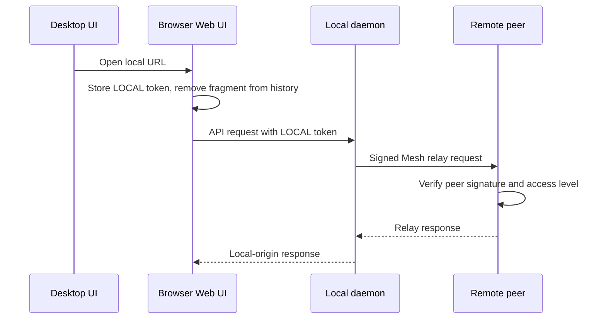

# Mesh Web UI discovery and secure open flow

This implemented design makes every reachable CodeTerm peer expose a predictable Web UI
affordance without distributing peer API tokens. It also removes the current delay
between changing a local Tailscale Serve route and seeing that change on other Mesh
nodes.

The design does not require a separately approved Tailscale Service such as
`svc:codeterm`. A normal node Serve route is sufficient when its HTTPS root is verified
to proxy to the correct CodeTerm daemon.

---

## 1. Goals

- Show `Web UI → Open` for the local daemon and every online paired peer.
- Keep the action visible but disabled for an offline or unreachable peer.
- Prefer verified Tailscale HTTPS whenever a direct endpoint is needed.
- Propagate Web UI endpoint changes immediately through signed Mesh announces.
- Open remote peers without revealing or copying their permanent API tokens.
- Keep endpoint discovery, button availability, and authentication as separate concerns.
- Replace timer-driven UI convergence with explicit Mesh state-change events.

## 2. Non-goals

- Creating or approving a Tailscale Service definition.
- Sharing a peer's permanent API token over Mesh.
- Making an unpaired machine visible or reachable.
- Treating a successful DNS lookup as proof that a URL serves the correct CodeTerm.
- Adding compatibility shims for older announce payloads.
- Adding Playwright coverage while Playwright is suspended.

## 3. Current behavior and gaps

### 3.1 Discovery is too narrow

`PeerAnnounce` currently carries one optional `https_url`. The sender populates it only
when `reconcile_web_serve` classifies a Tailscale Serve route as `Ready`. A peer with a
working Tailscale IP plus API port is reachable but has no advertised Web UI capability.

Relevant owners:

- `src-tauri/crates/codeterm-types/src/mesh/types.rs` — `PeerAnnounce` and `PairedPeer`.
- `src-tauri/crates/codeterm-mesh/src/broadcast.rs` — local endpoint refresh.
- `src-tauri/crates/codeterm-mesh/src/manager.rs` — announce construction and apply.
- `src/components/MeshPanel/useMeshData.ts` — frontend peer projection.

### 3.2 Serve mutations converge late

`enable_web_access` and `disable_web_access` mutate Tailscale Serve but do not update
`MeshManager.local_https_url`, broadcast a new announce, or emit `mesh-state-changed`.
The background address refresh eventually notices the change, so the UI can lag behind a
successful mutation.

### 3.3 Endpoint-only changes do not emit peer-state events

`apply_announce` stores `ann.https_url`, but its change result compares only addresses and
online state. If only the Web UI endpoint changes, the receiver returns `changed: false`
and emits no `mesh-state-changed` event.

### 3.4 Button availability was coupled to direct HTTPS

A direct HTTPS URL is not required to operate a remote CodeTerm. The existing Web mirror
already keeps the browser on its local daemon and sends remote API calls through the
signed Mesh relay. Button availability should therefore follow peer reachability, not the
presence of `https_url`.

---

## 4. Target user contract

| Card | Footer | Action |
|---|---|---|
| Local daemon healthy | `Web UI` + enabled `Open` | Open the best local entry URL with the local token. |
| Paired peer online | `Web UI` + enabled `Open` | Open the local entry URL with the local token and bootstrap the peer relay target. |
| Paired peer offline | `Web UI` + disabled `Open` | Explain via tooltip that the peer is offline. |
| Pair pending/unreachable | `Web UI` + disabled `Open` | Never guess an endpoint or token. |

The floating Web UI capsule remains the local Web UI status and configuration surface.
It is always a dropdown trigger. `Open Web UI`, `Copy URL`, and `Show QR code` are explicit
menu actions; clicking the status chip itself performs no navigation.

## 5. Endpoint announcement contract

Replace the scalar `https_url` with a typed Web UI capability:

```rust
pub struct WebUiAnnouncement {
    pub endpoints: Vec<WebUiEndpoint>,
}

pub enum WebUiEndpoint {
    TailscaleHttps { host: String, port: u16 },
    TailscaleHttp { ip: IpAddr, port: u16 },
    LanHttp { ip: IpAddr, port: u16 },
}
```

`PeerAnnounce` and `PairedPeer` gain `web_ui: Option<WebUiAnnouncement>` and delete
`https_url`. There is no compatibility field because the project has no external user
base and the checked-in rules explicitly allow breaking changes.

### 5.1 Ranking

The protocol carries a typed origin rather than an arbitrary URL string. Paths, query
parameters, fragments, and userinfo cannot enter the announce payload. The receiver
validates host/IP class and ranks endpoints rather than trusting sender order:

1. Verified `TailscaleHttps`.
2. Verified `TailscaleHttp` using the peer's Tailscale IP and API port.
3. Verified `LanHttp` using a private LAN address and API port.

Loopback is never announced. A Tailscale hostname with plain HTTP does not outrank a
verified Tailscale IP unless it is actually probed and represented as a distinct verified
endpoint.

### 5.2 Verification

An endpoint enters `WebUiAnnouncement` only after a bounded request to `/api/health`
confirms that it reaches the current daemon build. Tailscale HTTPS additionally requires
the Serve route root to proxy to this daemon's exact API port. There is no sender-supplied
`verified` boolean: membership in the capability is the producer's verified claim. DNS
presence, an occupied port, or a generic HTTP 200 is insufficient.

Probing and Tailscale subprocess work must run outside the Tauri async runtime. The
result is computed with `spawn_blocking`, then written into Mesh state after the blocking
work completes. No lock may survive across an await.

### 5.3 What is not announced

- API tokens, token hashes, or token-derived identifiers.
- Loopback URLs.
- Unverified hostnames.
- URLs belonging to the sibling dev/prod daemon.
- A Tailscale route that proxies another application.

The announce is authenticated with the existing Ed25519 Mesh signature. The receiver
still validates URL scheme, host class, and port before storing it; pairing establishes
identity, not permission to inject arbitrary browser URLs.

---

## 6. Secure open flow

The default remote-open path uses the local browser origin and the signed Mesh relay. It
does not navigate directly to the peer's advertised endpoint.



Security properties:

- The URL fragment is not sent in HTTP requests or referrer headers.
- `WebGate` consumes the fragment once and removes it from browser history immediately.
- The browser stores only the token for the daemon that served the page.
- The remote peer's permanent API token never leaves that peer.
- The remote peer authorizes the local daemon through the existing signed Mesh identity
  and applies its configured `AccessLevel`.
- Unpairing removes the public key and naturally invalidates future relay requests.

The relay must call the same access-policy function as normal peer-authenticated REST
requests before forwarding. A second, manually maintained list of sensitive routes is
not an acceptable authorization boundary.

### 6.1 Local open

The local card uses the best local browser entry URL:

1. Verified Tailscale HTTPS.
2. Tailscale IP plus API port.
3. Private LAN IP plus API port.
4. Loopback plus API port when opened from the desktop on the same machine.

The fragment contains the local API token and `relay=self`, which clears any previously
selected remote target.

### 6.2 Remote open

An online paired peer uses the same best local entry URL plus
`relay=<instance_id>`. The browser resolves the display name from the authenticated local
peer list. The peer's announced direct endpoint is useful for diagnostics and future
sharing flows, but it does not gate or authenticate the default `Open` action.

### 6.3 Direct remote links

Do not put a remote permanent token into a direct URL. If direct peer links become a real
requirement, add a separate one-time grant protocol:

- Minted by the remote daemon after a signed Mesh request.
- Single use, short expiry, bound to the requesting peer and intended origin.
- Scoped to Web UI bootstrap rather than general API bearer access.
- Invalidated immediately after exchange.

This is explicitly deferred. Relay is the simpler and safer default.

---

## 7. Event and state propagation

### 7.1 Shared publication operation

Introduce one backend operation that owns a Web UI capability transition:

1. Probe and build the new local `WebUiAnnouncement` outside the async runtime.
2. Compare it with the stored local announcement.
3. Update Mesh state under a short lock.
4. Drop the lock.
5. Broadcast the signed announce to paired peers.
6. Emit `mesh-state-changed` locally after the state is committed.

Call it after:

- startup readiness;
- local REST recovery;
- Mesh enable;
- explicit Mesh refresh;
- successful Web Access enable;
- successful Web Access disable;
- an observed address or verified endpoint change.

The operation must be idempotent. An unchanged capability emits and broadcasts nothing
unless an explicit full announce was requested.

### 7.2 Receiver change classification

Replace `apply_announce -> Option<Vec<PeerAddress>>` with an explicit result:

```rust
pub struct PeerAnnounceChange {
    pub addresses_changed: bool,
    pub online_changed: bool,
    pub web_ui_changed: bool,
}
```

Any true field persists state and emits `mesh-state-changed`. This prevents a Web UI-only
change from disappearing behind an unchanged address list.

### 7.3 Frontend refresh

`useMeshData` should load once and refresh on `mesh-state-changed`,
`service-health-changed`, and explicit user refresh. Remove its fixed five-second polling
interval. A bounded timeout may fail an event-driven request, but elapsed time must never
be treated as successful readiness.

---

## 8. Implementation order

### Phase 0 — risk-reduction refactors

These refactors are go/no-go gates. Do not add the new capability before they land.

1. **Unify peer authorization.** Extract `check_access` from `src/api/auth.rs` into a
   focused `src/api/access_policy.rs`. Both auth middleware and Mesh relay call the same
   function with the original authenticated peer's `AccessLevel`, method, and path.
   Delete `path_requires_full_access`. Default behavior stays deny unless the shared
   policy explicitly permits the operation for that access level.
2. **Split announce state out of `manager.rs`.** The file is already 1187 lines. Move
   `local_announce_addresses`, `build_announce`, `apply_announce`, announce change types,
   and their tests into `manager/announce.rs`. Keep `manager.rs` as the state facade.
3. **Split relay responsibilities.** The file is already 1111 lines. Move access-policy
   adaptation, streaming, asset proxying, and tests into focused `relay/` modules before
   changing the browser flow.
4. **Keep Serve discovery out of `serve_setup.rs`.** At 941 lines it has insufficient
   headroom for endpoint collection. Add `web_ui_endpoints.rs`; keep Serve mutation and
   parsing in their current owner until a separate split is justified.
5. **Introduce one publication seam.** A blocking refresh gate serializes probe/commit
   work, while an async announce gate serializes delivery and snapshots state only after
   acquiring the gate. `service/web_access.rs` owns explicit Serve mutations and awaits
   refresh, broadcast, and local event emission. Other lifecycle callers use the same
   guarded refresh and broadcast functions. This prevents an older probe or delivery
   from restoring stale Web UI state without adding timer-driven coordination.

### Phase 1 — data model and pure ranking

- Add `WebUiAnnouncement` and the typed `WebUiEndpoint` enum to
  `codeterm-types/src/mesh/types.rs`.
- Replace `https_url` on `PeerAnnounce` and `PairedPeer`.
- Add URL sanitization, deduplication, and deterministic ranking tests.
- Construct URLs only at the final local rendering/open boundary from typed origins.
- Update the TypeScript peer types in `src/lib/types.ts` and Mesh projections.

### Phase 2 — local capability collection

- Extract endpoint collection from `refresh_local_addresses` into a focused Web UI
  capability module.
- Reuse the existing Serve parser and build-matching health verification.
- Add verified Tailscale-IP and LAN candidates without announcing loopback.
- Keep subprocess/network work off the Tauri runtime.

### Phase 3 — immediate publication

- Convert `enable_web_access` and `disable_web_access` into async commands whose blocking
  mutation runs through `spawn_blocking`.
- After a successful mutation, call the publication service and await its signed
  broadcast.
- Update `apply_announce` to detect Web UI-only changes and emit the state event.

### Phase 4 — frontend availability and opening

- Derive card availability from local daemon health plus paired-peer online/reachability.
- Keep the footer on every card; disable only when the path cannot work.
- Continue using the authenticated local URL plus relay bootstrap for remote peers.
- Put only `relay=<instance_id>` in the bootstrap fragment. Resolve the display name from
  the authenticated local peer list instead of accepting `relay_name` from the URL.
- Use announced endpoints for display/diagnostics, not for remote bearer authentication.
- Replace polling in `useMeshData` with bridge events.

### Phase 5 — documentation and cleanup

- Update `docs/MESH.md` with the capability, ranking, and relay auth contract.
- Update `docs/API.md` for the new `PeerAnnounce` and paired-peer response shape.
- Delete stale `https_url` comments, tests, and frontend assumptions.
- Bump the revision tag in every changed document.

---

## 9. Test plan

### Rust unit tests

- Ranking prefers verified Tailscale HTTPS over every other endpoint.
- Invalid schemes, public LAN addresses, loopback, userinfo, and malformed URLs are
  rejected.
- A route for another API port/build is never announced as CodeTerm Web UI.
- `build_announce` omits Web UI capability while local HTTP is unhealthy.
- `apply_announce` reports `web_ui_changed` when addresses remain identical.
- Offline announce clears active endpoints.
- Enable and disable publish exactly one changed announce.
- No Mesh lock is held across broadcast or health-probe awaits.
- Auth middleware and relay produce identical decisions for every `AccessLevel` fixture.
- A `ReadOnly` relay cannot POST, PUT, PATCH, or DELETE any route.
- An `AgentIsolated` relay can reach only the operations granted by the shared policy.
- Concurrent publication intents cannot commit or deliver an older capability after a
  newer one.

Run focused Rust tests through `build.ps1 test-one app NAME`; do not invoke raw Cargo.

### TypeScript unit tests

- Every card renders the Web UI footer.
- Local and online paired cards enable `Open`.
- Offline/pending cards keep a disabled action.
- Local links contain the local token fragment and `relay=self`.
- Remote links contain the same local token and only the selected peer id.
- `WebGate` consumes token/relay bootstrap data and removes it from the visible URL.
- The floating capsule is only a dropdown trigger.
- The dropdown's Open and Copy actions use the same authenticated URL.
- Mesh data refreshes from explicit events without a fixed polling interval.

### Manual dev inspection

- Use one foreground dev instance on port 7686.
- Verify the running build before inspection.
- Enable Web Access and confirm peers receive the button without waiting for a timer.
- Move Serve from 443 to a fallback HTTPS port and confirm endpoint replacement.
- Disable Serve and confirm remote cards still open through local relay when the local
  browser entry falls back to Tailscale IP, LAN, or loopback as appropriate.
- Unpair a peer and confirm an already-open browser can no longer relay to it.

No Playwright run or new Playwright test is part of this plan.

---

## 10. Risk assessment and mitigations

### 10.1 Go/no-go risks

| ID | Risk | Severity | Likelihood without mitigation | Required mitigation |
|---|---|---:|---:|---|
| R1 | Relay authorization diverges from normal peer authorization. A write route omitted from `path_requires_full_access` can run after the loopback request authenticates as Local. | Critical | High | Phase 0 shared access-policy extraction; delete the duplicate sensitive-route list; matrix-test all access levels. |
| R2 | A local permanent token is appended to a remote-controlled or malformed origin. | Critical | Medium | Brand locally derived entry URLs separately from announced endpoints; only the local entry builder accepts a token; use typed announced origins with no path/query/fragment. |
| R3 | Concurrent refresh, liveness, config, and Serve mutations broadcast out of order, restoring stale endpoint state. | High | Medium | Serialized refresh commit and announce gates; explicit Serve mutations force a post-mutation refresh before their awaited broadcast. |
| R4 | New code pushes source files over the absolute 1200-line limit. | High | Certain | Split `manager.rs` and `relay.rs` before feature work; put endpoint collection in a new module. |
| R5 | Blocking Tailscale probes or HTTPS health checks starve the Tauri runtime and freeze all tabs. | High | High | Thin async commands plus `spawn_blocking`; cache the resulting capability; never probe from render or tab-switch paths. |

The implementation must stop if any R1–R5 mitigation is absent. These are structural
preconditions, not follow-up cleanup.

### 10.2 Protocol and state risks

| ID | Risk | Severity | Likelihood | Mitigation and detection |
|---|---|---:|---:|---|
| R6 | A paired peer announces a malicious browser destination. | High | Low | Typed endpoint enum, host/IP validation, bounded length, no arbitrary URL components, and no default navigation to remote endpoints. Property tests reject malformed origins. |
| R7 | A Web UI-only announce is persisted but does not wake the frontend. | Medium | High | Explicit `PeerAnnounceChange.web_ui_changed`; route test asserts event emission with unchanged addresses. |
| R8 | Removing polling leaves stale UI after a missed event or browser reconnect. | Medium | Medium | Initial snapshot on mount plus an explicit resync after event-stream reconnection; event cursors detect gaps. Never use elapsed time as successful reconciliation. |
| R9 | Prod and dev endpoints are confused on the same host. | High | Medium | Verify exact API port and expected build; include instance identity in health verification if `/api/health` exposes it. Reject sibling-port matches. |
| R10 | An offline/stale peer still appears openable. | Low | Medium | Derive enabled state from current paired reachability; relay failure returns a visible structured error and never silently falls back to an unverified direct URL. |
| R11 | Old announce data survives disable or offline transitions. | Medium | Medium | Offline and disable announcements explicitly carry an empty capability; receiver replacement is wholesale, not additive. Unit-test clearing. |
| R12 | A forged `relay_name` pollutes local storage/UI while the id targets another peer. | Medium | Medium | Remove `relay_name` from bootstrap links; resolve the authoritative name by peer id from the local daemon. |

### 10.3 Token and browser risks

| ID | Risk | Severity | Likelihood | Mitigation and detection |
|---|---|---:|---:|---|
| R13 | Token appears in server logs, referrers, screenshots, or browser history. | High | Low | Fragment only; never query; consume before app mount; immediately `replaceState` without fragment; redact URLs in diagnostics and UI subtitles. Test visible URL cleanup. |
| R14 | Browser extensions or same-origin compromised code read the local permanent token. | High | Low | Existing threat remains bounded to the local daemon. Keep plugin UI sandboxing and CSP intact. Future hardening may replace permanent fragment bootstrap with a local one-time exchange. |
| R15 | Remote permanent token is exposed to the local browser. | Critical | Low | Relay-only default; no token field in announce; no API that returns peer tokens; regression tests scan serialized peer payloads for token-shaped fields. |
| R16 | A stale relay target persists after unpair or an invalid bootstrap. | Medium | Medium | Validate the id against the fresh local peer list before storing it; clear on 404/unpaired and on every `relay=self` link. |

### 10.4 Operational risks

| ID | Risk | Severity | Likelihood | Mitigation and detection |
|---|---|---:|---:|---|
| R17 | Cross-platform Tailscale output differs and endpoint discovery silently disappears. | Medium | Medium | Keep the existing Windows/Linux JSON and macOS LocalAPI adapters; test shared normalized fixtures rather than shell output strings. |
| R18 | Publication failure is reported as Web UI setup failure even though Serve succeeded. | Medium | Medium | Return mutation and publication outcomes separately. UI says “Web UI enabled; Mesh announce failed” and offers explicit refresh instead of rolling back a working route. |
| R19 | Unpair races with an in-flight relay request. | Medium | Low | Recheck pairing at relay admission and rely on signed-request verification at the target; do not retry mutation requests after an authorization failure. |
| R20 | Event storms cause repeated probes and broadcasts. | Medium | Medium | Concurrent refresh requests capture a generation and coalesce behind the active refresh. Unchanged commits do not emit UI events. No debounce timer. |

### 10.5 Refactoring map

| Existing owner | Refactor | Risk reduced |
|---|---|---|
| `src/api/auth.rs` + `mesh_routes/relay.rs` | Shared `access_policy.rs` | R1, R19 |
| `codeterm-mesh/src/manager.rs` | `manager/announce.rs` | R3, R4, R7, R11 |
| `src/api/mesh_routes/relay.rs` | `relay/access.rs`, `relay/stream.rs`, `relay/assets.rs`, `relay/tests.rs` | R1, R4, R15 |
| `codeterm-mesh/src/serve_setup.rs` | New sibling `web_ui_endpoints.rs` | R2, R4, R5, R9, R17 |
| Refresh and announce call sites | guarded functions in `broadcast.rs`; explicit Serve mutations in `service/web_access.rs` | R3, R5, R8, R18, R20 |
| String URL helpers | `LocalWebEntry` and typed `WebUiEndpoint` builders | R2, R6, R9, R13 |
| Fragment-provided peer name | Authoritative lookup by peer id | R12, R16 |

---

## 11. Acceptance criteria

- A normal verified Tailscale node Serve route appears without `svc:codeterm`.
- Changing Serve configuration updates all online peers immediately through a signed
  announce.
- An online paired peer always has an enabled `Open` action even when it advertises no
  direct HTTPS URL.
- Opening a remote peer exposes no remote permanent API token to the browser.
- Relay and normal REST authorization return identical decisions for the same peer,
  access level, method, and path.
- Disabling/unpairing removes access without waiting for polling.
- The frontend has no timer-driven Mesh convergence path.
- No token-bearing link can be constructed from a remotely announced endpoint type.
- `manager.rs`, `relay.rs`, and every new source file remain below 1200 lines.
- All focused Rust and TypeScript tests pass, and source-size limits remain satisfied.

<!-- revision: 3 -->
