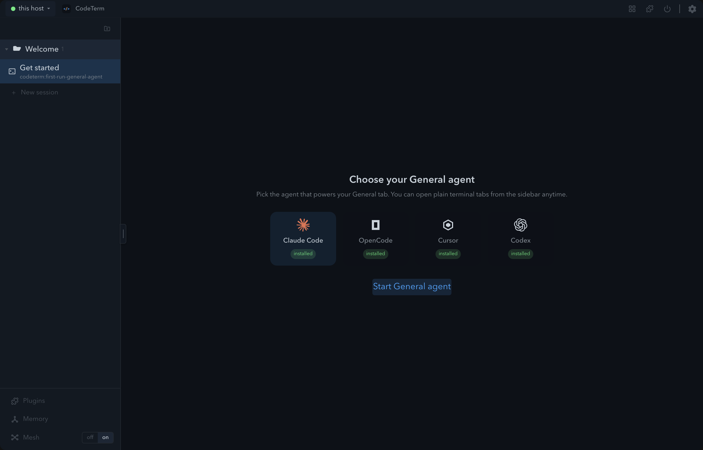
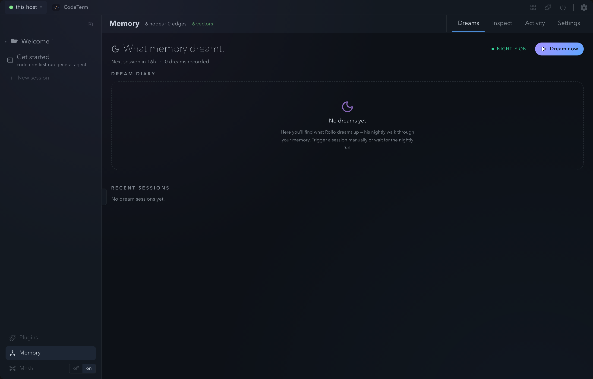
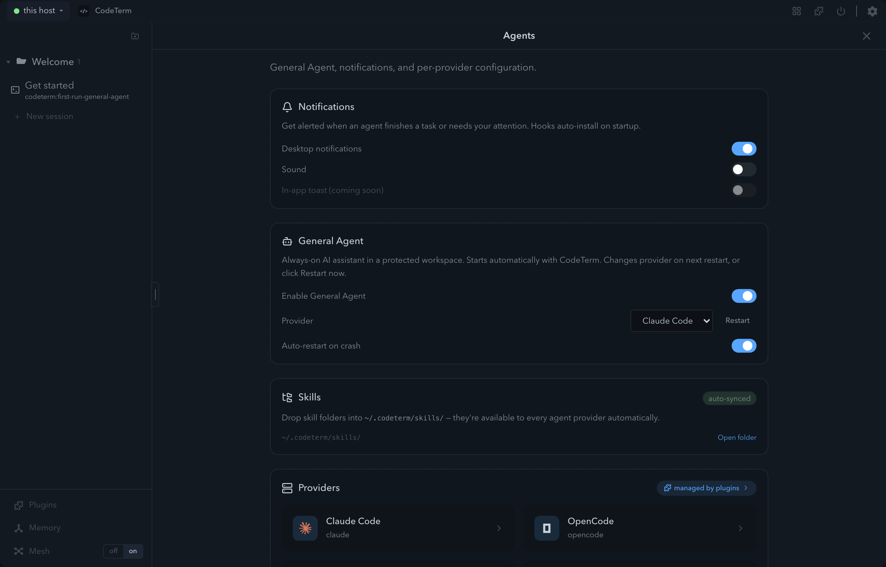
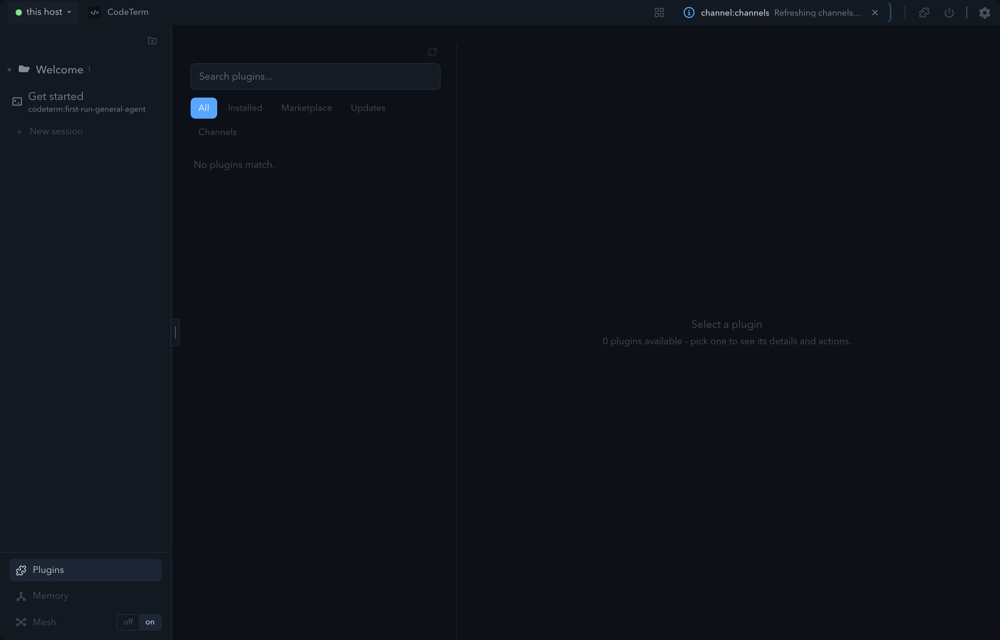
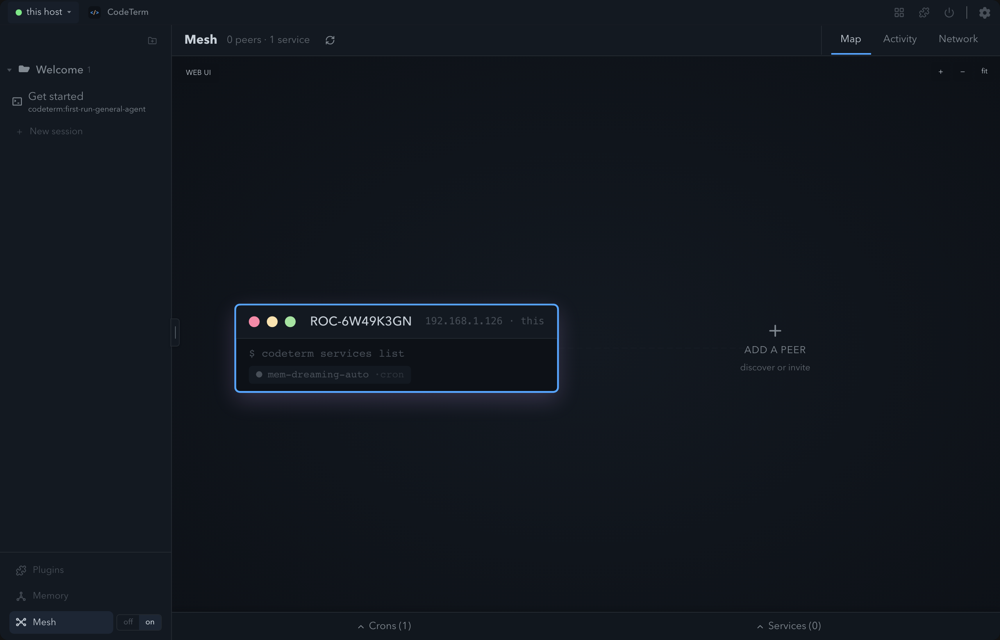

<!-- revision: 1 -->
# Design audit — interactive-primitive inventory & migration table

**Scope:** every `<button>`, `<input>`, `<select>`, `<textarea>` under `src/components/` (excluding `*.test.tsx`), plus a supplementary chip/badge/card sweep. One row per usage. Generated mechanically from source, then hand-annotated — see `Reconciliation` for the grep-vs-table proof.

**Raw data** (for the sibling token-migration tasks): `design-audit-data/inventory.csv` (510 tag rows: dir,file,line,element,className,class,inlineStyle) and `design-audit-data/chips.csv` (div/span chip+card sweep). **Atlas:** `design-audit-atlas/` (10 PNGs, live dev 7705).

## Shared primitive surface (class **a** target)

Defined in `src/components/shared/design.ts` + `src/styles/globals.css`:

- **Buttons** — `UI_BUTTON.{base,primary,ghost,accent,compact,danger,icon,sm,lg}` → `ct-btn*`; `UI_TRAY_BTN` (titlebar tray).
- **Inputs** — `UI_INPUT.{base,compact,mono,select,full,fullCompact,fullMono}` → `ct-input*`.
- **Select/menu** — `shared/DropdownMenu.tsx` (`DropdownMenu`, `DropdownSelect`), `shared/Segmented.tsx` (pill switch).
- **Pill/badge** — `UI_TABL.smallPill` → `ct-small-pill`; `ct-kbd`.
- **Card/tabl** — `UI_TABL.{card,cardSoft}` → `ct-tabl-card`; `ct-toolbar`, `ct-tabl-tab` (`tabClass`).

## Classification legend

- **(a) shared** — uses a `UI_*` token / `ct-*` class (directly or via a hoisted `const … = UI_BUTTON.x` class string).
- **(b) bespoke duplicate** — re-implements a primitive the tokens already cover (inline `style={}`, ad-hoc Tailwind). **Default class.**
- **(c) genuinely custom** — needs a stated reason. Here only native form controls (`checkbox/radio/range/color/file`) that are intentionally left unstyled qualify (`c-native`); every other bespoke case defaults to (b).

## Totals

| Class | Count |
|---|---|
| (a) shared | 84 |
| (b) bespoke duplicate | 412 |
| (c-native) intentional native control | 14 |
| **Total tag usages** | **510** |

`<button>`=393, `<input>`=79, `<select>`=25, `<textarea>`=13. Only **84/510 (16%)** of primitives use the shared tokens.

## Migration table (one row per usage)

`class`: a=shared · b=bespoke duplicate · cN=intentional native. `~` in file col = repeated file.

### (root)  — 5 usages (a=0, b=5, cN=0)

| file:line | el | class | className / style | target primitive | risk |
|---|---|---|---|---|---|
| CrashReportToast.tsx:59 | button | **b** | "mt-1.5 inline-flex items-center gap-1 text-[10px] px-2 p… | UI_BUTTON.{ghost/primary/accent} | low — plain bespoke button |
| ~:72 | button | **b** | "shrink-0 text-[var(--ct-muted)] hover:text-[var(--ct-fg)… | UI_BUTTON.{ghost/primary/accent} | low — plain bespoke button |
| StaleBuildBanner.tsx:51 | button | **b** | "shrink-0 text-[var(--ct-muted)] hover:text-[var(--ct-fg)… | UI_BUTTON.{ghost/primary/accent} | low — plain bespoke button |
| UpdateBadge.tsx:10 | button | **b** | "group inline-flex items-center gap-1 h-[22px] shrink-0 r… | Chip/Toggle or UI_BUTTON pill variant (GAP) | med — pill button, no shared pill-button token |
| UpdateProgressLayer.tsx:53 | button | **b** | "flex h-6 w-6 shrink-0 items-center justify-center rounde… | UI_BUTTON.{ghost/primary/accent} | low — plain bespoke button |

### AgentPicker  — 4 usages (a=3, b=1, cN=0)

| file:line | el | class | className / style | target primitive | risk |
|---|---|---|---|---|---|
| AgentProviderPicker.tsx:110 | button | a | {UI_BUTTON.accent} | ✓ shared | none — already tokenised |
| ProviderCard.tsx:22 | button | **b** | {[         "flex flex-col items-center gap-2 rounded-xl b… | UI_BUTTON.{ghost/primary/accent} | low — bespoke radius/padding, maps to ct-btn |
| ~:95 | button | a | {UI_BUTTON.ghost} | ✓ shared | none — already tokenised |
| ~:99 | button | a | {UI_BUTTON.accent} | ✓ shared | none — already tokenised |

### AgentRun  — 6 usages (a=0, b=6, cN=0)

| file:line | el | class | className / style | target primitive | risk |
|---|---|---|---|---|---|
| AgentRunLogPopup.tsx:122 | button | **b** | "bg-transparent border-0 text-[var(--ct-muted-fg)] cursor… | UI_BUTTON.{ghost/primary/accent} | low — plain bespoke button |
| ~:163 | button | **b** | "bg-transparent border-0 text-[10px] text-[var(--ct-muted… | UI_BUTTON.{ghost/primary/accent} | low — plain bespoke button |
| EventRenderer.tsx:143 | button | **b** | "bg-transparent border-0 text-left text-[var(--ct-muted-f… | UI_BUTTON.{ghost/primary/accent} | low — plain bespoke button |
| ~:170 | button | **b** | "bg-transparent border-0 text-left cursor-pointer flex it… | UI_BUTTON.{ghost/primary/accent} | low — plain bespoke button |
| ~:209 | button | **b** | "bg-transparent border-0 text-left cursor-pointer flex it… | UI_BUTTON.{ghost/primary/accent} | low — plain bespoke button |
| RunChatPopup.tsx:118 | button | **b** | "bg-transparent border-0 text-[var(--ct-muted-fg)] cursor… | UI_BUTTON.{ghost/primary/accent} | low — plain bespoke button |

### Canvas  — 27 usages (a=1, b=25, cN=1)

| file:line | el | class | className / style | target primitive | risk |
|---|---|---|---|---|---|
| CanvasButton.tsx:11 | button | a | {`${UI_TRAY_BTN} ${active ? "text-[var(--ct-accent)]" : "… | ✓ shared | none — already tokenised |
| CanvasDebugTabl.tsx:101 | button | **b** | `style={}` | UI_BUTTON.icon / .ghost (or Segmented if toggle) | med — inline style{} sets own geometry/radius; visual drift from ct-btn |
| ~:127 | select | **b** | `style={}` | UI_INPUT.select or DropdownSelect | med — native select; DropdownSelect avoids canvas flicker |
| ~:154 | input | cN | — | native native | low — add styled variant only if visual parity wanted |
| ~:166 | input | **b** | — | UI_INPUT.* | low — bespoke border/bg, maps to ct-input |
| ~:186 | button | **b** | `style={}` | UI_BUTTON.icon / .ghost (or Segmented if toggle) | med — inline style{} sets own geometry/radius; visual drift from ct-btn |
| ~:202 | button | **b** | `style={}` | UI_BUTTON.icon / .ghost (or Segmented if toggle) | med — inline style{} sets own geometry/radius; visual drift from ct-btn |
| CanvasEmptyActions.tsx:38 | button | **b** | "inline-flex items-center gap-2 rounded border px-4 py-2 … | UI_BUTTON.{ghost/primary/accent} | low — plain bespoke button |
| CanvasPresenceLayer.tsx:78 | button | **b** | `style={}` | UI_BUTTON.icon / .ghost (or Segmented if toggle) | med — inline style{} sets own geometry/radius; visual drift from ct-btn |
| CanvasSwarmCluster.tsx:49 | button | **b** | `style={}` | UI_BUTTON.icon / .ghost (or Segmented if toggle) | med — inline style{} sets own geometry/radius; visual drift from ct-btn |
| ~:82 | button | **b** | `style={}` | UI_BUTTON.icon / .ghost (or Segmented if toggle) | med — inline style{} sets own geometry/radius; visual drift from ct-btn |
| ~:201 | button | **b** | `style={}` | UI_BUTTON.icon / .ghost (or Segmented if toggle) | med — inline style{} sets own geometry/radius; visual drift from ct-btn |
| CanvasTagLegend.tsx:41 | button | **b** | `style={}` | UI_BUTTON.icon / .ghost (or Segmented if toggle) | med — inline style{} sets own geometry/radius; visual drift from ct-btn |
| CanvasToolbar.tsx:57 | button | **b** | `style={}` | UI_BUTTON.icon / .ghost (or Segmented if toggle) | med — inline style{} sets own geometry/radius; visual drift from ct-btn |
| ~:63 | button | **b** | `style={}` | UI_BUTTON.icon / .ghost (or Segmented if toggle) | med — inline style{} sets own geometry/radius; visual drift from ct-btn |
| ~:66 | button | **b** | `style={}` | UI_BUTTON.icon / .ghost (or Segmented if toggle) | med — inline style{} sets own geometry/radius; visual drift from ct-btn |
| ~:69 | button | **b** | `style={}` | UI_BUTTON.icon / .ghost (or Segmented if toggle) | med — inline style{} sets own geometry/radius; visual drift from ct-btn |
| ~:75 | button | **b** | `style={}` | UI_BUTTON.icon / .ghost (or Segmented if toggle) | med — inline style{} sets own geometry/radius; visual drift from ct-btn |
| ~:78 | button | **b** | `style={}` | UI_BUTTON.icon / .ghost (or Segmented if toggle) | med — inline style{} sets own geometry/radius; visual drift from ct-btn |
| ~:81 | button | **b** | `style={}` | UI_BUTTON.icon / .ghost (or Segmented if toggle) | med — inline style{} sets own geometry/radius; visual drift from ct-btn |
| CanvasUnownedTray.tsx:75 | button | **b** | "w-full px-3 py-2 text-left cursor-pointer" | UI_BUTTON.{ghost/primary/accent} | low — plain bespoke button |
| ~:96 | button | **b** | "shrink-0 rounded border px-2 py-0.5 text-xs cursor-point… | UI_BUTTON.{ghost/primary/accent} | low — plain bespoke button |
| CanvasView.tsx:705 | button | **b** | "absolute top-2 right-2 z-20 flex h-7 w-7 items-center ju… | UI_BUTTON.{ghost/primary/accent} | low — plain bespoke button |
| ~:797 | button | **b** | "ct-canvas-edge-marker" | UI_BUTTON.{ghost/primary/accent} | low — plain bespoke button |
| FlyToActiveControl.tsx:22 | button | **b** | {`ct-fly-to-active${entry.stale ? " ct-fly-to-active-stal… | UI_BUTTON.{ghost/primary/accent} | low — plain bespoke button |
| PlanButton.tsx:69 | button | **b** | {`flex shrink-0 items-center gap-1 rounded border px-2 te… | UI_BUTTON.{ghost/primary/accent} | low — plain bespoke button |
| PlanViewShell.tsx:71 | button | **b** | "flex h-7 w-7 shrink-0 items-center justify-center rounde… | UI_BUTTON.{ghost/primary/accent} | low — plain bespoke button |

### Canvas/canvasRender  — 4 usages (a=0, b=4, cN=0)

| file:line | el | class | className / style | target primitive | risk |
|---|---|---|---|---|---|
| DetailContent.tsx:76 | button | **b** | `style={}` | UI_BUTTON.icon / .ghost (or Segmented if toggle) | med — inline style{} sets own geometry/radius; visual drift from ct-btn |
| ~:127 | button | **b** | `style={}` | UI_BUTTON.icon / .ghost (or Segmented if toggle) | med — inline style{} sets own geometry/radius; visual drift from ct-btn |
| ~:183 | button | **b** | `style={}` | UI_BUTTON.icon / .ghost (or Segmented if toggle) | med — inline style{} sets own geometry/radius; visual drift from ct-btn |
| ~:326 | button | **b** | `style={}` | UI_BUTTON.icon / .ghost (or Segmented if toggle) | med — inline style{} sets own geometry/radius; visual drift from ct-btn |

### Canvas/missionControl  — 6 usages (a=0, b=6, cN=0)

| file:line | el | class | className / style | target primitive | risk |
|---|---|---|---|---|---|
| MissionControlLiveView.tsx:155 | button | **b** | "mc-pill" | UI_BUTTON.{ghost/primary/accent} | low — plain bespoke button |
| ~:159 | button | **b** | "mc-pill" | UI_BUTTON.{ghost/primary/accent} | low — plain bespoke button |
| ~:165 | button | **b** | "mc-pill" | UI_BUTTON.{ghost/primary/accent} | low — plain bespoke button |
| ~:168 | button | **b** | "mc-pill" | UI_BUTTON.{ghost/primary/accent} | low — plain bespoke button |
| MissionControlPrototype.tsx:31 | button | **b** | "mc-pill" | UI_BUTTON.{ghost/primary/accent} | low — plain bespoke button |
| ~:46 | button | **b** | "mc-pill" | UI_BUTTON.{ghost/primary/accent} | low — plain bespoke button |

### Canvas/planView  — 37 usages (a=0, b=37, cN=0)

| file:line | el | class | className / style | target primitive | risk |
|---|---|---|---|---|---|
| ActiveWorkStrip.tsx:24 | button | **b** | {`active-work-strip-row${entry.stale ? " active-work-stri… | UI_BUTTON.{ghost/primary/accent} | low — plain bespoke button |
| CancelledTasksTabl.tsx:18 | button | **b** | "plan-cancelled-task-row plan-task-selectable" | UI_BUTTON.{ghost/primary/accent} | low — plain bespoke button |
| PlanBoardView.tsx:108 | button | **b** | "plan-board-done-toggle" | UI_BUTTON.{ghost/primary/accent} | low — plain bespoke button |
| ~:118 | button | **b** | "plan-board-done-toggle" | UI_BUTTON.{ghost/primary/accent} | low — plain bespoke button |
| ~:182 | button | **b** | "plan-board-cancelled-note plan-board-cancelled-trigger" | UI_BUTTON.{ghost/primary/accent} | low — plain bespoke button |
| PlanCompanionBubble.tsx:139 | button | **b** | "flex h-6 w-6 shrink-0 items-center justify-center rounde… | UI_BUTTON.{ghost/primary/accent} | low — plain bespoke button |
| ~:150 | button | **b** | "flex h-6 w-6 shrink-0 items-center justify-center rounde… | UI_BUTTON.{ghost/primary/accent} | low — plain bespoke button |
| ~:166 | button | **b** | "pointer-events-auto relative flex items-center justify-c… | Chip/Toggle or UI_BUTTON pill variant (GAP) | med — pill button, no shared pill-button token |
| PlanContextHeader.tsx:55 | button | **b** | "plan-context-compact-bar" | UI_BUTTON.{ghost/primary/accent} | low — plain bespoke button |
| ~:149 | button | **b** | "plan-context-header-plan-trigger" | UI_BUTTON.{ghost/primary/accent} | low — plain bespoke button |
| ~:163 | button | **b** | "plan-context-header-spec-trigger" | UI_BUTTON.{ghost/primary/accent} | low — plain bespoke button |
| ~:218 | button | **b** | {`plan-context-chip plan-peer-chip plan-peer-chip-${role}`} | UI_BUTTON.{ghost/primary/accent} | low — plain bespoke button |
| PlanDetailOverlay.tsx:218 | button | **b** | `style={}` | UI_BUTTON.icon / .ghost (or Segmented if toggle) | med — inline style{} sets own geometry/radius; visual drift from ct-btn |
| ~:238 | button | **b** | `style={}` | UI_BUTTON.icon / .ghost (or Segmented if toggle) | med — inline style{} sets own geometry/radius; visual drift from ct-btn |
| PlanFetchErrorState.tsx:38 | button | **b** | "rounded border px-3 py-1 text-xs cursor-pointer" | UI_BUTTON.{ghost/primary/accent} | low — plain bespoke button |
| PlanListFilterBar.tsx:33 | button | **b** | "rounded px-2 py-0.5 text-[10px] font-medium tracking-wid… | UI_BUTTON.{ghost/primary/accent} | low — plain bespoke button |
| ~:51 | button | **b** | "rounded px-2 py-0.5 text-[10px] font-medium tracking-wid… | UI_BUTTON.{ghost/primary/accent} | low — plain bespoke button |
| ~:67 | input | **b** | "min-w-[8rem] flex-1 rounded border px-2 py-0.5 text-[11p… | UI_INPUT.* | low — bespoke border/bg, maps to ct-input |
| PlanListRowView.tsx:40 | button | **b** | "plan-list-rollup" | UI_BUTTON.{ghost/primary/accent} | low — plain bespoke button |
| ~:57 | button | **b** | "plan-list-group" | UI_BUTTON.{ghost/primary/accent} | low — plain bespoke button |
| ~:131 | button | **b** | "plan-list-belonging-chip" | UI_BUTTON.{ghost/primary/accent} | low — plain bespoke button |
| PlanListView.tsx:278 | button | **b** | "absolute top-2 right-2 z-20 flex h-7 w-7 items-center ju… | UI_BUTTON.{ghost/primary/accent} | low — plain bespoke button |
| PlanSkillsSection.tsx:40 | button | **b** | {`plan-skill-row${selected ? " is-selected" : ""}`} | UI_BUTTON.{ghost/primary/accent} | low — plain bespoke button |
| PlanSwitcher.tsx:108 | button | **b** | "plan-switcher-menu-item" | UI_BUTTON.{ghost/primary/accent} | low — plain bespoke button |
| ~:116 | button | **b** | "plan-switcher-menu-item" | UI_BUTTON.{ghost/primary/accent} | low — plain bespoke button |
| ~:125 | button | **b** | "plan-switcher-menu-item" | UI_BUTTON.{ghost/primary/accent} | low — plain bespoke button |
| ~:138 | button | **b** | "plan-switcher-menu-item" | UI_BUTTON.{ghost/primary/accent} | low — plain bespoke button |
| ~:147 | button | **b** | "plan-switcher-menu-item plan-switcher-menu-item-danger" | UI_BUTTON.{ghost/primary/accent} | low — plain bespoke button |
| ~:172 | button | **b** | "plan-switcher-kebab" | UI_BUTTON.{ghost/primary/accent} | low — plain bespoke button |
| ~:241 | button | **b** | {`plan-board-switcher-btn${selected ? " plan-board-switch… | UI_BUTTON.{ghost/primary/accent} | low — plain bespoke button |
| ~:291 | button | **b** | "plan-switcher-archived-toggle" | UI_BUTTON.{ghost/primary/accent} | low — plain bespoke button |
| ~:404 | button | **b** | "plan-switcher-opt-select" | UI_BUTTON.{ghost/primary/accent} | low — plain bespoke button |
| ~:437 | button | **b** | "plan-switcher-combo-trigger" | UI_BUTTON.{ghost/primary/accent} | low — plain bespoke button |
| TaskActivityTimeline.tsx:138 | button | **b** | "plan-task-activity-show-all" | UI_BUTTON.{ghost/primary/accent} | low — plain bespoke button |
| ~:148 | button | **b** | "plan-task-activity-show-all" | UI_BUTTON.{ghost/primary/accent} | low — plain bespoke button |
| attachments.tsx:33 | button | **b** | `style={}` | UI_BUTTON.icon / .ghost (or Segmented if toggle) | med — inline style{} sets own geometry/radius; visual drift from ct-btn |
| ~:45 | button | **b** | `style={}` | UI_BUTTON.icon / .ghost (or Segmented if toggle) | med — inline style{} sets own geometry/radius; visual drift from ct-btn |

### ChatView  — 7 usages (a=0, b=7, cN=0)

| file:line | el | class | className / style | target primitive | risk |
|---|---|---|---|---|---|
| ChatView.tsx:420 | button | **b** | "text-[10px] px-3 py-1 rounded-md transition-colors" | UI_BUTTON.{ghost/primary/accent} | low — bespoke radius/padding, maps to ct-btn |
| ~:459 | button | **b** | "px-3 py-1.5 rounded-md text-xs font-medium transition-co… | UI_BUTTON.{ghost/primary/accent} | low — bespoke radius/padding, maps to ct-btn |
| ~:522 | button | **b** | "absolute -top-2 -right-2 w-5 h-5 rounded-full flex items… | Chip/Toggle or UI_BUTTON pill variant (GAP) | med — pill button, no shared pill-button token |
| ~:536 | button | **b** | "w-full flex items-center justify-center gap-1 py-1 text-… | UI_BUTTON.{ghost/primary/accent} | low — plain bespoke button |
| ~:547 | button | **b** | "w-full flex items-center justify-center gap-1 py-1 text-… | UI_BUTTON.{ghost/primary/accent} | low — plain bespoke button |
| ~:566 | textarea | **b** | "block flex-1 self-center bg-transparent border-none outl… | UI_INPUT.* | low — bespoke border/bg, maps to ct-input |
| ~:602 | button | **b** | {`flex items-center justify-center w-7 h-7 rounded-md tra… | UI_BUTTON.{ghost/primary/accent} | low — bespoke radius/padding, maps to ct-btn |

### CommandPalette  — 2 usages (a=0, b=2, cN=0)

| file:line | el | class | className / style | target primitive | risk |
|---|---|---|---|---|---|
| CommandPalette.tsx:256 | input | **b** | `style={}` | UI_INPUT.* | low — bespoke border/bg, maps to ct-input |
| ~:339 | button | **b** | `style={}` | UI_BUTTON.icon / .ghost (or Segmented if toggle) | med — inline style{} sets own geometry/radius; visual drift from ct-btn |

### Extensions  — 57 usages (a=0, b=55, cN=2)

| file:line | el | class | className / style | target primitive | risk |
|---|---|---|---|---|---|
| ChannelManager.tsx:64 | button | **b** | `style={}` | UI_BUTTON.icon / .ghost (or Segmented if toggle) | med — inline style{} sets own geometry/radius; visual drift from ct-btn |
| ~:93 | button | **b** | `style={}` | UI_BUTTON.icon / .ghost (or Segmented if toggle) | med — inline style{} sets own geometry/radius; visual drift from ct-btn |
| ~:118 | input | **b** | `style={}` | UI_INPUT.* | low — bespoke border/bg, maps to ct-input |
| ~:125 | input | **b** | `style={}` | UI_INPUT.* | low — bespoke border/bg, maps to ct-input |
| ~:127 | button | **b** | `style={}` | UI_BUTTON.icon / .ghost (or Segmented if toggle) | med — inline style{} sets own geometry/radius; visual drift from ct-btn |
| ~:142 | button | **b** | `style={}` | UI_BUTTON.icon / .ghost (or Segmented if toggle) | med — inline style{} sets own geometry/radius; visual drift from ct-btn |
| ChatModelBubble.tsx:91 | button | **b** | "ct-chat-model-bubble inline-flex h-7 items-center gap-1 … | Chip/Toggle or UI_BUTTON pill variant (GAP) | med — pill button, no shared pill-button token |
| ~:123 | button | **b** | "w-full grid grid-cols-[0.75rem_minmax(0,1fr)] gap-2 roun… | UI_BUTTON.{ghost/primary/accent} | low — plain bespoke button |
| ChatPreprocessorPresetManager.tsx:190 | button | **b** | `style={}` | UI_BUTTON.icon / .ghost (or Segmented if toggle) | med — inline style{} sets own geometry/radius; visual drift from ct-btn |
| ~:231 | button | **b** | `style={}` | UI_BUTTON.icon / .ghost (or Segmented if toggle) | med — inline style{} sets own geometry/radius; visual drift from ct-btn |
| ~:310 | input | **b** | `style={}` | UI_INPUT.* | low — bespoke border/bg, maps to ct-input |
| ~:321 | select | **b** | `style={}` | UI_INPUT.select or DropdownSelect | med — native select; DropdownSelect avoids canvas flicker |
| ~:334 | input | **b** | `style={}` | UI_INPUT.* | low — bespoke border/bg, maps to ct-input |
| ~:349 | textarea | **b** | `style={}` | UI_INPUT.* | low — bespoke border/bg, maps to ct-input |
| ~:371 | textarea | **b** | `style={}` | UI_INPUT.* | low — bespoke border/bg, maps to ct-input |
| ~:393 | button | **b** | `style={}` | UI_BUTTON.icon / .ghost (or Segmented if toggle) | med — inline style{} sets own geometry/radius; visual drift from ct-btn |
| ~:402 | button | **b** | `style={}` | UI_BUTTON.icon / .ghost (or Segmented if toggle) | med — inline style{} sets own geometry/radius; visual drift from ct-btn |
| ~:412 | button | **b** | `style={}` | UI_BUTTON.icon / .ghost (or Segmented if toggle) | med — inline style{} sets own geometry/radius; visual drift from ct-btn |
| ChatPresetBubble.tsx:60 | button | **b** | "ct-chat-preset-bubble inline-flex h-7 items-center gap-1… | Chip/Toggle or UI_BUTTON pill variant (GAP) | med — pill button, no shared pill-button token |
| ~:92 | button | **b** | "w-full grid grid-cols-[0.75rem_minmax(0,1fr)] gap-2 roun… | UI_BUTTON.{ghost/primary/accent} | low — plain bespoke button |
| ConfirmDialog.tsx:61 | button | **b** | `style={}` | UI_BUTTON.icon / .ghost (or Segmented if toggle) | med — inline style{} sets own geometry/radius; visual drift from ct-btn |
| ~:77 | button | **b** | `style={}` | UI_BUTTON.icon / .ghost (or Segmented if toggle) | med — inline style{} sets own geometry/radius; visual drift from ct-btn |
| ExtensionsView.tsx:254 | button | **b** | `style={}` | UI_BUTTON.icon / .ghost (or Segmented if toggle) | med — inline style{} sets own geometry/radius; visual drift from ct-btn |
| ~:457 | button | **b** | `style={}` | UI_BUTTON.icon / .ghost (or Segmented if toggle) | med — inline style{} sets own geometry/radius; visual drift from ct-btn |
| ~:479 | input | **b** | `style={}` | UI_INPUT.* | low — bespoke border/bg, maps to ct-input |
| ~:480 | input | **b** | `style={}` | UI_INPUT.* | low — bespoke border/bg, maps to ct-input |
| ~:482 | button | **b** | `style={}` | UI_BUTTON.icon / .ghost (or Segmented if toggle) | med — inline style{} sets own geometry/radius; visual drift from ct-btn |
| ~:490 | button | **b** | `style={}` | UI_BUTTON.icon / .ghost (or Segmented if toggle) | med — inline style{} sets own geometry/radius; visual drift from ct-btn |
| GlancePopover.tsx:132 | button | **b** | `style={}` | UI_BUTTON.icon / .ghost (or Segmented if toggle) | med — inline style{} sets own geometry/radius; visual drift from ct-btn |
| InstallGrantDialog.tsx:157 | button | **b** | `style={}` | UI_BUTTON.icon / .ghost (or Segmented if toggle) | med — inline style{} sets own geometry/radius; visual drift from ct-btn |
| ~:172 | button | **b** | `style={}` | UI_BUTTON.icon / .ghost (or Segmented if toggle) | med — inline style{} sets own geometry/radius; visual drift from ct-btn |
| PluginBubbles.tsx:123 | button | **b** | `style={}` | UI_BUTTON.icon / .ghost (or Segmented if toggle) | med — inline style{} sets own geometry/radius; visual drift from ct-btn |
| PluginDetailTabl.tsx:121 | button | **b** | `style={}` | UI_BUTTON.icon / .ghost (or Segmented if toggle) | med — inline style{} sets own geometry/radius; visual drift from ct-btn |
| ~:133 | button | **b** | `style={}` | UI_BUTTON.icon / .ghost (or Segmented if toggle) | med — inline style{} sets own geometry/radius; visual drift from ct-btn |
| ~:173 | input | cN | — | native native | low — add styled variant only if visual parity wanted |
| ~:182 | button | **b** | `style={}` | UI_BUTTON.icon / .ghost (or Segmented if toggle) | med — inline style{} sets own geometry/radius; visual drift from ct-btn |
| ~:193 | button | **b** | `style={}` | UI_BUTTON.icon / .ghost (or Segmented if toggle) | med — inline style{} sets own geometry/radius; visual drift from ct-btn |
| ~:231 | button | **b** | `style={}` | UI_BUTTON.icon / .ghost (or Segmented if toggle) | med — inline style{} sets own geometry/radius; visual drift from ct-btn |
| ~:251 | button | **b** | `style={}` | UI_BUTTON.icon / .ghost (or Segmented if toggle) | med — inline style{} sets own geometry/radius; visual drift from ct-btn |
| PluginList.tsx:77 | input | **b** | `style={}` | UI_INPUT.* | low — bespoke border/bg, maps to ct-input |
| ~:97 | button | **b** | `style={}` | UI_BUTTON.icon / .ghost (or Segmented if toggle) | med — inline style{} sets own geometry/radius; visual drift from ct-btn |
| ~:132 | button | **b** | `style={}` | UI_BUTTON.icon / .ghost (or Segmented if toggle) | med — inline style{} sets own geometry/radius; visual drift from ct-btn |
| ~:171 | button | **b** | `style={}` | UI_BUTTON.icon / .ghost (or Segmented if toggle) | med — inline style{} sets own geometry/radius; visual drift from ct-btn |
| ~:259 | button | **b** | `style={}` | UI_BUTTON.icon / .ghost (or Segmented if toggle) | med — inline style{} sets own geometry/radius; visual drift from ct-btn |
| ~:402 | button | **b** | `style={}` | UI_BUTTON.icon / .ghost (or Segmented if toggle) | med — inline style{} sets own geometry/radius; visual drift from ct-btn |
| PresetManager.tsx:118 | button | **b** | `style={}` | UI_BUTTON.icon / .ghost (or Segmented if toggle) | med — inline style{} sets own geometry/radius; visual drift from ct-btn |
| ~:144 | button | **b** | `style={}` | UI_BUTTON.icon / .ghost (or Segmented if toggle) | med — inline style{} sets own geometry/radius; visual drift from ct-btn |
| ~:198 | input | **b** | `style={}` | UI_INPUT.* | low — bespoke border/bg, maps to ct-input |
| ~:208 | textarea | **b** | `style={}` | UI_INPUT.* | low — bespoke border/bg, maps to ct-input |
| ~:220 | select | **b** | `style={}` | UI_INPUT.select or DropdownSelect | med — native select; DropdownSelect avoids canvas flicker |
| ~:235 | input | **b** | `style={}` | UI_INPUT.* | low — bespoke border/bg, maps to ct-input |
| ~:250 | button | **b** | `style={}` | UI_BUTTON.icon / .ghost (or Segmented if toggle) | med — inline style{} sets own geometry/radius; visual drift from ct-btn |
| ~:263 | button | **b** | `style={}` | UI_BUTTON.icon / .ghost (or Segmented if toggle) | med — inline style{} sets own geometry/radius; visual drift from ct-btn |
| SecretBackendDetail.tsx:177 | input | cN | `style={}` | native native | low — add styled variant only if visual parity wanted |
| ~:206 | select | **b** | `style={}` | UI_INPUT.select or DropdownSelect | med — native select; DropdownSelect avoids canvas flicker |
| ~:224 | select | **b** | `style={}` | UI_INPUT.select or DropdownSelect | med — native select; DropdownSelect avoids canvas flicker |
| ViewNodeRenderer.tsx:142 | button | **b** | `style={}` | UI_BUTTON.icon / .ghost (or Segmented if toggle) | med — inline style{} sets own geometry/radius; visual drift from ct-btn |

### FloatingInput  — 3 usages (a=0, b=3, cN=0)

| file:line | el | class | className / style | target primitive | risk |
|---|---|---|---|---|---|
| FloatingInput.tsx:105 | button | **b** | "absolute -top-2.5 -right-2.5 w-5 h-5 rounded-full flex i… | Chip/Toggle or UI_BUTTON pill variant (GAP) | med — pill button, no shared pill-button token |
| ~:125 | textarea | **b** | "w-full bg-transparent text-xs outline-none resize-none l… | UI_INPUT.* | low — bespoke border/bg, maps to ct-input |
| ~:144 | button | **b** | "flex items-center gap-2 rounded-xl shadow-lg transition-… | UI_BUTTON.{ghost/primary/accent} | low — bespoke radius/padding, maps to ct-btn |

### MemoryTabl  — 61 usages (a=14, b=45, cN=2)

| file:line | el | class | className / style | target primitive | risk |
|---|---|---|---|---|---|
| DreamCard.tsx:259 | button | **b** | "h-7 px-2 rounded-full flex items-center gap-1 bg-white/5… | Chip/Toggle or UI_BUTTON pill variant (GAP) | med — pill button, no shared pill-button token |
| ~:270 | button | **b** | "w-7 h-7 rounded-full flex items-center justify-center bg… | Chip/Toggle or UI_BUTTON pill variant (GAP) | med — pill button, no shared pill-button token |
| ~:302 | button | **b** | "flex items-center gap-1.5 text-[10px] uppercase tracking… | UI_BUTTON.{ghost/primary/accent} | low — plain bespoke button |
| ~:353 | button | **b** | "ml-auto h-6 px-2 rounded-full flex items-center gap-1 bg… | Chip/Toggle or UI_BUTTON pill variant (GAP) | med — pill button, no shared pill-button token |
| MemoryActivityTab.tsx:169 | select | **b** | "bg-transparent border border-[var(--ct-border)] rounded … | UI_INPUT.select or DropdownSelect | med — native select; DropdownSelect avoids canvas flicker |
| ~:183 | button | **b** | "text-[10px] text-[var(--ct-muted-fg)] hover:text-[var(--… | UI_BUTTON.{ghost/primary/accent} | low — plain bespoke button |
| ~:195 | input | cN | "w-3 h-3" | native native | low — add styled variant only if visual parity wanted |
| ~:209 | button | **b** | "px-3 py-1 rounded-full bg-[var(--ct-accent)] text-white … | Chip/Toggle or UI_BUTTON pill variant (GAP) | med — pill button, no shared pill-button token |
| ~:305 | button | **b** | "ml-auto flex items-center gap-1 px-2 py-0.5 rounded text… | UI_BUTTON.{ghost/primary/accent} | low — plain bespoke button |
| ~:314 | button | **b** | "px-1.5 py-0.5 rounded text-[var(--ct-muted-fg)] hover:te… | UI_BUTTON.{ghost/primary/accent} | low — plain bespoke button |
| ~:433 | button | **b** | "text-[10px] px-1 text-[var(--ct-muted-fg)] hover:text-[#… | UI_BUTTON.{ghost/primary/accent} | low — plain bespoke button |
| MemoryDreamsTab.tsx:273 | button | **b** | "inline-flex items-center gap-1.5 px-2.5 py-1.5 rounded-f… | Chip/Toggle or UI_BUTTON pill variant (GAP) | med — pill button, no shared pill-button token |
| ~:292 | button | **b** | "flex items-center gap-2 px-3 py-1.5 rounded-full text-[v… | Chip/Toggle or UI_BUTTON pill variant (GAP) | med — pill button, no shared pill-button token |
| ~:331 | button | **b** | "w-7 h-7 rounded-full border border-[var(--ct-border)] te… | Chip/Toggle or UI_BUTTON pill variant (GAP) | med — pill button, no shared pill-button token |
| ~:339 | button | **b** | "w-7 h-7 rounded-full border border-[var(--ct-border)] te… | Chip/Toggle or UI_BUTTON pill variant (GAP) | med — pill button, no shared pill-button token |
| ~:521 | button | **b** | "text-[10px] uppercase tracking-wider text-[var(--ct-mute… | UI_BUTTON.{ghost/primary/accent} | low — plain bespoke button |
| MemoryItemEditor.tsx:134 | button | **b** | "bg-[var(--ct-accent)] text-white border-0 px-3 py-1 roun… | UI_BUTTON.{ghost/primary/accent} | low — plain bespoke button |
| ~:143 | button | **b** | "bg-transparent border-0 text-[var(--ct-muted-fg)] cursor… | UI_BUTTON.{ghost/primary/accent} | low — plain bespoke button |
| ~:170 | input | **b** | "w-full bg-[var(--ct-bg)] border border-[var(--ct-border)… | UI_INPUT.* | low — bespoke border/bg, maps to ct-input |
| ~:182 | input | **b** | "w-full bg-[var(--ct-bg)] border border-[var(--ct-border)… | UI_INPUT.* | low — bespoke border/bg, maps to ct-input |
| ~:192 | input | **b** | "w-full bg-[var(--ct-bg)] border border-[var(--ct-border)… | UI_INPUT.* | low — bespoke border/bg, maps to ct-input |
| ~:205 | textarea | **b** | "w-full bg-[var(--ct-bg)] border border-[var(--ct-border)… | UI_INPUT.* | low — bespoke border/bg, maps to ct-input |
| ~:220 | button | **b** | "ml-auto bg-transparent border border-[#ef4444] text-[#ef… | UI_BUTTON.{ghost/primary/accent} | low — plain bespoke button |
| MemoryListTab.tsx:129 | input | **b** | "w-full bg-[var(--ct-bg)] border border-[var(--ct-border)… | UI_INPUT.* | low — bespoke border/bg, maps to ct-input |
| ~:139 | select | **b** | "bg-[var(--ct-bg)] border border-[var(--ct-border)] round… | UI_INPUT.select or DropdownSelect | med — native select; DropdownSelect avoids canvas flicker |
| ~:158 | button | **b** | {`px-2 py-0.5 rounded-full text-[10px] flex items-center … | Chip/Toggle or UI_BUTTON pill variant (GAP) | med — pill button, no shared pill-button token |
| ~:171 | select | **b** | "ml-1 bg-[var(--ct-bg)] border border-[var(--ct-border)] … | UI_INPUT.select or DropdownSelect | med — native select; DropdownSelect avoids canvas flicker |
| MemoryNodeDetail.tsx:206 | button | **b** | "absolute top-3 right-0 z-10 px-1.5 py-2 rounded-l bg-[va… | UI_BUTTON.{ghost/primary/accent} | low — plain bespoke button |
| ~:235 | input | a | {`${inputClass} text-sm font-semibold`} | ✓ shared | none — already tokenised |
| ~:244 | button | a | {`${btnClass} !px-2 !py-0.5 !text-base leading-none`} | ✓ shared | none — already tokenised |
| ~:270 | textarea | a | {`${inputClass} resize-y`} | ✓ shared | none — already tokenised |
| ~:287 | textarea | a | {`${inputClass} resize-y font-mono`} | ✓ shared | none — already tokenised |
| ~:307 | input | a | {inputClass} | ✓ shared | none — already tokenised |
| ~:321 | input | cN | "w-full" | native native | low — add styled variant only if visual parity wanted |
| ~:344 | button | **b** | "bg-transparent border-0 text-inherit p-0 text-xs leading… | UI_BUTTON.{ghost/primary/accent} | low — plain bespoke button |
| ~:356 | input | a | {`${inputClass} !w-[100px] !text-[10px]`} | ✓ shared | none — already tokenised |
| ~:379 | button | a | {`${rowButtonClass} cursor-pointer`} | ✓ shared | none — already tokenised |
| ~:444 | button | a | {`${btnClass} !bg-[#3b82f6] !border-[#3b82f6]`} | ✓ shared | none — already tokenised |
| ~:447 | button | a | {btnClass} | ✓ shared | none — already tokenised |
| ~:453 | button | a | {btnClass} | ✓ shared | none — already tokenised |
| ~:456 | button | a | {`${btnClass} !text-[#ef4444] !border-[#ef4444]`} | ✓ shared | none — already tokenised |
| ~:463 | button | a | {btnClass} | ✓ shared | none — already tokenised |
| MemoryTabl.tsx:166 | button | **b** | {tabClass(activeTab === tab, touchUi)} | UI_BUTTON.{ghost/primary/accent} | low — plain bespoke button |
| ~:232 | button | a | {`${UI_BUTTON.ghost} ${UI_BUTTON.lg} gap-1.5 backdrop-blu… | ✓ shared | none — already tokenised |
| ~:243 | button | a | {`${UI_BUTTON.ghost} ${UI_BUTTON.lg} gap-1.5 backdrop-blu… | ✓ shared | none — already tokenised |
| MemorySettingsTab.tsx:197 | select | **b** | {inputClass} | UI_INPUT.select or DropdownSelect | med — native select; DropdownSelect avoids canvas flicker |
| ~:214 | select | **b** | {inputClass} | UI_INPUT.select or DropdownSelect | med — native select; DropdownSelect avoids canvas flicker |
| ~:221 | input | **b** | {inputClass} | UI_INPUT.* | low — bespoke border/bg, maps to ct-input |
| ~:233 | button | **b** | "text-[10px] uppercase tracking-wider px-2.5 py-1 rounded… | UI_BUTTON.{ghost/primary/accent} | low — plain bespoke button |
| ~:243 | button | **b** | "text-[10px] uppercase tracking-wider px-2.5 py-1 rounded… | UI_BUTTON.{ghost/primary/accent} | low — plain bespoke button |
| ~:278 | input | **b** | {inputClass} | UI_INPUT.* | low — bespoke border/bg, maps to ct-input |
| ~:295 | input | **b** | {inputClass} | UI_INPUT.* | low — bespoke border/bg, maps to ct-input |
| ~:324 | select | **b** | {inputClass} | UI_INPUT.select or DropdownSelect | med — native select; DropdownSelect avoids canvas flicker |
| ~:337 | input | **b** | {inputClass} | UI_INPUT.* | low — bespoke border/bg, maps to ct-input |
| ~:394 | input | **b** | {inputClass} | UI_INPUT.* | low — bespoke border/bg, maps to ct-input |
| MemorySpawnWorkerDialog.tsx:84 | input | **b** | {fieldClass} | UI_INPUT.* | low — bespoke border/bg, maps to ct-input |
| ~:95 | textarea | **b** | {`${fieldClass} resize-y min-h-[120px]`} | UI_INPUT.* | low — bespoke border/bg, maps to ct-input |
| ~:106 | select | **b** | {fieldClass} | UI_INPUT.select or DropdownSelect | med — native select; DropdownSelect avoids canvas flicker |
| ~:121 | input | **b** | {fieldClass} | UI_INPUT.* | low — bespoke border/bg, maps to ct-input |
| ~:129 | button | **b** | {btnClass} | UI_BUTTON.{ghost/primary/accent} | low — plain bespoke button |
| ~:132 | button | **b** | {`${btnClass} !bg-[var(--ct-accent)] !border-[var(--ct-ac… | UI_BUTTON.{ghost/primary/accent} | low — plain bespoke button |

### MeshTabl  — 62 usages (a=33, b=28, cN=1)

| file:line | el | class | className / style | target primitive | risk |
|---|---|---|---|---|---|
| AddPeerTabl.tsx:151 | button | a | {`${UI_BUTTON.primary} ${UI_BUTTON.compact} flex-shrink-0`} | ✓ shared | none — already tokenised |
| ~:182 | button | a | {`${ACTION_BTN_CLASS} text-[var(--ct-muted)] disabled:opa… | ✓ shared | none — already tokenised |
| ~:224 | input | a | {`${UI_INPUT.mono} flex-1 bg-[var(--ct-titlebar-bg)]`} | ✓ shared | none — already tokenised |
| ~:233 | button | a | {PRIMARY_BTN_CLASS} | ✓ shared | none — already tokenised |
| ~:239 | button | a | {ACTION_BTN_CLASS} | ✓ shared | none — already tokenised |
| ~:248 | button | a | {`${UI_BUTTON.accent} ${UI_BUTTON.compact}`} | ✓ shared | none — already tokenised |
| ~:293 | button | a | {`${UI_BUTTON.primary} ${UI_BUTTON.compact} disabled:opac… | ✓ shared | none — already tokenised |
| ~:300 | button | a | {`${ACTION_BTN_CLASS} disabled:opacity-50`} | ✓ shared | none — already tokenised |
| ~:363 | button | a | {`${UI_BUTTON.accent} ${UI_BUTTON.compact} disabled:opaci… | ✓ shared | none — already tokenised |
| AddServiceWizard.tsx:116 | button | **b** | "px-4 py-2 bg-[var(--ct-accent)] text-[var(--ct-bg)] roun… | UI_BUTTON.{ghost/primary/accent} | low — plain bespoke button |
| ~:145 | input | **b** | {INPUT} | UI_INPUT.* | low — bespoke border/bg, maps to ct-input |
| ~:155 | select | **b** | {INPUT} | UI_INPUT.select or DropdownSelect | med — native select; DropdownSelect avoids canvas flicker |
| ~:171 | input | **b** | {`${INPUT_MONO} flex-1`} | UI_INPUT.* | low — bespoke border/bg, maps to ct-input |
| ~:180 | button | **b** | "px-3 py-1 bg-[var(--ct-titlebar-bg)] border border-[var(… | UI_BUTTON.{ghost/primary/accent} | low — plain bespoke button |
| ~:195 | input | **b** | {INPUT_MONO} | UI_INPUT.* | low — bespoke border/bg, maps to ct-input |
| ~:208 | input | **b** | {INPUT_MONO} | UI_INPUT.* | low — bespoke border/bg, maps to ct-input |
| ~:216 | input | **b** | {INPUT_MONO} | UI_INPUT.* | low — bespoke border/bg, maps to ct-input |
| ~:229 | input | **b** | {INPUT_MONO} | UI_INPUT.* | low — bespoke border/bg, maps to ct-input |
| ~:240 | input | **b** | {INPUT_MONO} | UI_INPUT.* | low — bespoke border/bg, maps to ct-input |
| ~:250 | input | cN | — | native native | low — add styled variant only if visual parity wanted |
| ~:265 | button | **b** | "px-4 py-2 bg-transparent text-[var(--ct-muted)] rounded … | UI_BUTTON.{ghost/primary/accent} | low — plain bespoke button |
| ~:271 | button | **b** | "px-4 py-2 bg-[var(--ct-accent)] text-[var(--ct-bg)] roun… | UI_BUTTON.{ghost/primary/accent} | low — plain bespoke button |
| BroadcastToggle.tsx:70 | button | **b** | {`inline-flex items-center gap-1.5 text-[11px] px-2 py-1 … | UI_BUTTON.{ghost/primary/accent} | low — plain bespoke button |
| CronDrawerSection.tsx:110 | input | a | {scheduleInputClass} | ✓ shared | none — already tokenised |
| ~:116 | button | a | {`${UI_BUTTON.primary} ${UI_BUTTON.compact} disabled:opac… | ✓ shared | none — already tokenised |
| ~:123 | button | a | {scheduleBtnClass} | ✓ shared | none — already tokenised |
| ~:138 | button | a | {`${UI_BUTTON.base} ${UI_BUTTON.compact} text-[var(--ct-m… | ✓ shared | none — already tokenised |
| ~:158 | button | a | {`${UI_BUTTON.ghost} ${UI_BUTTON.compact} flex-1 disabled… | ✓ shared | none — already tokenised |
| ~:166 | button | a | {`${UI_BUTTON.ghost} ${UI_BUTTON.compact} flex-1 disabled… | ✓ shared | none — already tokenised |
| ~:198 | button | **b** | {`flex items-center gap-2 text-[10px] bg-transparent bord… | UI_BUTTON.{ghost/primary/accent} | low — plain bespoke button |
| CronsTable.tsx:59 | select | **b** | {SELECT_CLASS} | UI_INPUT.select or DropdownSelect | med — native select; DropdownSelect avoids canvas flicker |
| MeshCanvas.tsx:220 | button | **b** | "bg-[var(--ct-bg)] border border-[var(--ct-border)] round… | UI_BUTTON.{ghost/primary/accent} | low — plain bespoke button |
| ~:231 | button | **b** | "bg-[var(--ct-bg)] border border-[var(--ct-border)] round… | UI_BUTTON.{ghost/primary/accent} | low — plain bespoke button |
| ~:238 | button | **b** | "bg-[var(--ct-bg)] border border-[var(--ct-border)] round… | UI_BUTTON.{ghost/primary/accent} | low — plain bespoke button |
| ~:245 | button | **b** | "bg-[var(--ct-bg)] border border-[var(--ct-border)] round… | UI_BUTTON.{ghost/primary/accent} | low — plain bespoke button |
| ~:324 | button | **b** | "w-[260px] py-6 rounded-xl border-2 border-dashed border-… | UI_BUTTON.{ghost/primary/accent} | low — bespoke radius/padding, maps to ct-btn |
| MeshTabl.tsx:74 | button | a | {`${DRAWER_BTN} flex-1 justify-start`} | ✓ shared | none — already tokenised |
| ~:78 | button | a | {`${DRAWER_BTN} flex-1 justify-start`} | ✓ shared | none — already tokenised |
| ~:279 | button | a | {`${UI_BUTTON.ghost} ${UI_BUTTON.icon} shrink-0`} | ✓ shared | none — already tokenised |
| ~:314 | input | a | {`${UI_INPUT.base} ${UI_INPUT.compact} ct-text-mono min-w… | ✓ shared | none — already tokenised |
| ~:323 | button | a | {`${UI_BUTTON.ghost} ${UI_BUTTON.icon} shrink-0`} | ✓ shared | none — already tokenised |
| ~:356 | button | a | {`${UI_BUTTON.accent} ${UI_BUTTON.lg} w-full gap-1.5 disa… | ✓ shared | none — already tokenised |
| ~:369 | button | a | {`${UI_BUTTON.accent} ${UI_BUTTON.lg} w-full gap-1.5`} | ✓ shared | none — already tokenised |
| ~:381 | button | a | {`${UI_BUTTON.ghost} ${UI_BUTTON.sm} w-full gap-1.5`} | ✓ shared | none — already tokenised |
| ~:398 | button | **b** | {`${UI_TEXT.metaMuted} flex items-center gap-1 hover:text… | UI_BUTTON.{ghost/primary/accent} | low — plain bespoke button |
| ~:418 | button | a | {`${UI_BUTTON.accent} ${UI_BUTTON.lg} gap-1.5`} | ✓ shared | none — already tokenised |
| ~:427 | button | a | {`${UI_BUTTON.ghost} ${UI_BUTTON.lg} gap-1.5 disabled:opa… | ✓ shared | none — already tokenised |
| ~:564 | button | **b** | {`flex ${touchUi ? "h-9 w-9" : "h-7 w-7"} shrink-0 items-… | UI_BUTTON.{ghost/primary/accent} | low — plain bespoke button |
| ~:575 | button | **b** | {tabClass(activeTab === tab, touchUi)} | UI_BUTTON.{ghost/primary/accent} | low — plain bespoke button |
| NetworkTab.tsx:65 | button | **b** | "text-[10px] uppercase tracking-wider px-2.5 py-1 rounded… | UI_BUTTON.{ghost/primary/accent} | low — plain bespoke button |
| ~:111 | button | **b** | "text-[10px] px-2 py-1 rounded text-[var(--ct-red)]/70 ho… | UI_BUTTON.{ghost/primary/accent} | low — plain bespoke button |
| PeerTerminal.tsx:78 | button | **b** | "absolute top-1/2 left-1/2 -translate-x-1/2 -translate-y-… | Chip/Toggle or UI_BUTTON pill variant (GAP) | med — pill button, no shared pill-button token |
| ServiceDrawer.tsx:163 | button | a | {CLOSE_BUTTON_CLASS} | ✓ shared | none — already tokenised |
| ~:208 | select | a | {sectionSelectClass} | ✓ shared | none — already tokenised |
| ~:247 | button | a | {`${peerActionBtnClass} text-[var(--ct-accent)] border-da… | ✓ shared | none — already tokenised |
| ~:255 | button | a | {`${peerActionBtnClass} flex-1 disabled:opacity-50`} | ✓ shared | none — already tokenised |
| ~:263 | button | a | {`${peerActionDangerClass} flex-1 disabled:opacity-50`} | ✓ shared | none — already tokenised |
| ~:357 | button | a | {CLOSE_BUTTON_CLASS} | ✓ shared | none — already tokenised |
| ~:485 | button | a | {`${serviceActionBtnClass} flex-1 disabled:opacity-50`} | ✓ shared | none — already tokenised |
| ~:500 | button | a | {`${serviceActionDangerClass} disabled:opacity-50`} | ✓ shared | none — already tokenised |
| ServicesTable.tsx:75 | select | **b** | {SELECT_CLASS} | UI_INPUT.select or DropdownSelect | med — native select; DropdownSelect avoids canvas flicker |
| ~:87 | select | **b** | {SELECT_CLASS} | UI_INPUT.select or DropdownSelect | med — native select; DropdownSelect avoids canvas flicker |

### Navigation  — 1 usages (a=0, b=1, cN=0)

| file:line | el | class | className / style | target primitive | risk |
|---|---|---|---|---|---|
| NavigationBackBar.tsx:26 | button | **b** | "fixed top-11 left-1/2 -translate-x-1/2 z-[1100] flex ite… | Chip/Toggle or UI_BUTTON pill variant (GAP) | med — pill button, no shared pill-button token |

### Notifications  — 5 usages (a=3, b=2, cN=0)

| file:line | el | class | className / style | target primitive | risk |
|---|---|---|---|---|---|
| NotificationTabl.tsx:51 | button | a | {`${headerBtnClass} border-[color-mix(in srgb, var(--ct-a… | ✓ shared | none — already tokenised |
| ~:58 | button | a | {headerActionClass} | ✓ shared | none — already tokenised |
| ~:65 | button | a | "ct-btn ct-btn-ghost w-7 h-7" | ✓ shared | none — already tokenised |
| NotificationToast.tsx:97 | button | **b** | {                 i === 0                   ? "h-5 rounde… | UI_BUTTON.{ghost/primary/accent} | low — plain bespoke button |
| ~:111 | button | **b** | "inline-flex h-5 w-5 shrink-0 items-center justify-center… | UI_BUTTON.{ghost/primary/accent} | low — plain bespoke button |

### Settings  — 79 usages (a=25, b=52, cN=2)

| file:line | el | class | className / style | target primitive | risk |
|---|---|---|---|---|---|
| AgentsTab.tsx:50 | select | **b** | "bg-[var(--ct-bg)] border border-[var(--ct-border)] round… | UI_INPUT.select or DropdownSelect | med — native select; DropdownSelect avoids canvas flicker |
| ~:60 | button | **b** | "px-2.5 py-1.5 text-[11px] font-medium rounded border bor… | UI_BUTTON.{ghost/primary/accent} | low — plain bespoke button |
| ~:93 | button | **b** | "text-[var(--ct-accent)] hover:underline" | UI_BUTTON.{ghost/primary/accent} | low — plain bespoke button |
| ~:106 | button | **b** | "flex items-center gap-1 rounded-full bg-[var(--ct-accent… | Chip/Toggle or UI_BUTTON pill variant (GAP) | med — pill button, no shared pill-button token |
| ~:129 | button | **b** | "flex items-center gap-3 p-4 rounded-xl border border-[va… | UI_BUTTON.{ghost/primary/accent} | low — bespoke radius/padding, maps to ct-btn |
| IntegrationsTab.tsx:35 | input | **b** | "w-full bg-[var(--ct-bg)] border border-[var(--ct-border)… | UI_INPUT.* | low — bespoke border/bg, maps to ct-input |
| KeybindGroup.tsx:33 | input | **b** | "w-36 bg-[var(--ct-bg)] border border-[var(--ct-accent)] … | UI_INPUT.* | low — bespoke border/bg, maps to ct-input |
| ~:48 | button | **b** | "flex items-center gap-1 px-1.5 py-0.5 rounded hover:bg-[… | UI_BUTTON.{ghost/primary/accent} | low — plain bespoke button |
| LogsFilterBar.tsx:34 | button | **b** | {`px-2 py-0.5 rounded-full text-[10px] uppercase tracking… | Chip/Toggle or UI_BUTTON pill variant (GAP) | med — pill button, no shared pill-button token |
| ~:52 | input | **b** | "w-full bg-[var(--ct-bg)] border border-[var(--ct-border)… | UI_INPUT.* | low — bespoke border/bg, maps to ct-input |
| ~:72 | button | **b** | {`px-2 py-1 text-[10px] uppercase tracking-wider transiti… | UI_BUTTON.{ghost/primary/accent} | low — plain bespoke button |
| LogsListRow.tsx:30 | button | **b** | "w-full flex items-center gap-2 text-left text-[11px]" | UI_BUTTON.{ghost/primary/accent} | low — plain bespoke button |
| LogsTab.tsx:182 | button | **b** | "flex items-center gap-1 px-2 h-7 rounded-md hover:bg-[va… | UI_BUTTON.{ghost/primary/accent} | low — bespoke radius/padding, maps to ct-btn |
| ~:227 | button | **b** | "inline-flex items-center gap-1 text-[var(--ct-muted-fg)]… | UI_BUTTON.{ghost/primary/accent} | low — plain bespoke button |
| NetworkTab.tsx:178 | button | **b** | "shrink-0 text-xs px-2 py-1 rounded border border-[var(--… | UI_BUTTON.{ghost/primary/accent} | low — plain bespoke button |
| ~:199 | button | **b** | "text-xs px-2 py-1.5 rounded border border-[var(--ct-bord… | UI_BUTTON.{ghost/primary/accent} | low — plain bespoke button |
| ~:205 | button | **b** | "text-xs px-2 py-1.5 rounded border border-[var(--ct-bord… | UI_BUTTON.{ghost/primary/accent} | low — plain bespoke button |
| ~:270 | button | **b** | "text-xs px-2.5 py-1.5 rounded border border-[var(--ct-bo… | UI_BUTTON.{ghost/primary/accent} | low — plain bespoke button |
| ~:298 | button | **b** | "text-xs px-2.5 py-1.5 rounded border border-[var(--ct-ac… | UI_BUTTON.{ghost/primary/accent} | low — plain bespoke button |
| ~:306 | button | **b** | "text-xs px-2.5 py-1.5 rounded border border-[var(--ct-bo… | UI_BUTTON.{ghost/primary/accent} | low — plain bespoke button |
| ~:322 | button | **b** | "flex items-center justify-between w-full px-4 py-2 text-… | UI_BUTTON.{ghost/primary/accent} | low — plain bespoke button |
| PluginsTab.tsx:129 | button | **b** | "w-7 h-7 inline-flex items-center justify-center rounded-… | UI_BUTTON.{ghost/primary/accent} | low — bespoke radius/padding, maps to ct-btn |
| ~:243 | input | **b** | "min-w-0 bg-[var(--ct-bg)] border border-[var(--ct-border… | UI_INPUT.* | low — bespoke border/bg, maps to ct-input |
| ~:250 | input | **b** | "min-w-0 bg-[var(--ct-bg)] border border-[var(--ct-border… | UI_INPUT.* | low — bespoke border/bg, maps to ct-input |
| ~:257 | button | **b** | "px-3 py-1.5 rounded-md border border-[var(--ct-border)] … | UI_BUTTON.{ghost/primary/accent} | low — bespoke radius/padding, maps to ct-btn |
| ~:436 | button | **b** | "w-7 h-7 inline-flex items-center justify-center rounded-… | UI_BUTTON.{ghost/primary/accent} | low — bespoke radius/padding, maps to ct-btn |
| ProviderInstallCard.tsx:73 | button | **b** | "px-2.5 py-1 text-[10px] font-medium rounded border borde… | UI_BUTTON.{ghost/primary/accent} | low — plain bespoke button |
| ~:81 | button | **b** | "px-3 py-1 text-[11px] font-medium rounded bg-[var(--ct-a… | UI_BUTTON.{ghost/primary/accent} | low — plain bespoke button |
| SchemaRenderer.tsx:143 | input | **b** | "w-full bg-[var(--ct-bg)] border border-[var(--ct-border)… | UI_INPUT.* | low — bespoke border/bg, maps to ct-input |
| ~:164 | input | **b** | "w-full bg-[var(--ct-bg)] border border-[var(--ct-border)… | UI_INPUT.* | low — bespoke border/bg, maps to ct-input |
| ~:183 | select | **b** | "bg-[var(--ct-bg)] border border-[var(--ct-border)] round… | UI_INPUT.select or DropdownSelect | med — native select; DropdownSelect avoids canvas flicker |
| ~:320 | button | **b** | "rounded border border-[var(--ct-border)] px-2 py-1 text-… | UI_BUTTON.{ghost/primary/accent} | low — plain bespoke button |
| ~:342 | button | **b** | "rounded border border-[var(--ct-border)] px-2 py-0.5 tex… | UI_BUTTON.{ghost/primary/accent} | low — plain bespoke button |
| ~:413 | input | **b** | "w-full bg-[var(--ct-bg)] border border-[var(--ct-border)… | UI_INPUT.* | low — bespoke border/bg, maps to ct-input |
| ~:432 | textarea | **b** | "w-full resize-y bg-[var(--ct-bg)] border border-[var(--c… | UI_INPUT.* | low — bespoke border/bg, maps to ct-input |
| ~:460 | input | **b** | "w-full bg-[var(--ct-bg)] border border-[var(--ct-border)… | UI_INPUT.* | low — bespoke border/bg, maps to ct-input |
| ~:496 | textarea | **b** | "w-full resize-y bg-[var(--ct-bg)] border border-[var(--c… | UI_INPUT.* | low — bespoke border/bg, maps to ct-input |
| ~:547 | button | **b** | {`relative w-9 h-5 rounded-full transition-colors flex-sh… | Chip/Toggle or UI_BUTTON pill variant (GAP) | med — pill button, no shared pill-button token |
| ~:597 | button | **b** | "text-[var(--ct-accent)] hover:underline" | UI_BUTTON.{ghost/primary/accent} | low — plain bespoke button |
| ~:763 | button | **b** | {`w-full py-1.5 text-xs rounded font-medium transition-al… | UI_BUTTON.{ghost/primary/accent} | low — plain bespoke button |
| SecretsTab.tsx:386 | button | a | {`${statusBtnClass} gap-1 disabled:opacity-50`} | ✓ shared | none — already tokenised |
| ~:406 | select | a | {inputClass} | ✓ shared | none — already tokenised |
| ~:431 | input | a | {inputClass} | ✓ shared | none — already tokenised |
| ~:440 | button | a | {`${applyBtnClass} disabled:opacity-40 disabled:cursor-no… | ✓ shared | none — already tokenised |
| ~:465 | input | a | {inputClass} | ✓ shared | none — already tokenised |
| ~:475 | button | a | {`${primaryBtnClass} whitespace-nowrap`} | ✓ shared | none — already tokenised |
| ~:500 | button | a | {dangerBtnClass} | ✓ shared | none — already tokenised |
| ~:521 | button | a | {`${primaryBtnClass} font-medium`} | ✓ shared | none — already tokenised |
| ~:546 | button | a | {`${UI_BUTTON.compact} border ${                 activeTa… | ✓ shared | none — already tokenised |
| ~:555 | button | a | {`${UI_BUTTON.compact} border ${                 activeTa… | ✓ shared | none — already tokenised |
| ~:567 | input | a | {inputClass} | ✓ shared | none — already tokenised |
| ~:577 | input | a | {inputClass} | ✓ shared | none — already tokenised |
| ~:587 | input | a | {inputClass} | ✓ shared | none — already tokenised |
| ~:595 | button | a | {primaryBtnClass} | ✓ shared | none — already tokenised |
| ~:608 | input | a | {inputClass} | ✓ shared | none — already tokenised |
| ~:617 | input | a | {inputClass} | ✓ shared | none — already tokenised |
| ~:626 | input | a | {inputClass} | ✓ shared | none — already tokenised |
| ~:636 | button | a | {primaryBtnClass} | ✓ shared | none — already tokenised |
| ~:659 | button | a | {primaryBtnClass} | ✓ shared | none — already tokenised |
| ~:697 | select | a | {inputClass} | ✓ shared | none — already tokenised |
| ~:713 | select | a | {inputClass} | ✓ shared | none — already tokenised |
| ~:731 | button | a | {dangerBtnClass} | ✓ shared | none — already tokenised |
| ~:745 | button | a | {`${statusBtnClass} gap-1`} | ✓ shared | none — already tokenised |
| SettingsTabl.tsx:165 | button | **b** | "-ml-1 flex items-center gap-0.5 pr-2 text-[var(--ct-acce… | UI_BUTTON.{ghost/primary/accent} | low — plain bespoke button |
| ~:179 | button | **b** | "-mr-1 flex h-8 w-8 shrink-0 items-center justify-center … | UI_BUTTON.{ghost/primary/accent} | low — bespoke radius/padding, maps to ct-btn |
| ~:199 | button | **b** | "flex items-start gap-3 p-4 rounded-xl border border-[var… | UI_BUTTON.{ghost/primary/accent} | low — bespoke radius/padding, maps to ct-btn |
| ~:227 | select | **b** | "w-full bg-[var(--ct-bg)] border border-[var(--ct-border)… | UI_INPUT.select or DropdownSelect | med — native select; DropdownSelect avoids canvas flicker |
| ~:269 | button | **b** | "text-[10px] text-[var(--ct-accent)] hover:underline shri… | UI_BUTTON.{ghost/primary/accent} | low — plain bespoke button |
| ~:282 | button | **b** | "text-[10px] text-[var(--ct-red)] hover:underline" | UI_BUTTON.{ghost/primary/accent} | low — plain bespoke button |
| ~:300 | input | **b** | "w-full bg-[var(--ct-bg)] border border-[var(--ct-border)… | UI_INPUT.* | low — bespoke border/bg, maps to ct-input |
| ~:310 | input | cN | "w-full accent-[var(--ct-accent)]" | native native | low — add styled variant only if visual parity wanted |
| ~:330 | select | **b** | "w-full bg-[var(--ct-bg)] border border-[var(--ct-border)… | UI_INPUT.select or DropdownSelect | med — native select; DropdownSelect avoids canvas flicker |
| ~:351 | input | cN | "w-full accent-[var(--ct-accent)]" | native native | low — add styled variant only if visual parity wanted |
| ShellDiagnosticsBanner.tsx:58 | button | **b** | "text-[11px] px-2.5 py-1 rounded border bg-[var(--ct-acce… | UI_BUTTON.{ghost/primary/accent} | low — plain bespoke button |
| ~:64 | button | **b** | "text-[11px] px-2.5 py-1 rounded border bg-transparent te… | UI_BUTTON.{ghost/primary/accent} | low — plain bespoke button |
| UpdateSection.tsx:68 | button | a | {`${UI_BUTTON.primary} ${UI_BUTTON.sm} gap-1.5 disabled:o… | ✓ shared | none — already tokenised |
| ~:78 | button | a | {`${UI_BUTTON.ghost} ${UI_BUTTON.sm} gap-1.5 disabled:opa… | ✓ shared | none — already tokenised |
| shared.tsx:124 | button | **b** | {`relative inline-flex h-5 w-9 items-center rounded-full … | Chip/Toggle or UI_BUTTON pill variant (GAP) | med — pill button, no shared pill-button token |
| ~:152 | button | **b** | "shrink-0 w-5 h-5 flex items-center justify-center rounde… | UI_BUTTON.{ghost/primary/accent} | low — plain bespoke button |

### Sidebar  — 32 usages (a=0, b=30, cN=2)

| file:line | el | class | className / style | target primitive | risk |
|---|---|---|---|---|---|
| GroupCloseConfirmDialog.tsx:40 | button | **b** | "px-3 py-1.5 text-[11px] text-[var(--ct-muted-fg)] hover:… | UI_BUTTON.{ghost/primary/accent} | low — bespoke radius/padding, maps to ct-btn |
| ~:46 | button | **b** | "px-4 py-1.5 text-[11px] font-medium text-white rounded-m… | UI_BUTTON.{ghost/primary/accent} | low — bespoke radius/padding, maps to ct-btn |
| HierarchyTree.tsx:146 | button | **b** | {rowClass} | UI_BUTTON.{ghost/primary/accent} | low — plain bespoke button |
| OrchestrationCreate.tsx:67 | input | **b** | "px-2 py-1.5 rounded-md border border-[var(--ct-border)] … | UI_INPUT.* | low — bespoke border/bg, maps to ct-input |
| ~:79 | button | **b** | "px-3 py-1.5 text-[11px] text-[var(--ct-muted-fg)] hover:… | UI_BUTTON.{ghost/primary/accent} | low — bespoke radius/padding, maps to ct-btn |
| ~:85 | button | **b** | "px-4 py-1.5 text-[11px] font-medium text-white bg-[var(-… | UI_BUTTON.{ghost/primary/accent} | low — bespoke radius/padding, maps to ct-btn |
| RecentlyClosed.tsx:127 | button | **b** | {`flex items-start gap-2 w-full ${child ? "pl-6" : "pl-2"… | UI_BUTTON.{ghost/primary/accent} | low — bespoke radius/padding, maps to ct-btn |
| ~:177 | button | **b** | {`flex items-center gap-1.5 w-full px-2 ${touchMode ? "py… | UI_BUTTON.{ghost/primary/accent} | low — bespoke radius/padding, maps to ct-btn |
| ~:203 | button | **b** | {`flex items-start justify-center shrink-0 pl-2 pr-1 ${ro… | UI_BUTTON.{ghost/primary/accent} | low — plain bespoke button |
| ~:217 | button | **b** | {`flex items-start gap-2 min-w-0 flex-1 pr-1 ${rowPad} te… | UI_BUTTON.{ghost/primary/accent} | low — plain bespoke button |
| Sidebar.tsx:465 | button | **b** | "flex items-center justify-center w-6 h-6 rounded border … | UI_BUTTON.{ghost/primary/accent} | low — plain bespoke button |
| ~:484 | button | **b** | {`w-full py-1.5 flex items-center justify-center transiti… | UI_BUTTON.{ghost/primary/accent} | low — plain bespoke button |
| ~:517 | button | **b** | {`w-8 h-7 flex items-center justify-center rounded transi… | UI_BUTTON.{ghost/primary/accent} | low — plain bespoke button |
| ~:675 | button | **b** | {`flex items-center ${isCompact ? "justify-center w-8 h-8… | UI_BUTTON.{ghost/primary/accent} | low — bespoke radius/padding, maps to ct-btn |
| ~:688 | button | **b** | {`flex items-center ${isCompact ? "justify-center w-8 h-8… | UI_BUTTON.{ghost/primary/accent} | low — bespoke radius/padding, maps to ct-btn |
| ~:710 | button | **b** | {`flex items-center ${isCompact ? "justify-center w-8 h-8… | UI_BUTTON.{ghost/primary/accent} | low — bespoke radius/padding, maps to ct-btn |
| ~:740 | button | **b** | {`px-2 py-0.5 transition-colors ${                       … | UI_BUTTON.{ghost/primary/accent} | low — plain bespoke button |
| ~:753 | button | **b** | {`px-2 py-0.5 transition-colors border-l border-[var(--ct… | UI_BUTTON.{ghost/primary/accent} | low — plain bespoke button |
| ~:773 | button | **b** | {`absolute top-1/2 z-20 flex -translate-y-1/2 cursor-col-… | UI_BUTTON.{ghost/primary/accent} | low — plain bespoke button |
| ~:807 | input | cN | "w-3.5 h-3.5 rounded accent-[var(--ct-accent)]" | native native | low — add styled variant only if visual parity wanted |
| ~:816 | input | cN | "w-3.5 h-3.5 rounded accent-[var(--ct-accent)]" | native native | low — add styled variant only if visual parity wanted |
| ~:826 | button | **b** | "px-3 py-1.5 text-[11px] text-[var(--ct-muted-fg)] hover:… | UI_BUTTON.{ghost/primary/accent} | low — bespoke radius/padding, maps to ct-btn |
| ~:832 | button | **b** | "px-4 py-1.5 text-[11px] font-medium text-white bg-[var(-… | UI_BUTTON.{ghost/primary/accent} | low — bespoke radius/padding, maps to ct-btn |
| SidebarWorkspaceTabs.tsx:266 | button | **b** | {`flex items-center gap-2 min-w-0 max-w-full mx-2 mt-1 mb… | UI_BUTTON.{ghost/primary/accent} | low — bespoke radius/padding, maps to ct-btn |
| TabItem.tsx:221 | button | **b** | "sidebar-group-chevron shrink-0 -ml-2 flex items-center j… | UI_BUTTON.{ghost/primary/accent} | low — plain bespoke button |
| ~:252 | input | **b** | {`${tabText} bg-[var(--ct-bg)] text-[var(--ct-fg)] border… | UI_INPUT.* | low — bespoke border/bg, maps to ct-input |
| ~:351 | button | **b** | {`${touchMode ? "h-11 w-11 text-[var(--ct-muted-fg)]" : "… | UI_BUTTON.{ghost/primary/accent} | low — plain bespoke button |
| WorkspaceItem.tsx:128 | button | **b** | {`${touchMode ? "w-8 h-8" : "w-4 h-4"} flex items-center … | UI_BUTTON.{ghost/primary/accent} | low — plain bespoke button |
| ~:160 | input | **b** | {`${touchMode ? `${workspaceTouchText} py-1` : `${workspa… | UI_INPUT.* | low — bespoke border/bg, maps to ct-input |
| ~:193 | button | **b** | {`${touchMode ? "h-11 w-11" : "w-5 h-5"} flex items-cente… | UI_BUTTON.{ghost/primary/accent} | low — plain bespoke button |
| WorkspacePlanEntry.tsx:54 | button | **b** | {`           sidebar-workspace-plan-compact sidebar-tab-p… | UI_BUTTON.{ghost/primary/accent} | low — plain bespoke button |
| ~:84 | button | **b** | {`         sidebar-tab sidebar-tab-plan group flex w-full… | UI_BUTTON.{ghost/primary/accent} | low — plain bespoke button |

### Swarm  — 1 usages (a=0, b=1, cN=0)

| file:line | el | class | className / style | target primitive | risk |
|---|---|---|---|---|---|
| SwarmOverlay.tsx:225 | button | **b** | `style={}` | UI_BUTTON.icon / .ghost (or Segmented if toggle) | med — inline style{} sets own geometry/radius; visual drift from ct-btn |

### Terminal  — 51 usages (a=0, b=48, cN=3)

| file:line | el | class | className / style | target primitive | risk |
|---|---|---|---|---|---|
| AgentStateIndicator.tsx:219 | button | **b** | "ct-agent-open-term inline-flex items-center gap-1.5 roun… | UI_BUTTON.{ghost/primary/accent} | low — bespoke radius/padding, maps to ct-btn |
| ~:235 | button | **b** | "ct-agent-cancel inline-flex items-center gap-1.5 rounded… | UI_BUTTON.{ghost/primary/accent} | low — bespoke radius/padding, maps to ct-btn |
| ~:285 | button | **b** | "ct-agent-stop shrink-0 inline-flex items-center gap-1 ro… | UI_BUTTON.{ghost/primary/accent} | low — bespoke radius/padding, maps to ct-btn |
| ChatComposer.tsx:77 | button | **b** | "opacity-60 hover:opacity-100" | UI_BUTTON.{ghost/primary/accent} | low — plain bespoke button |
| ~:115 | button | **b** | "inline-flex h-7 items-center gap-1 rounded-full border p… | Chip/Toggle or UI_BUTTON pill variant (GAP) | med — pill button, no shared pill-button token |
| ~:176 | button | **b** | "w-full flex items-center justify-between gap-2 px-2 py-1… | UI_BUTTON.{ghost/primary/accent} | low — plain bespoke button |
| ~:664 | button | **b** | "px-2 h-7 rounded text-xs font-mono hover:brightness-125" | UI_BUTTON.{ghost/primary/accent} | low — plain bespoke button |
| ~:682 | button | **b** | "w-full grid grid-cols-[1rem_minmax(0,1fr)] gap-2 rounded… | UI_BUTTON.{ghost/primary/accent} | low — plain bespoke button |
| ~:744 | textarea | **b** | "block w-full min-h-5 flex-1 self-center resize-none bg-t… | UI_INPUT.* | low — bespoke border/bg, maps to ct-input |
| ChatDefaultSuggestion.tsx:52 | button | **b** | "relative z-[1] flex h-full items-center text-[11px] font… | UI_BUTTON.{ghost/primary/accent} | low — plain bespoke button |
| ~:61 | button | **b** | "relative z-[1] flex h-5 w-5 items-center justify-center … | Chip/Toggle or UI_BUTTON pill variant (GAP) | med — pill button, no shared pill-button token |
| ComposerActionButton.tsx:45 | button | **b** | {`${btnBase} ct-composer-voice-bubble absolute left-1/2 t… | Chip/Toggle or UI_BUTTON pill variant (GAP) | med — pill button, no shared pill-button token |
| ComposerActions.tsx:58 | input | cN | "hidden" | native native | low — add styled variant only if visual parity wanted |
| ComposerAttachButton.tsx:14 | button | **b** | {`${btnBase} ct-composer-round-button h-10 w-10 rounded-f… | Chip/Toggle or UI_BUTTON pill variant (GAP) | med — pill button, no shared pill-button token |
| ComposerInputShell.tsx:82 | button | **b** | {`${btnBase} ml-1 h-5 w-5 shrink-0 self-center rounded-fu… | Chip/Toggle or UI_BUTTON pill variant (GAP) | med — pill button, no shared pill-button token |
| ComposerPlanActivityStrip.tsx:36 | button | **b** | {`ct-composer-activity-chip h-7 max-w-full min-w-0 hover:… | UI_BUTTON.{ghost/primary/accent} | low — plain bespoke button |
| ContextMenu.tsx:85 | button | **b** | `style={}` | UI_BUTTON.icon / .ghost (or Segmented if toggle) | med — inline style{} sets own geometry/radius; visual drift from ct-btn |
| DelayedSendTabl.tsx:48 | button | **b** | "inline-flex h-7 w-7 items-center justify-center rounded-… | UI_BUTTON.{ghost/primary/accent} | low — bespoke radius/padding, maps to ct-btn |
| ~:106 | button | **b** | {`${presetHeight} rounded-lg border text-[13px] font-medi… | UI_BUTTON.{ghost/primary/accent} | low — bespoke radius/padding, maps to ct-btn |
| ~:131 | button | **b** | {`${presetHeight} inline-flex items-center justify-center… | UI_BUTTON.{ghost/primary/accent} | low — bespoke radius/padding, maps to ct-btn |
| ~:153 | input | **b** | {`mt-2 w-full rounded-lg border bg-transparent px-2.5 tex… | UI_INPUT.* | low — bespoke border/bg, maps to ct-input |
| ~:168 | button | **b** | {`inline-flex items-center justify-center gap-1.5 rounded… | UI_BUTTON.{ghost/primary/accent} | low — bespoke radius/padding, maps to ct-btn |
| ~:203 | button | **b** | {`inline-flex items-center justify-center gap-1.5 rounded… | UI_BUTTON.{ghost/primary/accent} | low — bespoke radius/padding, maps to ct-btn |
| ~:257 | button | **b** | {`inline-flex ${size} items-center justify-center rounded… | UI_BUTTON.{ghost/primary/accent} | low — bespoke radius/padding, maps to ct-btn |
| ~:322 | textarea | **b** | "min-h-16 resize-y rounded-lg border bg-transparent px-2.… | UI_INPUT.* | low — bespoke border/bg, maps to ct-input |
| ~:333 | input | **b** | {`min-w-[12rem] flex-1 rounded-lg border bg-transparent p… | UI_INPUT.* | low — bespoke border/bg, maps to ct-input |
| ModelSuggestionPicker.tsx:30 | button | **b** | "grid w-full grid-cols-[minmax(0,1fr)_auto] items-center … | UI_BUTTON.{ghost/primary/accent} | low — plain bespoke button |
| NewSessionPicker.tsx:327 | button | **b** | "px-4 py-2 text-[12px] font-medium text-white bg-[var(--c… | UI_BUTTON.{ghost/primary/accent} | low — bespoke radius/padding, maps to ct-btn |
| ~:348 | input | cN | "w-3.5 h-3.5 rounded accent-[var(--ct-accent)]" | native native | low — add styled variant only if visual parity wanted |
| ~:357 | input | cN | "w-3.5 h-3.5 rounded accent-[var(--ct-accent)]" | native native | low — add styled variant only if visual parity wanted |
| ~:367 | button | **b** | "px-3 py-1.5 text-[11px] text-[var(--ct-muted-fg)] hover:… | UI_BUTTON.{ghost/primary/accent} | low — bespoke radius/padding, maps to ct-btn |
| ~:373 | button | **b** | "px-4 py-1.5 text-[11px] font-medium text-white bg-[var(-… | UI_BUTTON.{ghost/primary/accent} | low — bespoke radius/padding, maps to ct-btn |
| NewSessionPickerParts.tsx:19 | button | **b** | "picker-mode-card" | UI_BUTTON.{ghost/primary/accent} | low — plain bespoke button |
| ~:132 | input | **b** | "flex-1 min-w-0 px-2 py-1.5 rounded-md border border-[var… | UI_INPUT.* | low — bespoke border/bg, maps to ct-input |
| ~:143 | button | **b** | "px-2.5 py-1.5 text-[11px] font-medium text-white bg-[var… | UI_BUTTON.{ghost/primary/accent} | low — bespoke radius/padding, maps to ct-btn |
| ~:151 | button | **b** | "px-2 py-1.5 text-[11px] text-[var(--ct-muted-fg)] hover:… | UI_BUTTON.{ghost/primary/accent} | low — plain bespoke button |
| TabSessionChat.tsx:325 | button | **b** | "rounded px-2.5 py-1 text-xs font-mono hover:brightness-1… | UI_BUTTON.{ghost/primary/accent} | low — plain bespoke button |
| ~:395 | button | **b** | "absolute right-4 bottom-4 z-10 flex h-8 w-8 items-center… | Chip/Toggle or UI_BUTTON pill variant (GAP) | med — pill button, no shared pill-button token |
| PendingPromptCard.tsx:130 | button | **b** | "flex w-full items-center gap-3 rounded-lg border px-3 py… | UI_BUTTON.{ghost/primary/accent} | low — bespoke radius/padding, maps to ct-btn |
| ~:171 | button | **b** | "inline-flex items-center gap-1.5 rounded-lg border px-3 … | UI_BUTTON.{ghost/primary/accent} | low — bespoke radius/padding, maps to ct-btn |
| ~:188 | button | **b** | "inline-flex items-center gap-1.5 rounded-lg px-3 py-1.5 … | UI_BUTTON.{ghost/primary/accent} | low — bespoke radius/padding, maps to ct-btn |
| ~:292 | input | **b** | "min-w-0 flex-1 bg-transparent text-sm outline-none" | UI_INPUT.* | low — bespoke border/bg, maps to ct-input |
| ~:311 | button | **b** | "inline-flex shrink-0 items-center gap-1.5 rounded-md px-… | UI_BUTTON.{ghost/primary/accent} | low — bespoke radius/padding, maps to ct-btn |
| SearchBar.tsx:80 | input | **b** | `style={}` | UI_INPUT.* | low — bespoke border/bg, maps to ct-input |
| ~:100 | button | **b** | `style={}` | UI_BUTTON.icon / .ghost (or Segmented if toggle) | med — inline style{} sets own geometry/radius; visual drift from ct-btn |
| ~:108 | button | **b** | `style={}` | UI_BUTTON.icon / .ghost (or Segmented if toggle) | med — inline style{} sets own geometry/radius; visual drift from ct-btn |
| ~:116 | button | **b** | `style={}` | UI_BUTTON.icon / .ghost (or Segmented if toggle) | med — inline style{} sets own geometry/radius; visual drift from ct-btn |
| TerminalKeyBar.tsx:46 | button | **b** | {`inline-flex h-11 ${extra} select-none touch-manipulatio… | UI_BUTTON.{ghost/primary/accent} | low — plain bespoke button |
| TerminalTab.tsx:583 | button | **b** | "inline-flex h-7 w-7 items-center justify-center rounded-… | UI_BUTTON.{ghost/primary/accent} | low — bespoke radius/padding, maps to ct-btn |
| ~:625 | button | **b** | "mt-1 flex h-8 items-center gap-1 rounded-full px-3 text-… | Chip/Toggle or UI_BUTTON pill variant (GAP) | med — pill button, no shared pill-button token |
| UIModeToggle.tsx:12 | button | **b** | "absolute top-1 right-1 z-20 text-xs px-2 py-0.5 rounded" | UI_BUTTON.{ghost/primary/accent} | low — plain bespoke button |

### Terminal/voice  — 4 usages (a=0, b=4, cN=0)

| file:line | el | class | className / style | target primitive | risk |
|---|---|---|---|---|---|
| VoicePreview.tsx:65 | button | **b** | "flex h-8 w-8 shrink-0 items-center justify-center rounde… | Chip/Toggle or UI_BUTTON pill variant (GAP) | med — pill button, no shared pill-button token |
| ~:76 | button | **b** | "flex h-9 w-9 shrink-0 items-center justify-center rounde… | Chip/Toggle or UI_BUTTON pill variant (GAP) | med — pill button, no shared pill-button token |
| ~:109 | button | **b** | "flex h-9 w-9 shrink-0 items-center justify-center rounde… | Chip/Toggle or UI_BUTTON pill variant (GAP) | med — pill button, no shared pill-button token |
| VoiceRecordingBar.tsx:100 | button | **b** | "shrink-0 rounded-full px-3 py-1 text-[12px] font-semibol… | Chip/Toggle or UI_BUTTON pill variant (GAP) | med — pill button, no shared pill-button token |

### Titlebar  — 19 usages (a=5, b=14, cN=0)

| file:line | el | class | className / style | target primitive | risk |
|---|---|---|---|---|---|
| ExtensionsTray.tsx:83 | button | a | {iconBtn} | ✓ shared | none — already tokenised |
| ~:93 | button | **b** | "flex items-center justify-center w-6 h-6 rounded-full tr… | Chip/Toggle or UI_BUTTON pill variant (GAP) | med — pill button, no shared pill-button token |
| ~:105 | button | **b** | "flex items-center justify-center w-6 h-6 rounded-full tr… | Chip/Toggle or UI_BUTTON pill variant (GAP) | med — pill button, no shared pill-button token |
| KeepAwakeTray.tsx:163 | button | a | {           status.active             ? "flex items-cente… | ✓ shared | none — already tokenised |
| ~:205 | button | **b** | "ml-2 px-2 py-0.5 text-[10px] rounded-full border border-… | Chip/Toggle or UI_BUTTON pill variant (GAP) | med — pill button, no shared pill-button token |
| ~:220 | button | **b** | "flex-1 px-1 py-1 text-[11px] rounded-md text-[var(--ct-f… | UI_BUTTON.{ghost/primary/accent} | low — bespoke radius/padding, maps to ct-btn |
| ~:234 | button | **b** | "flex items-center justify-between w-full px-3 py-2 text-… | UI_BUTTON.{ghost/primary/accent} | low — plain bespoke button |
| MeshPresenceTray.tsx:108 | button | **b** | "flex items-center justify-center w-7 h-7 rounded-md tran… | UI_BUTTON.{ghost/primary/accent} | low — bespoke radius/padding, maps to ct-btn |
| ~:160 | button | **b** | {`flex items-start gap-2.5 w-full px-3 py-2 text-left tra… | UI_BUTTON.{ghost/primary/accent} | low — plain bespoke button |
| SettingsMenu.tsx:76 | button | **b** | {className} | UI_BUTTON.{ghost/primary/accent} | low — plain bespoke button |
| ~:91 | button | **b** | "group inline-flex items-center gap-1 h-6 rounded-full pl… | Chip/Toggle or UI_BUTTON pill variant (GAP) | med — pill button, no shared pill-button token |
| ~:163 | button | **b** | "group relative flex w-full items-center gap-3 rounded-xl… | UI_BUTTON.{ghost/primary/accent} | low — bespoke radius/padding, maps to ct-btn |
| Titlebar.tsx:79 | button | **b** | "flex h-full items-center gap-2 pl-3 pr-2 text-left hover… | UI_BUTTON.{ghost/primary/accent} | low — plain bespoke button |
| ~:165 | button | **b** | "w-3 h-3 rounded-full flex items-center justify-center tr… | Chip/Toggle or UI_BUTTON pill variant (GAP) | med — pill button, no shared pill-button token |
| ~:179 | button | **b** | "w-3 h-3 rounded-full flex items-center justify-center tr… | Chip/Toggle or UI_BUTTON pill variant (GAP) | med — pill button, no shared pill-button token |
| ~:192 | button | **b** | "w-3 h-3 rounded-full flex items-center justify-center tr… | Chip/Toggle or UI_BUTTON pill variant (GAP) | med — pill button, no shared pill-button token |
| ~:222 | button | a | {`${UI_BUTTON.ghost} h-full w-12`} | ✓ shared | none — already tokenised |
| ~:231 | button | a | {`${UI_BUTTON.ghost} h-full w-12`} | ✓ shared | none — already tokenised |
| ~:240 | button | a | {`${UI_BUTTON.base} h-full w-12 text-[var(--ct-muted)] ho… | ✓ shared | none — already tokenised |

### Toast  — 1 usages (a=0, b=1, cN=0)

| file:line | el | class | className / style | target primitive | risk |
|---|---|---|---|---|---|
| InternalToast.tsx:79 | button | **b** | "ml-1 inline-flex h-5 w-5 shrink-0 items-center justify-c… | UI_BUTTON.{ghost/primary/accent} | low — plain bespoke button |

### Usage  — 8 usages (a=0, b=8, cN=0)

| file:line | el | class | className / style | target primitive | risk |
|---|---|---|---|---|---|
| UsageBubble.tsx:95 | button | **b** | {bubbleClass} | UI_BUTTON.{ghost/primary/accent} | low — plain bespoke button |
| UsageDetail.tsx:112 | button | **b** | {`ico-btn ${refreshing ? "spin" : ""}`} | UI_BUTTON.{ghost/primary/accent} | low — plain bespoke button |
| ~:159 | button | **b** | "link" | UI_BUTTON.{ghost/primary/accent} | low — plain bespoke button |
| ~:203 | button | **b** | {`ico-btn ${refreshing ? "spin" : ""}`} | UI_BUTTON.{ghost/primary/accent} | low — plain bespoke button |
| UsageHistoryModal.tsx:111 | button | **b** | "close-btn" | UI_BUTTON.{ghost/primary/accent} | low — plain bespoke button |
| ~:124 | button | **b** | {`refresh-btn ${refreshing ? "spin" : ""}`} | UI_BUTTON.{ghost/primary/accent} | low — plain bespoke button |
| ~:183 | button | **b** | {range === r ? "active" : ""} | UI_BUTTON.{ghost/primary/accent} | low — plain bespoke button |
| UsageTable.tsx:44 | button | **b** | — | UI_BUTTON.{ghost/primary/accent} | low — plain bespoke button |

### WebGate  — 6 usages (a=0, b=6, cN=0)

| file:line | el | class | className / style | target primitive | risk |
|---|---|---|---|---|---|
| PwaSetup.tsx:135 | button | **b** | "mt-2 block w-full min-h-[36px] rounded bg-[var(--ct-acce… | UI_BUTTON.{ghost/primary/accent} | low — plain bespoke button |
| ~:144 | button | **b** | "shrink-0 -m-1 p-1 opacity-60 hover:opacity-100 text-sm l… | UI_BUTTON.{ghost/primary/accent} | low — plain bespoke button |
| ~:170 | button | **b** | "shrink-0 -m-1 p-1 opacity-60 hover:opacity-100 text-sm l… | UI_BUTTON.{ghost/primary/accent} | low — plain bespoke button |
| WebGate.tsx:99 | input | **b** | "w-full min-h-[44px] px-3 rounded border border-[var(--ct… | UI_INPUT.* | low — bespoke border/bg, maps to ct-input |
| ~:114 | button | **b** | "mt-4 w-full min-h-[44px] rounded bg-[var(--ct-accent,#1f… | UI_BUTTON.{ghost/primary/accent} | low — plain bespoke button |
| ~:123 | button | **b** | "mt-2 w-full min-h-[44px] rounded border border-[var(--ct… | UI_BUTTON.{ghost/primary/accent} | low — plain bespoke button |

### WebPeerPicker  — 5 usages (a=0, b=5, cN=0)

| file:line | el | class | className / style | target primitive | risk |
|---|---|---|---|---|---|
| WebPeerPicker.tsx:120 | button | **b** | "flex-1 min-h-[36px] rounded bg-[var(--ct-accent,#58a6ff)… | UI_BUTTON.{ghost/primary/accent} | low — plain bespoke button |
| ~:128 | button | **b** | "flex-1 min-h-[36px] rounded border border-[var(--ct-bord… | UI_BUTTON.{ghost/primary/accent} | low — plain bespoke button |
| ~:139 | button | **b** | "flex items-center gap-1.5 min-h-[44px] sm:min-h-0 sm:h-7… | UI_BUTTON.{ghost/primary/accent} | low — plain bespoke button |
| ~:154 | button | **b** | {`w-full text-left px-3 min-h-[44px] flex items-center ga… | UI_BUTTON.{ghost/primary/accent} | low — plain bespoke button |
| ~:168 | button | **b** | {`w-full text-left px-3 min-h-[44px] flex items-center ga… | UI_BUTTON.{ghost/primary/accent} | low — plain bespoke button |

### shared  — 17 usages (a=0, b=16, cN=1)

| file:line | el | class | className / style | target primitive | risk |
|---|---|---|---|---|---|
| DropdownMenu.tsx:106 | button | **b** | {`flex items-center gap-2 w-full px-3 py-1.5 text-[11px] … | UI_BUTTON.{ghost/primary/accent} | low — bespoke radius/padding, maps to ct-btn |
| ~:148 | select | **b** | — | UI_INPUT.select or DropdownSelect | med — native select; DropdownSelect avoids canvas flicker |
| ~:184 | button | **b** | {`flex items-center gap-1.5 w-full min-w-0 px-2 py-1.5 ro… | UI_BUTTON.{ghost/primary/accent} | low — bespoke radius/padding, maps to ct-btn |
| RemoteFolderPicker.tsx:115 | button | **b** | "flex h-9 w-9 items-center justify-center rounded hover:b… | UI_BUTTON.{ghost/primary/accent} | low — plain bespoke button |
| ~:126 | button | **b** | "flex h-8 items-center gap-1 rounded px-2 text-xs disable… | UI_BUTTON.{ghost/primary/accent} | low — plain bespoke button |
| ~:136 | button | **b** | "flex h-8 items-center gap-1 rounded px-2 text-xs hover:b… | UI_BUTTON.{ghost/primary/accent} | low — plain bespoke button |
| ~:146 | button | **b** | "flex h-8 items-center gap-1 rounded px-2 text-xs hover:b… | UI_BUTTON.{ghost/primary/accent} | low — plain bespoke button |
| ~:155 | button | **b** | "flex h-8 items-center gap-1 rounded px-2 text-xs hover:b… | UI_BUTTON.{ghost/primary/accent} | low — plain bespoke button |
| ~:166 | input | cN | "accent-[var(--ct-accent,#58a6ff)]" | native native | low — add styled variant only if visual parity wanted |
| ~:184 | input | **b** | "min-w-0 flex-1 rounded border border-[var(--ct-border)] … | UI_INPUT.* | low — bespoke border/bg, maps to ct-input |
| ~:192 | button | **b** | "rounded border border-[var(--ct-accent,#58a6ff)] px-3 te… | UI_BUTTON.{ghost/primary/accent} | low — plain bespoke button |
| ~:210 | input | **b** | "min-w-0 flex-1 rounded border border-[var(--ct-border)] … | UI_INPUT.* | low — bespoke border/bg, maps to ct-input |
| ~:216 | button | **b** | "rounded border border-[var(--ct-border)] px-3 text-xs ho… | UI_BUTTON.{ghost/primary/accent} | low — plain bespoke button |
| ~:228 | button | **b** | "shrink-0 rounded border border-[var(--ct-border)] px-2 p… | UI_BUTTON.{ghost/primary/accent} | low — plain bespoke button |
| ~:256 | button | **b** | "flex min-h-11 w-full items-center gap-2 rounded px-2 tex… | UI_BUTTON.{ghost/primary/accent} | low — plain bespoke button |
| ~:272 | button | **b** | "h-9 shrink-0 rounded bg-[var(--ct-accent,#58a6ff)] px-3 … | UI_BUTTON.{ghost/primary/accent} | low — plain bespoke button |
| Segmented.tsx:65 | button | **b** | {`relative z-[1] flex items-center justify-center gap-1.5… | Chip/Toggle or UI_BUTTON pill variant (GAP) | med — pill button, no shared pill-button token |

## Screenshot atlas — top-10 worst inconsistencies (live dev, port 7705, build 5e679362)

Captured via Playwright web-mode against the isolated `designaudit` dev instance (`docs/spikes/design-audit-atlas/`). The first-run screen blocks the canvas, so canvas-only surfaces are cited by code ref. Ranked by severity × spread.

### 1. First-run CTA reads as a text link, not a hero button

`AgentProviderPicker.tsx:110` uses `UI_BUTTON.accent` (small, tinted) for the primary "Start General agent" action on a full-screen hero. No large solid primary exists → the single most important action in onboarding looks like low-emphasis text. **Exhibit A / Gap #1.**

### 2. Memory "Dream now" is a bespoke purple-gradient pill

A rounded-full gradient button that matches no `ct-btn` variant and appears nowhere else — a one-off visual language. Also the "NIGHTLY ON" green status chip is bespoke. Gap #3/#6.

### 3. Native `<select>` used where the flicker-safe `DropdownSelect` was purpose-built

Settings → Agents "Provider" is a raw native `<select>` (OS arrow, compositor flicker over the WebGL canvas) — the exact problem `shared/DropdownMenu.tsx > DropdownSelect` was written to solve. 25 native `<select>` total. Gap #8.

### 4. Toggle switches have no shared primitive

Desktop-notifications / Sound / Enable-General-Agent / Auto-restart are bespoke toggle switches. There is NO toggle token in `design.ts` — every tabl rolls its own. Gap #9.

### 5. Canvas toolbar reimplements icon+toggle buttons in inline CSS

_(no screenshot — surface behind first-run gate; code reference only)_

`Canvas/CanvasToolbar.tsx` — `const iconBtn = (active) => ({...CSSProperties})` reinvents `UI_BUTTON.icon` + a Segmented toggle group (Overview/Read/minimap) as inline `style={}`. Canvas is behind the first-run gate so no screenshot; see `CanvasToolbar.tsx:22,57-83`. Gap #4/#5.

### 6. Plugins filter tabs: solid-blue "All" pill, inconsistent with tabs AND Segmented

Extensions/Plugins All / Installed / Marketplace / Updates / Channels are bespoke filter chips — the active one is a solid blue pill, unlike `ct-tabl-tab` (underline) or `Segmented` (sliding thumb) used elsewhere for the same job. Gap #6.

### 7. Selectable provider cards + "installed" chips are bespoke

`AgentPicker/ProviderCard.tsx` — rounded-xl selectable cards with hand-rolled selected/hover/disabled states (no Card primitive) and green/grey "installed" pills (no semantic Badge). Gap #2/#3.

### 8. Mesh toolbar & node card: bespoke +/−/fit, tabs, service chip

Map/Activity/Network tabs + `+ − fit` zoom controls + `mem-dreaming-auto ·cron` service chip + "ADD A PEER" affordance are all bespoke inline-styled. Gap #3/#4.

### 9. Search inputs hand-rolled per tabl

"Search plugins…" is a bespoke input; CommandPalette, MemoryTabl and MeshTabl each re-implement their own search field + embedded controls. No composed search-input. Gap #10.

### 10. 64 inline-`style={}`-only buttons bypass `ct-btn` entirely

_(no screenshot — surface behind first-run gate; code reference only)_

Extensions (35) + Canvas cluster (23) + Terminal (4) + others render buttons with a raw `style={}` object and no className — the largest single bespoke bucket. They cannot inherit any token change. See migration table rows flagged `style={}`. Gap #4.

**Atlas files:** `01-first-run` (Exhibit A), `02-settings`, `02b-settings`, `03-extensions`, `04-mesh`, `05-memory`, `06-settings-general`, `07-settings-agents`, `08-plugins`, `09-memory-settings` — 10 screenshots in `docs/spikes/design-audit-atlas/`.

## Reconciliation (deliverable-as-test): grep count vs table rows

Per directory × tag: raw `grep <tag\b` (excluding `*.test.tsx`) vs rows emitted above. **All pairs match** — a mismatch would mean missing rows.

| dir | tag | grep | table | match |
|---|---|---|---|---|
| (root) | button | 5 | 5 | ✓ |
| AgentPicker | button | 4 | 4 | ✓ |
| AgentRun | button | 6 | 6 | ✓ |
| Canvas | button | 24 | 24 | ✓ |
| Canvas | input | 2 | 2 | ✓ |
| Canvas | select | 1 | 1 | ✓ |
| Canvas/canvasRender | button | 4 | 4 | ✓ |
| Canvas/missionControl | button | 6 | 6 | ✓ |
| Canvas/planView | button | 36 | 36 | ✓ |
| Canvas/planView | input | 1 | 1 | ✓ |
| ChatView | button | 6 | 6 | ✓ |
| ChatView | textarea | 1 | 1 | ✓ |
| CommandPalette | button | 1 | 1 | ✓ |
| CommandPalette | input | 1 | 1 | ✓ |
| Extensions | button | 39 | 39 | ✓ |
| Extensions | input | 11 | 11 | ✓ |
| Extensions | select | 4 | 4 | ✓ |
| Extensions | textarea | 3 | 3 | ✓ |
| FloatingInput | button | 2 | 2 | ✓ |
| FloatingInput | textarea | 1 | 1 | ✓ |
| MemoryTabl | button | 34 | 34 | ✓ |
| MemoryTabl | input | 16 | 16 | ✓ |
| MemoryTabl | select | 7 | 7 | ✓ |
| MemoryTabl | textarea | 4 | 4 | ✓ |
| MeshTabl | button | 46 | 46 | ✓ |
| MeshTabl | input | 11 | 11 | ✓ |
| MeshTabl | select | 5 | 5 | ✓ |
| Navigation | button | 1 | 1 | ✓ |
| Notifications | button | 5 | 5 | ✓ |
| Settings | button | 50 | 50 | ✓ |
| Settings | input | 20 | 20 | ✓ |
| Settings | select | 7 | 7 | ✓ |
| Settings | textarea | 2 | 2 | ✓ |
| Sidebar | button | 27 | 27 | ✓ |
| Sidebar | input | 5 | 5 | ✓ |
| Swarm | button | 1 | 1 | ✓ |
| Terminal | button | 41 | 41 | ✓ |
| Terminal | input | 8 | 8 | ✓ |
| Terminal | textarea | 2 | 2 | ✓ |
| Terminal/voice | button | 4 | 4 | ✓ |
| Titlebar | button | 19 | 19 | ✓ |
| Toast | button | 1 | 1 | ✓ |
| Usage | button | 8 | 8 | ✓ |
| WebGate | button | 5 | 5 | ✓ |
| WebGate | input | 1 | 1 | ✓ |
| WebPeerPicker | button | 5 | 5 | ✓ |
| shared | button | 13 | 13 | ✓ |
| shared | input | 3 | 3 | ✓ |
| shared | select | 1 | 1 | ✓ |

**Result: ALL 48 (dir×tag) pairs match ✓** (510 table rows == 510 grep hits).

## Gap list — variants the tokens do NOT cover, and who needs them

| # | Missing variant / component | Surfaces that need it |
|---|---|---|
| 1 | Large primary hero button (`UI_BUTTON.lg`+`primary` combo, high-emphasis) | First-run agent picker (`AgentProviderPicker.tsx:110`) — its CTA uses the small tinted `UI_BUTTON.accent`, not a large solid hero button. **Exhibit A.** Also empty-state CTAs (no-workspace, WebGate). |
| 2 | Selectable **Card** primitive (border + hover + selected/disabled states) | `AgentPicker/ProviderCard.tsx` (rounded-xl selectable card), `ProviderInstallTabl`, Settings option cards, MemoryTabl node cards. `ct-tabl-card` is a static container only — no selected/hover/disabled affordance. |
| 3 | Semantic **Badge/Chip** with color variants (success / warn / danger / info / neutral) | `ProviderCard` installed/not-installed pill, MeshTabl health/status chips, Sidebar agent-status dots, Titlebar update badge, Terminal status pills. `ct-small-pill` is a single neutral bordered pill — no semantic color set. |
| 4 | **Icon-only / toggle button** used consistently | `UI_BUTTON.icon` exists but Canvas re-implements it as inline `iconBtn()` CSS (`CanvasToolbar.tsx`), and Extensions/Terminal use ad-hoc inline-styled icon buttons (64 inline-style buttons total). Needs enforced adoption, not a new token. |
| 5 | **Segmented / pill-toggle group** adoption | `shared/Segmented.tsx` exists but Canvas toolbar builds an Overview/Read/minimap toggle group from inline-styled `iconBtn(active)` buttons instead. Any 2-3 way view switch should use Segmented. |
| 6 | **Pill-shaped button** token (`rounded-full` action button) | 40 `rounded-full` bespoke buttons (UpdateBadge, Sidebar, Terminal, MemoryTabl). No `ct-btn` pill variant exists — they hand-roll radius/padding/color. |
| 7 | **Form row** primitive (label + control + help/error text) | 79 `<input>` + 26 `<select>` + 13 `<textarea>`, almost all wrapped in bespoke label/spacing markup (Settings, MemoryTabl, MeshTabl, Extensions). No shared field/row component; spacing & label styling drift per tabl. |
| 8 | Styled **select** — `DropdownSelect` adoption or `UI_INPUT.select` for native | 25 `<select>`; most are native/bespoke. `DropdownSelect` (canvas-flicker-safe) exists but is used in only a few places. `DropdownSelect`'s OWN trigger is also bespoke (inline border/bg, not `ct-input`). |
| 9 | Styled **checkbox / radio / range** controls | 14 native `type=checkbox/radio/...` left unstyled (Settings, MemoryTabl, Extensions). Intentional today (class c-native) but visually inconsistent — a styled variant would unify them. |
| 10 | **Icon-button-in-input / clear-affordance** (search field trailing button) | CommandPalette, MemoryTabl search, MeshTabl filters each hand-roll input+embedded button. No composed search-input primitive. |

## Supplementary: chip / badge / card sweep (div/span-based)

These are not `<tag>` elements so they fall outside the exact grep reconciliation above; listed here for completeness. Shared = `ct-small-pill`/`ct-tabl-card`; bespoke = ad-hoc `rounded-full` pill or `rounded-*+border+bg` card.

Chip/card usages found: **42** (shared a=4, bespoke b=38).

| file:line | kind | class | className |
|---|---|---|---|
| ProviderCard.tsx:40 | chip/pill | **b** | {[           "text-[9px] px-1.5 py-0.5 rounded-full",    … |
| AgentRunLogPopup.tsx:207 | chip/pill | **b** | "text-[9px] px-1.5 py-[1px] rounded-full shrink-0" |
| ChatModelBubble.tsx:94 | chip/pill | **b** | "ct-chat-model-bubble inline-flex h-7 items-center gap-1 … |
| ChatPresetBubble.tsx:63 | chip/pill | **b** | "ct-chat-preset-bubble inline-flex h-7 items-center gap-1… |
| DreamCard.tsx:99 | chip/pill | **b** | "inline-block text-[9px] uppercase tracking-[0.25em] px-2… |
| DreamCard.tsx:237 | chip/pill | **b** | "inline-block text-[10px] uppercase tracking-[0.3em] px-2… |
| DreamCard.tsx:264 | chip/pill | **b** | "h-7 px-2 rounded-full flex items-center gap-1 bg-white/5… |
| DreamCard.tsx:338 | chip/pill | **b** | "text-[10px] tracking-wide px-2 py-0.5 rounded-full" |
| DreamCard.tsx:356 | chip/pill | **b** | "ml-auto h-6 px-2 rounded-full flex items-center gap-1 bg… |
| MemoryActivityTab.tsx:212 | chip/pill | **b** | "px-3 py-1 rounded-full bg-[var(--ct-accent)] text-white … |
| MemoryDreamsTab.tsx:277 | chip/pill | **b** | "inline-flex items-center gap-1.5 px-2.5 py-1.5 rounded-f… |
| MemoryDreamsTab.tsx:296 | chip/pill | **b** | "flex items-center gap-2 px-3 py-1.5 rounded-full text-[v… |
| MemoryListTab.tsx:163 | chip/pill | **b** | {`px-2 py-0.5 rounded-full text-[10px] flex items-center … |
| AddPeerTabl.tsx:147 | card | a | {`${UI_TABL.card} bg-[var(--ct-titlebar-bg)] p-2.5 flex … |
| AddPeerTabl.tsx:343 | chip/pill | a | {`${UI_TABL.smallPill} bg-[var(--ct-yellow)]/20 text-[va… |
| AddPeerTabl.tsx:347 | chip/pill | a | {`ct-small-pill flex-shrink-0 ${               hasVoucher… |
| PeerTerminal.tsx:83 | chip/pill | **b** | "absolute top-1/2 left-1/2 -translate-x-1/2 -translate-y-… |
| NavigationBackBar.tsx:31 | chip/pill | **b** | "fixed top-11 left-1/2 -translate-x-1/2 z-[1100] flex ite… |
| NotificationBadge.tsx:24 | chip/pill | **b** | {`         inline-flex items-center justify-center min-w-… |
| AgentsTab.tsx:110 | chip/pill | **b** | "flex items-center gap-1 rounded-full bg-[var(--ct-accent… |
| LogsFilterBar.tsx:39 | chip/pill | **b** | {`px-2 py-0.5 rounded-full text-[10px] uppercase tracking… |
| ProviderInstallCard.tsx:99 | chip/pill | **b** | "text-[9px] px-1.5 py-0.5 rounded-full bg-[var(--ct-borde… |
| ProviderInstallCard.tsx:106 | chip/pill | **b** | "text-[9px] px-1.5 py-0.5 rounded-full bg-[var(--ct-green… |
| ProviderInstallCard.tsx:112 | chip/pill | **b** | "text-[9px] px-1.5 py-0.5 rounded-full bg-[var(--ct-red)]… |
| SchemaRenderer.tsx:672 | chip/pill | **b** | {`text-[9px] px-1.5 py-0.5 rounded-full inline-block ${BA… |
| UpdateSection.tsx:96 | chip/pill | **b** | "mt-2 h-1.5 overflow-hidden rounded-full bg-[var(--ct-bor… |
| UpdateSection.tsx:98 | chip/pill | **b** | "h-full rounded-full bg-[var(--ct-accent)] transition-[wi… |
| shared.tsx:93 | chip/pill | a | {`${UI_TABL.smallPill} ${PILL_TONES[tone]}`} |
| HierarchyTree.tsx:174 | chip/pill | **b** | "inline-flex shrink-0 items-center justify-center min-w-[… |
| WorkspaceItem.tsx:179 | chip/pill | **b** | "inline-flex items-center justify-center min-w-[14px] h-3… |
| ChatComposer.tsx:120 | chip/pill | **b** | "inline-flex h-7 items-center gap-1 rounded-full border p… |
| ChatComposer.tsx:142 | chip/pill | **b** | "inline-flex h-7 items-center rounded-full border px-2 te… |
| ModelSuggestionPicker.tsx:53 | chip/pill | **b** | "rounded-full border px-1.5 py-0.5 text-[9px] uppercase t… |
| PendingPromptCard.tsx:381 | chip/pill | **b** | "inline-flex items-center gap-1 rounded-full border px-2 … |
| ExtensionsTray.tsx:90 | chip/pill | **b** | "flex items-center gap-0.5 h-7 px-1 rounded-full border b… |
| KeepAwakeTray.tsx:208 | chip/pill | **b** | "ml-2 px-2 py-0.5 text-[10px] rounded-full border border-… |
| SettingsMenu.tsx:128 | chip/pill | **b** | "flex items-center gap-1 h-7 pl-1 pr-1 rounded-full borde… |
| UpdateBadge.tsx:37 | chip/pill | **b** | "inline-flex items-center gap-1.5 h-[22px] shrink-0 round… |
| UpdateProgressLayer.tsx:125 | chip/pill | **b** | "h-1.5 overflow-hidden rounded-full bg-[var(--ct-border)]" |
| UpdateProgressLayer.tsx:127 | chip/pill | **b** | "h-full rounded-full bg-[var(--ct-accent)] transition-[wi… |
| OfflineIndicator.tsx:32 | chip/pill | **b** | "fixed top-[calc(var(--ct-safe-top,0px)+0.5rem)] left-1/2… |
| Segmented.tsx:73 | chip/pill | **b** | {`relative z-[1] flex items-center justify-center gap-1.5… |
